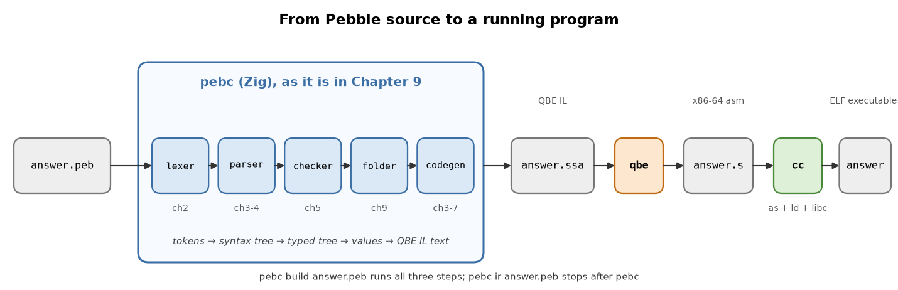

# Chapter 1 — A Compiler in One Afternoon

A compiler is a program that reads a program and writes another one. That sounds grand, but the
smallest useful compiler fits in one Zig file, and by the end of this chapter you will have
written it. First you meet the pipeline the whole course uses: our compiler, `pebc`, writes QBE
intermediate language; `qbe` turns that into x86-64 assembly; `cc` assembles it and links it with
libc. You write QBE IL by hand for "hello" and for factorial, read the assembly QBE makes, and see
what QBE rejects and what it lets through. Then you build version zero of `pebc`: it compiles one
integer expression, such as `6 * (3 + 4)`, into a real executable that prints `42`, with a
`build.zig`, a driver that runs `qbe` and `cc`, and golden tests.

Next: [Chapter 2](02-lexing.md).

## What a compiler is

A compiler translates a program from one language (the *source* language) into another (the
*target* language), keeping its meaning. `gcc` translates C into x86-64 machine code; `tsc`
translates TypeScript into JavaScript. The target does not have to be machine code, only
something closer to the machine, or something another tool already knows how to run.

Every compiler has two halves:

- The **front end** *understands* the source. It reads the text, checks that it is a valid
  program, works out what every name refers to and what type every value has, and rejects
  programs that make no sense with a message that points at the mistake.
- The **back end** *generates* the target. It picks machine instructions, decides which
  values live in which registers, lays out the stack, and follows the platform's calling
  convention so the program can call C libraries.

Between the two the program is moved step by step from a form close to the source to a form
close to the machine. Each step is called a **lowering**: `while` loops become labels and
jumps, variables become stack slots or registers, `a[i]` becomes an address computation and a
load.

Writing a good back end is a project of its own (register allocation alone fills book
chapters). This course writes the front end and a code generator, and hands the back end to
**QBE**, a small compiler back end by Quentin Carbonneaux. QBE reads a text file in its
*intermediate language* (IL), a simple assembly-like language with unlimited temporaries, and
writes x86-64 assembly. QBE's own home page states its goal: "70% of the performance of
industrial optimizing compilers in 10% of the code".



The figure shows the pipeline as it is at the end of the course. Three programs run one after
the other:

1. **`pebc`** (ours, in Zig) reads `answer.peb` and writes `answer.ssa`, QBE IL. Inside it, the
   front end is split into phases that each get a chapter: the lexer (Chapter 2), the parser
   (Chapters 3–4), the type checker (Chapter 5), a constant folder (Chapter 9), and the code
   generator (Chapters 3–7). Today it is a single file, `compiler.zig`; the boxes arrive one
   chapter at a time.
2. **`qbe`** reads `answer.ssa` and writes `answer.s`, x86-64 assembly. It does instruction
   selection, a few optimisations, register allocation, and the System V calling convention.
3. **`cc`** (gcc here) runs the assembler on `answer.s`, then the linker, which adds the C
   start-up code and libc. That is how a Pebble program gets `printf`.

Splitting the work keeps every stage small and lets you read the text between stages.

## Meet Pebble

The language you will compile is **Pebble** (files end in `.peb`). A pebble is a small stone; this
is a small language you can hold in one hand. It is statically typed and looks like C with Zig's
syntax for declarations: `fn`, `let` and `var`, `i64`, `i32`, `u8`, `bool`, pointers, fixed-size
arrays, structs, strings as `*u8`, `if`, `while`, `return`, and calls to C functions declared with
`extern fn`. Here is a piece of the Game of Life that Chapter 7 compiles and runs:

```
struct Grid {
    width: i64,
    height: i64,
    cells: *bool,
}

// Off the edge on one side means back in on the other.
fn get(g: *Grid, x: i64, y: i64) bool {
    let wx = (x + g.width) % g.width;
    let wy = (y + g.height) % g.height;
    return g.cells[wy * g.width + wx];
}
```

The road from here to there:

| Chapter | The compiler learns to… |
|---|---|
| 1 | compile one integer expression, end to end |
| 2 | split the text into tokens and point at errors with line, column and a caret |
| 3 | build a syntax tree with a precedence-climbing (Pratt) parser |
| 4 | parse statements and functions, and recover from syntax errors |
| 5 | resolve names and check types |
| 6 | handle pointers, arrays and addresses |
| 7 | lay out structs, call libc, run Game of Life and Mandelbrot |
| 8 | test itself with golden files, a fuzzer and differential testing against C |
| 9 | fold constants itself, and where to go next |

## Tools

The course assumes you know Zig (learn-zig) and can read x86-64 assembly (learn-linux-nasm).
You need three tools:

- **Zig 0.17.1**, exactly that version (the standard library changes between releases).
  Download the tarball for your platform from ziglang.org and put the `zig` binary on your
  `PATH`.
- **QBE 1.2.** Build it from the release tarball; it needs nothing but a C compiler:
  ```console
  $ curl -O https://c9x.me/compile/release/qbe-1.2.tar.xz
  $ tar xf qbe-1.2.tar.xz && cd qbe-1.2
  $ make
  $ sudo make install            # or: make install PREFIX=$HOME/.local
  ```
  The source is about 13,000 lines of C (13,187 lines of `.c` and `.h` outside the `minic/`,
  `tools/` and `test/` directories) and `make` took 4 seconds on this machine.
- **A C compiler as `cc`** (`sudo apt install build-essential`). This course used gcc 11.4.
  Clang works too: QBE writes plain GNU assembler syntax.

```console
$ zig version
0.17.1
$ qbe -h | head -1
qbe [OPTIONS] {file.ssa, -}
$ cc --version | head -1
cc (Ubuntu 11.4.0-1ubuntu1~22.04.3) 11.4.0
```

## QBE in ten minutes: hello

Before you generate IL, write some. The examples live in `examples/ch01/`; a Makefile builds
each `X.ssa` into `X.s` and `X`.

`examples/ch01/hello.ssa`

```
data $msg = { b "Hello from QBE!", b 0 }

export function w $main() {
@start
	call $puts(l $msg)
	ret 0
}
```

Read it line by line:

- `data $msg = { b "Hello from QBE!", b 0 }` defines global data: the bytes (`b`) of the string,
  then a zero byte, because C strings end in NUL. QBE does not add one for you.
- Names carry a **sigil** that says what they are: `$` for globals (functions and data), `%`
  for temporaries, `@` for block labels, `:` for aggregate types (Chapter 7).
- `export function w $main()` defines a function that returns a `w`. QBE has four base types:
  `w` (word, 32-bit integer), `l` (long, 64-bit integer), `s` and `d` (single and double
  floats). `export` makes the symbol visible to the linker; the C start-up code calls `main`,
  so it must be exported. `main` returns a C `int`, which is a `w`.
- `@start` is a label. A function body is a list of **blocks**: a label, then straight-line
  instructions, then exactly one **jump** (`jmp`, `jnz`, `ret` or `hlt`) that ends the block.
- `call $puts(l $msg)` calls the C function `puts` with one `l` argument, the address of
  `$msg` (an address is 64 bits, so it is an `l`). There is no `extern` declaration: any `$name`
  that this file does not define is left for the linker to find, here in libc. `ret 0`
  makes the exit status 0.

```console
$ cd examples/ch01
$ qbe hello.ssa
.data
.balign 8
msg:
	.ascii "Hello from QBE!"
	.byte 0
/* end data */

.text
.globl main
main:
	pushq %rbp
	movq %rsp, %rbp
	leaq msg(%rip), %rdi
	callq puts
	movl $0, %eax
	leave
	ret
.type main, @function
.size main, .-main
/* end function main */

.section .note.GNU-stack,"",@progbits
$ make hello
qbe -o hello.s hello.ssa
cc -o hello hello.s
$ ./hello; echo $?
Hello from QBE!
0
```

- With no `-o`, `qbe` prints the assembly to stdout. `qbe` only writes assembly; it does not
  assemble or link. That is `cc`'s job.
- QBE writes **AT&T syntax**, the GNU assembler's default, not the Intel syntax of NASM.
  Three differences matter for reading it: registers start with `%` and constants with `$`;
  the **source comes first and the destination last**; and the instruction name carries the
  operand size (`q` 64-bit, `l` 32-bit). So `movq %rsp, %rbp` is NASM's `mov rbp, rsp`, and
  `movl $0, %eax` is `mov eax, 0`.
- `leaq msg(%rip), %rdi` puts the address of `msg` in `rdi`, the first argument register of
  the System V ABI, relative to the instruction pointer (`rip`) so the program can be loaded at
  any address. `movl $0, %eax` sets the return value. `pushq %rbp`/`movq %rsp, %rbp` and
  `leave` are the frame set-up and tear-down you know from NASM.
- The last line marks the stack as non-executable; without it the linker warns.

## Factorial by hand

Now a program with a function, a loop, a branch and a variadic call:

`examples/ch01/fact.ssa`

```
data $fmt = { b "%ld! = %ld\n", b 0 }

function l $fact(l %n) {
@start
	%small =w cslel %n, 1
	jnz %small, @base, @rec
@base
	ret 1
@rec
	%m =l sub %n, 1
	%f =l call $fact(l %m)
	%r =l mul %n, %f
	ret %r
}

export function w $main() {
@start
	%i =l copy 0
@loop
	%f =l call $fact(l %i)
	call $printf(l $fmt, ..., l %i, l %f)
	%i =l add %i, 1
	%more =w csltl %i, 11
	jnz %more, @loop, @done
@done
	ret 0
}
```

- An instruction has the shape `%result =TYPE op arg, arg`. The type after `=` is the type of
  the result.
- `cslel` is "compare, signed, less or equal, on `l` operands". Comparisons are ordinary
  instructions that produce 0 or 1; the `=w` on the left makes the 0/1 a word. `csltl` is signed
  less-than. There are unsigned ones too (`cultl`, `culel`, …) and equality (`ceql`, `cnel`).
- `jnz %small, @base, @rec` jumps to `@base` if `%small` is non-zero, else to `@rec`.
- `$fact` has no `export`, so it is local to this file.
- `call $printf(l $fmt, ..., l %i, l %f)`: the `...` marks where the variadic arguments start.
  QBE needs to know, because the ABI treats variadic calls specially (more on this when we
  read pebc's output).
- `%i` is assigned twice: by `copy 0`, and by `add %i, 1` on every trip round the loop. Real
  SSA form (static single assignment) forbids that. QBE accepts it anyway and builds SSA
  form itself, as the next section shows. That is a big reason why QBE suits a small compiler.
- `@start` has no jump at its end. When a block simply continues with the next block in the
  file, QBE inserts the `jmp` for you. The loop needs its own `@loop` block because the first
  block of a function may never be the target of a jump.

```console
$ make fact
qbe -o fact.s fact.ssa
cc -o fact fact.s
$ ./fact | head -3
0! = 1
1! = 1
2! = 2
$ ./fact | tail -2
9! = 362880
10! = 3628800
```

The assembly is worth reading slowly, because it shows what a back end does for you:

```console
$ qbe fact.ssa | sed -n '/^fact:/,/ret$/p'
fact:
	pushq %rbp
	movq %rsp, %rbp
	subq $8, %rsp
	pushq %rbx
	cmpq $1, %rdi
	jle .Lbb2
	movq %rdi, %rbx
	subq $1, %rdi
	callq fact
	movq %rbx, %rdi
	imulq %rdi, %rax
	jmp .Lbb3
.Lbb2:
	movl $1, %eax
.Lbb3:
	popq %rbx
	leave
	ret
```

- **Instruction selection.** `cslel` followed by `jnz` became one `cmpq $1, %rdi` and one
  `jle`: the 0/1 value never exists. `%m =l sub %n, 1` became `subq $1, %rdi`, computed in
  place in the argument register for the next call.
- **Register allocation.** `%n` arrives in `%rdi`. It is still needed after `callq fact`, but
  `%rdi` is a caller-saved register: the callee may overwrite it. So QBE copies it to `%rbx`
  (`movq %rdi, %rbx`), a **callee-saved** register, which `fact` itself saves on entry
  (`pushq %rbx`) and restores before returning (`popq %rbx`). In NASM syntax the copy is
  `mov rbx, rdi`. In `main` (not shown) the loop counter `%i` lives in `%rbx` for the same
  reason: it must survive the calls to `fact` and `printf`.
- **Stack alignment.** At a `call` the stack pointer must be a multiple of 16. On entry it is
  8 off (the return address); `pushq %rbp` fixes that, `subq $8` breaks it again, and `pushq
  %rbx` fixes it. QBE does this bookkeeping for every function.
- `ret 1` became `movl $1, %eax`: a 32-bit move zero-extends into all of `%rax`, and it is a
  shorter instruction than `movq`.

### QBE builds the SSA form for you

`qbe -d` dumps QBE's internal state between passes to stderr. `-d N` shows the function after
SSA construction:

```console
$ qbe -d N fact.ssa 2>&1 >/dev/null | sed -n '/function \$main/,/^}/p' | grep -v arg
function $main() {
@start
	%i.1 =l copy 0
@loop
	%i.2 =l phi @start %i.1, @loop %i.3
	%f =l call $fact
	call $printf
	%i.3 =l add %i.2, 1
	%more =w csltl %i.3, 11
	jnz %more, @loop, @done
@done
	retw 0
}
```

(`grep -v` hides QBE's internal `argl`/`argv` lines for call arguments.) The two assignments to
`%i` became `%i.1` and `%i.3`, each assigned once, and a third, `%i.2`, joins them: at the top
of `@loop` it is a **phi**, "`%i.1` if we came from `@start`, `%i.3` if we came from `@loop`".
Optimisations are much simpler on this form, and QBE's IL documentation says outright that
"phi instructions are NOT necessary when writing a frontend to QBE". Our code generator will
never write one.

## Mistakes QBE catches, and ones it doesn't

`qbe` checks the IL it reads, but it checks the *form*, not the meaning. Three small files show
the difference.

`examples/ch01/t1.ssa`

```
data $fmt = { b "%ld\n", b 0 }

export function w $main() {
@start
	call $printf(l $fmt, ..., l 1)
	ret 0
	call $printf(l $fmt, ..., l 2)
}
```

```console
$ qbe t1.ssa; echo $?
.data
.balign 8
fmt:
	.ascii "%ld\n"
	.byte 0
/* end data */

qbe:t1.ssa:7: label or } expected
1
```

`ret` ends the block, so the next line must be a new label or the end of the function.
Instructions after a terminator are unreachable, and QBE refuses them rather than guess. Note
that QBE had already printed the data section when it hit the error: it works as a stream,
one definition at a time. When a code generator emits a statement after `return`, it must
start a new block first (Chapter 4 meets this).

`examples/ch01/t2.ssa`

```
data $fmt = { b "%ld\n", b 0 }

export function w $main() {
@start
	%q =l div 1, 0
	call $printf(l $fmt, ..., l %q)
	ret 0
}
```

```console
$ make -s t2 && ./t2; echo $?
Floating point exception (core dumped)
136
$ qbe t2.ssa | grep -B4 -A1 idiv
	movq %rsp, %rbp
	movl $0, %ecx
	movl $1, %eax
	cqto
	idivq %rcx
	movq %rax, %rsi
```

Division by a constant zero is perfectly valid IL. QBE does not fold it (it can't produce a
value at compile time, so it leaves the division for run time), and `idivq` raises a
divide error, which Linux delivers as `SIGFPE`. Exit status 136 is 128 + 8, and 8 is `SIGFPE`.
Catching `1 / 0` is the front end's job; this chapter's exercise 3 starts on it and Chapter 9
finishes it.

`examples/ch01/t3.ssa`

```
export function w $main() {
@start
	%i =l copy 0
@loop
	%p =l alloc8 8
	storel %i, %p
	%i =l add %i, 1
	%more =w csltl %i, 10
	jnz %more, @loop, @done
@done
	ret 0
}
```

```console
$ qbe t3.ssa | sed -n '/^\.Lbb2/,/jl/p'
.Lbb2:
	subq $16, %rsp
	movq %rsp, %rcx
	movq %rax, (%rcx)
	addq $1, %rax
	cmpq $10, %rax
	jl .Lbb2
```

`alloc8 8` reserves 8 bytes of stack aligned to 8 and returns their address. In the start block
QBE turns allocations into a fixed stack frame. Anywhere else it must grow the stack at run
time, so this loop runs `subq $16, %rsp` ten times and the stack grows on every iteration. It
works here, but a loop that runs a million times would overflow the stack. The rule for a
front end is to put every `alloc` in the start block, whatever block the variable is declared
in. Chapter 4's code generator does exactly that for every local variable's slot.

The rule of thumb: QBE checks syntax and types of its own IL; everything about what the program
*means* (division by zero, stack discipline, whether a value fits) is the front end's problem.

## The project: pebc

The course project lives in `project/`. Each chapter ends with a complete snapshot:
`project/ch01/` is the compiler at the end of this chapter.

```
project/ch01/
├── build.zig          the build: pebc, `run`, `test`, `demo`
├── build.zig.zon      package metadata
├── samples/answer.peb the program `zig build demo` compiles
├── src/
│   ├── main.zig       command line
│   ├── compiler.zig   the one-pass compiler
│   └── driver.zig     runs qbe and cc
└── tests/
    ├── golden.zig     the golden test runner
    └── run/           test programs and their expected output
```

The language of this version is tiny: one integer expression with `+ - * / %`, unary minus
and parentheses. `pebc` compiles it into a `main` that prints the value with `printf`.

```console
$ cd project/ch01
$ zig build demo
42
$ cat samples/answer.peb
6 * (3 + 4)
```

### build.zig

The first half of `project/ch01/build.zig` is the usual `addExecutable` for `src/main.zig`,
`installArtifact`, and a `run` step that passes arguments through. The second half is where a
compiler project differs:

`project/ch01/build.zig` (the `test` step)

```zig
    // `zig build test` runs two kinds of tests.
    const test_step = b.step("test", "Run unit tests and golden tests");

    // 1. Unit tests: the `test` blocks in src/.
    const unit_tests = b.addTest(.{ .root_module = pebc.root_module });
    test_step.dependOn(&b.addRunArtifact(unit_tests).step);

    // 2. Golden tests: tests/golden.zig compiles every program in tests/
    //    with pebc, runs it, and compares its output with the expected one.
    const golden = b.addExecutable(.{
        .name = "golden",
        .root_module = b.createModule(.{
            .root_source_file = b.path("tests/golden.zig"),
            .target = target,
            .optimize = optimize,
        }),
    });
    const run_golden = b.addRunArtifact(golden);
    run_golden.addArtifactArg(pebc);
    run_golden.addDirectoryArg(b.path("tests"));
    // A scratch directory inside .zig-cache for the compiled test programs.
    _ = run_golden.addOutputDirectoryArg("golden");
    // The results depend on qbe and cc, which the build system can't see,
    // so never skip this step because "nothing changed".
    run_golden.has_side_effects = true;
    test_step.dependOn(&run_golden.step);
```

Three things here are specific to a compiler:

- The golden runner is a second executable. `addArtifactArg(pebc)` passes the path of the
  freshly built `pebc`, so `zig build test` always tests the current compiler.
- `has_side_effects = true`. Zig's build system caches a run step when its inputs (the
  binaries and files it was given) have not changed. But the test results also depend on
  `qbe` and `cc`, which Zig cannot see. A test step that silently reports a cached success
  after you installed a different QBE would be lying, so the golden step always runs.
- The `demo` step, at the end of the file (not shown), uses pebc *as a build tool*: it runs
  `pebc build SAMPLE -o` with a path from `addOutputFileArg` in Zig's cache, then a second run
  step runs that executable. `-Dsample=FILE` picks another program than `samples/answer.peb`.
  This is the same mechanism `build.zig` files use for code generators.

`build.zig.zon` names the package `.pebc`, sets `.minimum_zig_version = "0.17.1"`, and has no
dependencies: pebc needs only the Zig standard library.

### main.zig: the command line

`project/ch01/src/main.zig` (excerpt; the imports and the usage text are above it)

```zig
pub fn main(init: std.process.Init) !u8 {
    // A compiler runs once and exits, so one arena holds everything.
    const arena = init.arena.allocator();
    const args = try init.minimal.args.toSlice(arena);
    // ... (buffered `Io.File.Writer`s for stdout and stderr, as in learn-zig)
    const status = try run(arena, init.io, args[1..], stdout, stderr);
    try stdout.flush();
    try stderr.flush();
    return status;
}
```

The comment is the point. A compiler is a batch program: it starts, reads one file,
allocates a lot of small objects (tokens, tree nodes, strings), writes its output and exits.
Nothing needs to be freed early, so one arena for the whole run is the simplest and fastest
choice. `std.process.Init` provides one, freed in one piece when `main` returns.

`run` parses the arguments, reads the file, compiles, and either prints the IL or calls the
driver. It returns the exit status: 0 for success, 1 if the program has errors (or `qbe`/`cc`
failed), 2 for bad usage. Scripts and the test runner rely on these numbers.

```zig
    var il: Io.Writer.Allocating = .init(arena);
    var compiler: Compiler = .init(src, &il.writer);
    compiler.compile() catch |err| switch (err) {
        error.SyntaxError => {
            try stderr.print("{s}: error at byte {d}: {s}\n", .{ path, compiler.err_pos, compiler.err_msg });
            return 1;
        },
        // Writing to an Allocating writer only fails when memory runs out.
        error.WriteFailed => return error.OutOfMemory,
    };

```

- The compiler writes into an `Io.Writer.Allocating`, a growing buffer, not straight to
  stdout. If compilation fails halfway, nothing has been printed. Afterwards `ir` writes
  `il.written()` to stdout and `build` hands it to `driver.build`, mapping its `ToolFailed`
  error to exit status 1.
- Before this excerpt, `run` checks the arguments: `std.meta.stringToEnum(Command, args[0])`
  turns `"ir"` into `.ir` (an unknown command gives `null` and exit status 2), and a loop
  picks up `-o OUTPUT`.
- Reading the file uses `readFileAlloc(io, path, arena, .limited(16 << 20))`, which refuses
  files over 16 MiB: no Pebble program is that big, and a typo that points pebc at a disk
  image should fail quickly.

```console
$ zig build
$ zig-out/bin/pebc
usage: pebc COMMAND FILE [-o OUTPUT]

commands:
  ir      print the QBE IL for FILE
  build   compile FILE to an executable (default name: FILE without .peb)
$ echo $?
2
$ zig-out/bin/pebc ir missing.peb
pebc: cannot read 'missing.peb': FileNotFound
$ echo $?
1
```

## The smallest compiler

`compiler.zig` reads characters and writes IL in a single pass: it never builds a data structure
for the program. The comment at its top is the grammar of today's language:

```
expr    = term { ("+" | "-") term }
term    = unary { ("*" | "/" | "%") unary }
unary   = "-" unary | primary
primary = NUMBER | "(" expr ")"
```

Read `{ … }` as "zero or more times" and `|` as "or". The grammar encodes precedence by
layering: an `expr` is a sum of `term`s, and a `term` is a product of `unary`s. Since a product
sits *inside* a sum, `1 + 2 * 3` can only mean `1 + (2 * 3)`. Parentheses reach back to the top
with `"(" expr ")"`.

The technique is **recursive descent**: one function per grammar rule, and each function
consumes the text its rule matches. The twist that makes it a compiler rather than a calculator:
each function *emits IL* for its part and returns the name of the value it computed.

### Values: constants and temporaries

`project/ch01/src/compiler.zig` (start)

```zig
const std = @import("std");
const Writer = std.Io.Writer;

pub const Error = error{ SyntaxError, WriteFailed };

/// An operand of a QBE instruction: a constant or a temporary.
const Value = union(enum) {
    int: i64,
    temp: u32,

    pub fn format(v: Value, w: *Writer) Writer.Error!void {
        switch (v) {
            .int => |n| try w.print("{d}", .{n}),
            .temp => |t| try w.print("%t{d}", .{t}),
        }
    }
};

pub const Compiler = struct {
    src: []const u8,
    pos: usize = 0,
    out: *Writer,
    /// The number of temporaries created so far.
    temps: u32 = 0,
    /// Where the first syntax error happened, and why.
    err_pos: usize = 0,
    err_msg: []const u8 = "",

    pub fn init(src: []const u8, out: *Writer) Compiler {
        return .{ .src = src, .out = out };
    }
```

A `Value` is what a parsing function returns: either a number known now (`.int`), or the
temporary `%tN` that will hold the value at run time (`.temp`). Its `format` method lets you
print it with `{f}`, so `print("{f}", .{v})` writes `42` or `%t3`. Returning a literal as `.int`
instead of copying it into a temporary first means `3 + 4` becomes `add 3, 4`, not three
instructions.

### One function per rule

```zig
    /// Compiles the whole program.
    pub fn compile(c: *Compiler) Error!void {
        try c.out.writeAll(
            \\data $fmt = { b "%ld\n", b 0 }
            \\
            \\export function w $main() {
            \\@start
            \\
        );
        const result = try c.expr();
        c.skipSpace();
        if (c.pos < c.src.len) return c.fail("expected an operator");
        try c.out.print("\tcall $printf(l $fmt, ..., l {f})\n", .{result});
        try c.out.writeAll("\tret 0\n}\n");
    }

    fn expr(c: *Compiler) Error!Value {
        var lhs = try c.term();
        while (true) {
            const op: []const u8 = switch (c.peek()) {
                '+' => "add",
                '-' => "sub",
                else => return lhs,
            };
            c.pos += 1;
            const rhs = try c.term();
            lhs = try c.emit(op, lhs, rhs);
        }
    }

    // term: the same loop as expr, calling unary, with '*' => "mul",
    // '/' => "div" and '%' => "rem".

    fn unary(c: *Compiler) Error!Value {
        if (c.peek() == '-') {
            c.pos += 1;
            const operand = try c.unary();
            return c.emit("sub", .{ .int = 0 }, operand);
        }
        return c.primary();
    }
```

- `compile` writes the fixed parts of the program (the format string, `main`'s header), lets
  `expr` emit the computation, then checks that *all* the input was used: `2 3` parses `2` and
  stops, and the leftover `3` is an error.
- `expr` follows its rule `term { ("+" | "-") term }` literally: one `term`, then a loop that
  continues while the next character is `+` or `-`. The `{ … }` in the grammar is the `while`
  in the code. `term` is the same shape one level down (shown as a comment here).
- The loop makes the operators **left-associative**: `lhs = emit(op, lhs, rhs)` folds each
  new operand into the result so far, so `10 - 3 - 2` is `(10 - 3) - 2`.
- `unary` is right-recursive (`"-" unary`), so `--5` works. Negation is `0 - x`; QBE has a
  `neg` instruction too, but `sub` is all we need.

The helpers do the character work and the output:

```zig
    fn primary(c: *Compiler) Error!Value {
        switch (c.peek()) {
            '0'...'9' => {
                const start = c.pos;
                while (c.pos < c.src.len and std.ascii.isDigit(c.src[c.pos])) c.pos += 1;
                const n = std.fmt.parseInt(i64, c.src[start..c.pos], 10) catch {
                    c.pos = start;
                    return c.fail("number too large");
                };
                return .{ .int = n };
            },
            '(' => {
                c.pos += 1;
                const inner = try c.expr();
                if (c.peek() != ')') return c.fail("expected ')'");
                c.pos += 1;
                return inner;
            },
            else => return c.fail("expected a number or '('"),
        }
    }

    /// Writes `%tN =l op lhs, rhs` and returns the new temporary.
    fn emit(c: *Compiler, op: []const u8, lhs: Value, rhs: Value) Error!Value {
        c.temps += 1;
        const result: Value = .{ .temp = c.temps };
        try c.out.print("\t{f} =l {s} {f}, {f}\n", .{ result, op, lhs, rhs });
        return result;
    }

    /// Skips whitespace, then returns the next character (0 at the end).
    fn peek(c: *Compiler) u8 {
        c.skipSpace();
        return if (c.pos < c.src.len) c.src[c.pos] else 0;
    }

    fn skipSpace(c: *Compiler) void {
        while (c.pos < c.src.len and std.ascii.isWhitespace(c.src[c.pos])) c.pos += 1;
    }

    fn fail(c: *Compiler, msg: []const u8) error{SyntaxError} {
        c.err_pos = c.pos;
        c.err_msg = msg;
        return error.SyntaxError;
    }
};
```

- `emit` is the whole code generator: a fresh temporary per operation, always type `l`
  (Pebble's integers are 64-bit for now), and the operands printed with `{f}`.
- `peek` skips whitespace before looking, so the grammar functions never think about spaces.
  It returns 0 at the end of the input, a character no rule accepts.
- `fail` records where and why, and returns `error.SyntaxError`. The `try` in every caller
  passes it up and stops the compiler: the first error is the only error. That is
  primitive, and the next chapter replaces it.

The file ends with a test helper, `compileToString`, and three unit tests that check the IL
for precedence, for parentheses with unary minus, and the position of a syntax error.

### Compiling `6 * (3 + 4)`

```console
$ zig-out/bin/pebc ir samples/answer.peb
data $fmt = { b "%ld\n", b 0 }

export function w $main() {
@start
	%t1 =l add 3, 4
	%t2 =l mul 6, %t1
	call $printf(l $fmt, ..., l %t2)
	ret 0
}
```

Follow the calls: `expr` → `term` → `unary` → `primary` reads `6` and returns `.int = 6`. Back in
`term`, the next character is `*`, so it calls `unary` → `primary`, which sees `(` and calls
`expr` from the top. That inner `expr` returns `%t1` after emitting `add 3, 4`. `primary` checks
the `)` and returns `%t1`, and `term` emits `mul 6, %t1`. Notice the order: the inner sum is
emitted *first*, because it must be computed before the product that uses it. The recursion
gives us that order for free.

```console
$ zig-out/bin/pebc build samples/answer.peb -o answer && ./answer
42
$ grep -A8 "^main:" answer.s
main:
	pushq %rbp
	movq %rsp, %rbp
	movl $42, %esi
	leaq fmt(%rip), %rdi
	movl $0, %eax
	callq printf
	movl $0, %eax
	leave
```

We emitted an `add` and a `mul`; the assembly has neither. QBE's constant propagation saw that
both operands were constants and computed `42` at compile time, so `main` just passes `42` to
`printf` in `%esi` (the second argument register). That is a back end doing its job. The
`movl $0, %eax` right before `callq printf` is not a return value: the System V ABI says that
the caller of a variadic function puts in `%al` the number of vector registers used for
arguments. There are no floating-point arguments, so 0. That is what the `...` in the IL told
QBE. Chapter 9 adds constant folding to pebc itself and explains why a front end wants it even
when the back end already does it.

The golden tests cover the other operators. Here is one with negative numbers:

```console
$ cat tests/run/division.peb
-7 / 2 + -7 % 2
$ zig-out/bin/pebc ir tests/run/division.peb | grep =l
	%t1 =l sub 0, 7
	%t2 =l div %t1, 2
	%t3 =l sub 0, 7
	%t4 =l rem %t3, 2
	%t5 =l add %t2, %t4
$ zig-out/bin/pebc build tests/run/division.peb -o division && ./division
-4
```

`-7` is not a literal: it is unary minus applied to `7`. QBE's `div` and `rem` round toward
zero, like C and x86's `idiv`: `-7 / 2` is `-3` and `-7 % 2` is `-1`, so the answer is `-4`.
(Python would say `-4 + 1 = -3`; Chapter 9 comes back to this.) QBE folded this one to
`movq $-4, %rsi`.

### Errors

Four files, each holding one line, and what `pebc ir` says about them:

| File | Contents | `pebc ir FILE` prints |
|---|---|---|
| `e1.peb` | `1 + * 2` | `e1.peb: error at byte 4: expected a number or '('` |
| `e2.peb` | `(1 + 2` | `e2.peb: error at byte 7: expected ')'` |
| `e3.peb` | `2 3` | `e3.peb: error at byte 2: expected an operator` |
| `e4.peb` | `99999999999999999999` | `e4.peb: error at byte 0: number too large` |

Every message is correct, and every one is unpleasant. "Byte 4" makes you count characters. In
`e2.peb` byte 7 is past the newline at the end of the file. "Expected a number or `'('`" does not
say what it found. And the compiler stops at the first error. Chapter 2 fixes all of that.

### A common mistake: recursion on the wrong side

It is tempting to write `expr` as the rule `term [("+" | "-") expr]`, recursing instead of
looping. It looks equivalent. Here is that version, tried in a scratch copy of the project:

```zig
    fn expr(c: *Compiler) Error!Value {
        const lhs = try c.term();
        const op: []const u8 = switch (c.peek()) {
            '+' => "add",
            '-' => "sub",
            else => return lhs,
        };
        c.pos += 1;
        const rhs = try c.expr(); // recursion on the right
        return c.emit(op, lhs, rhs);
    }
```

```console
$ cat sub.peb
10 - 3 - 2
$ zig-out/bin/pebc ir sub.peb | grep sub
	%t1 =l sub 3, 2
	%t2 =l sub 10, %t1
$ zig-out/bin/pebc build sub.peb -o sub && ./sub
9
$ zig build test 2>&1 | tail -1
golden: 4 passed, 0 failed
```

Recursing on the right groups to the right: `10 - (3 - 2)` = 9 instead of 5. For `+` and `*` you
would never notice, because they are associative. And **every test still passes**:
`precedence.peb` is `1 + 2 * 3 - 4 / 2`, which gives 5 grouped either way. Two lessons: loops
give left associativity, which is what arithmetic wants; and a test suite only catches the
bugs someone thought of. Chapter 8 generates tests by the thousand for exactly this reason.

## Running qbe and cc: driver.zig

`project/ch01/src/driver.zig`

```zig
//! The back half of the pipeline: QBE IL → assembly (qbe) → executable (cc).
const std = @import("std");
const Io = std.Io;

pub const Error = error{ToolFailed} || std.mem.Allocator.Error || Io.Writer.Error;

/// Writes `il` to EXE.ssa, runs `qbe -o EXE.s EXE.ssa`, then `cc -o EXE EXE.s`.
/// The .ssa and .s files stay next to the executable so you can read them.
pub fn build(gpa: std.mem.Allocator, io: Io, il: []const u8, exe_path: []const u8, stderr: *Io.Writer) Error!void {
    const ssa_path = try std.fmt.allocPrint(gpa, "{s}.ssa", .{exe_path});
    defer gpa.free(ssa_path);
    const asm_path = try std.fmt.allocPrint(gpa, "{s}.s", .{exe_path});
    defer gpa.free(asm_path);

    Io.Dir.cwd().writeFile(io, .{ .sub_path = ssa_path, .data = il }) catch |err| {
        try stderr.print("pebc: cannot write '{s}': {t}\n", .{ ssa_path, err });
        return error.ToolFailed;
    };
    try runTool(gpa, io, &.{ "qbe", "-o", asm_path, ssa_path }, stderr);
    try runTool(gpa, io, &.{ "cc", "-o", exe_path, asm_path }, stderr);
}

/// Runs a program, passes on whatever it printed to stderr, and fails if
/// the program could not start or exited with a nonzero status.
fn runTool(gpa: std.mem.Allocator, io: Io, argv: []const []const u8, stderr: *Io.Writer) Error!void {
    const result = std.process.run(gpa, io, .{ .argv = argv }) catch |err| {
        try stderr.print("pebc: cannot run '{s}': {t}\n", .{ argv[0], err });
        return error.ToolFailed;
    };
    defer gpa.free(result.stdout);
    defer gpa.free(result.stderr);
    try stderr.writeAll(result.stderr);
    if (!result.term.success()) {
        try stderr.print("pebc: '{s}' failed\n", .{argv[0]});
        return error.ToolFailed;
    }
}
```

- `std.process.run` spawns a child, waits for it and collects its stdout and stderr. `argv[0]`
  is looked up on `PATH`, like a shell would.
- The `.ssa` and `.s` files are kept on purpose. Reading them is how you will debug the code
  generator in every chapter. (They are also why you should not run `pebc build` inside the
  course repository: clean up `X`, `X.ssa` and `X.s` afterwards.)
- It frees what it allocates even though `main` passes the arena: a reusable piece should not
  rely on its caller's memory policy.
- If `qbe` is not on the `PATH`, `pebc build` writes the `.ssa` file, then prints
  `pebc: cannot run 'qbe': FileNotFound` and exits with status 1.

## Golden tests

How do you test a compiler? Checking the IL it emits is fragile: change the numbering of
temporaries and every test breaks, although every program still works. What you really care
about is that **the compiled program does the right thing**. So the backbone of compiler
testing is the end-to-end **golden test**: compile a program, run it, and compare what it
prints with a file of expected output, the *golden* file, checked into the repository. Today
there are four: `tests/run/answer.peb` (`6 * (3 + 4)`, expecting `42`), `division.peb`
(`-4`), `parens.peb` (`(1 + 2) * 3 - -4`, `13`) and `precedence.peb` (`1 + 2 * 3 - 4 / 2`, `5`),
each next to its `.out` file.

`tests/golden.zig` is a small program: `golden PEBC TESTS_DIR OUT_DIR`. The heart of it:

`project/ch01/tests/golden.zig` (excerpt)

```zig
    /// Compiles and runs one program; returns whether its output matched.
    fn runOne(r: *Runner, suite: []const u8, name: []const u8) !bool {
        const stem = name[0 .. name.len - ".peb".len];
        const src_path = try std.fs.path.join(r.arena, &.{ r.tests_path, suite, name });
        const exe_path = try std.fs.path.join(r.arena, &.{ r.out_path, stem });

        const compile = try r.exec(&.{ r.pebc, "build", src_path, "-o", exe_path });
        if (!compile.term.success()) {
            try r.out.print("  pebc failed:\n{s}", .{compile.stderr});
            return false;
        }
        const program = try r.exec(&.{exe_path});
        if (!program.term.success()) {
            try r.out.print("  the program failed: {any}\n", .{program.term});
            return false;
        }
        const expected_path = try std.fmt.allocPrint(r.arena, "{s}/{s}/{s}.out", .{ r.tests_path, suite, stem });
        const expected = try Io.Dir.cwd().readFileAlloc(r.io, expected_path, r.arena, .limited(1 << 20));
        if (!std.mem.eql(u8, expected, program.stdout)) {
            try r.out.print("  expected stdout:\n{s}  actual stdout:\n{s}", .{ expected, program.stdout });
            return false;
        }
        return true;
    }
```

`runAll` lists `tests/run/*.peb`, sorts the names (directory order is not stable, and test
output should be), calls `runOne` for each and prints `PASS` or `FAIL`. The executables go to
`OUT_DIR`, the directory `build.zig` created inside `.zig-cache`, so tests leave nothing behind
in your tree.

```console
$ zig build test --summary all
PASS run/answer.peb
PASS run/division.peb
PASS run/parens.peb
PASS run/precedence.peb
golden: 4 passed, 0 failed
Build Summary: 6/6 steps succeeded; 4/4 tests passed
...
```

The four unit tests are the three `test` blocks in `compiler.zig` plus the one in `main.zig`
that imports it. (`...` marks the cut step tree, which shows each step and its timing.) Without
`qbe` on the `PATH`, the unit tests still pass and the golden step fails: every test prints
`pebc: cannot run 'qbe': FileNotFound` and `FAIL`, the runner reports `golden: 0 passed, 4
failed`, and Zig ends with `Build Summary: 4/6 steps succeeded (1 failed)`. If you see this, put
QBE on your `PATH`.

Adding a test is two files: `tests/run/NAME.peb` and `tests/run/NAME.out`. Chapter 2 adds a
second suite for error messages, and Chapter 8 makes the runner print diffs and update golden
files for you.

## In the wild: QBE

QBE is Quentin Carbonneaux's project, and its home page (c9x.me/compile) is the best short
description of it: an SSA-based IL used at every stage, full support for the C ABI (which is why
our programs can call `printf` with no glue), and a short list of optimisations chosen for their
"impact/weight ratio": copy elimination, sparse conditional constant propagation (the pass that
turned `6 * (3 + 4)` into `$42`), dead instruction elimination, registerization of small stack
slots, and a linear register allocator with hinting. It targets amd64 (Linux and macOS), arm64
and riscv64. The size is a design rule, not an accident: in the page's words, the size limit
"prevents embarking on a never-ending path of diminishing returns".

Real compilers use it. QBE's users page lists **cproc**, Michael Forney's C11 compiler, which can
compile itself and is "known to bootstrap GCC", and **Hare**, Drew DeVault's systems language,
which "has been using QBE as backend from the beginning". The Hare 0.26.0 release (February
2026) is documented as compatible with QBE 1.2, the version this course uses.

QBE 1.3 came out on 2 June 2026. Its release notes are frank about performance: measured on
the CoreMark benchmark, QBE 1.2 reached only about 40% of `gcc -O2`, not the 70% goal; after new
passes 1.3 scores "more than 63%", and Hare's test suite, compiled with 1.3, ran 33% faster
(1.7 s against 2.6 s). The release added about 7,000 lines and deleted 1,500, so QBE is still
small. LWN covered the release in July 2026, noting that QBE is MIT-licensed and has had 38
contributors. This course stays on 1.2: every transcript and every assembly listing here is
1.2's, and 1.3 may choose different instructions.

## History: "Let's Build a Compiler"

This chapter's style, one small function per grammar rule emitting assembly as it parses, has
a famous teacher: Jack Crenshaw's *Let's Build a Compiler*, written from 1988 to 1995. Crenshaw,
whose Ph.D. is in physics, found compiler texts "tough sledding for the rest of us" and called
his a "learn-by-doing" series. He used Turbo Pascal 4.0, emitted 68000 assembly, stopped on the
first error, and began with single-character tokens, just like our `peek()`. His part 2 is
expression parsing and part 7 lexical scanning, the order this course follows. What changed
since 1988 is that a back end like QBE can take register allocation off our hands.

## Summary

- A compiler translates a program into another language. The front end understands (and
  rejects) programs; the back end generates machine code; lowering steps between them.
- Our pipeline: `pebc` writes QBE IL, `qbe` writes x86-64 assembly (AT&T syntax: source first),
  `cc` assembles and links with libc. `qbe -d` dumps the IL between QBE's passes.
- QBE IL: `$global`, `%temp`, `@label`; types `w` and `l`; blocks end in exactly one jump;
  temporaries may be assigned many times because QBE builds SSA form itself; `...` marks
  variadic arguments; there is no `extern`, an undefined `$name` is for the linker.
- QBE checks the form of the IL, not its meaning: code after `ret` is an error, but `div 1, 0`
  compiles and dies with SIGFPE (status 136), and an `alloc` in a loop grows the stack.
- pebc version zero: recursive descent with one function per grammar rule, each returning the
  `Value` (constant or `%tN`) that holds its result; loops make operators left-associative.
- One arena for the whole run; exit status 0/1/2; the driver keeps `.ssa` and `.s` for reading.
- Golden tests compile, run, and compare stdout with a checked-in `.out` file. They catch only
  the bugs their programs exercise.

## Exercises

1. **Sum by hand.** Write `sum.ssa`, a QBE program that prints the sum of 1 to 100 with
   `printf`. Use a loop and a reassigned temporary, like `fact.ssa`.

   <details><summary>Solution</summary>

   ```
   data $fmt = { b "%ld\n", b 0 }

   export function w $main() {
   @start
   	%i =l copy 1
   	%sum =l copy 0
   @loop
   	%sum =l add %sum, %i
   	%i =l add %i, 1
   	%more =w cslel %i, 100
   	jnz %more, @loop, @done
   @done
   	call $printf(l $fmt, ..., l %sum)
   	ret 0
   }
   ```

   ```console
   $ qbe -o sum.s sum.ssa && cc -o sum sum.s && ./sum
   5050
   $ sed -n '/movl $1/,/jle/p' sum.s
   	movl $1, %eax
   	movl $0, %ecx
   .Lbb2:
   	addq %rax, %rcx
   	addq $1, %rax
   	cmpq $100, %rax
   	jle .Lbb2
   ```

   `%i` and `%sum` live in `%rax` and `%rcx` during the loop. No callee-saved registers are
   needed this time, because there is no call inside the loop. QBE does not compute 5050 at
   compile time: its constant propagation does not run loops.

   </details>

2. **Unary plus.** Make `+5 - -2` compile (it should print `7`).

   <details><summary>Solution</summary>

   Add a helper that consumes a character if it is next, and use it at the top of `unary`:

   ```zig
       fn unary(c: *Compiler) Error!Value {
           if (c.eat('+')) return c.unary();
           // ... the '-' case as before
       }

       /// Consumes `char` if it is next.
       fn eat(c: *Compiler, char: u8) bool {
           if (c.peek() != char) return false;
           c.pos += 1;
           return true;
       }
   ```

   ```console
   $ echo '+5 - -2' > x.peb && zig-out/bin/pebc build x.peb -o x && ./x
   7
   ```

   Unary plus emits nothing: it returns the operand's value unchanged. The golden tests still
   pass.

   </details>

3. **Division by a literal zero.** Make pebc reject `1 % 0` and `6 / 0` at compile time with
   "division by zero", pointing at the zero. Does your check catch `7 / (3 - 3)`?

   <details><summary>Solution</summary>

   In `term`, skip the spaces before the right operand and remember where it starts; after
   parsing it, check for the constant 0:

   ```zig
               c.pos += 1;
               c.skipSpace();
               const at = c.pos;
               const rhs = try c.unary();
               if (!std.mem.eql(u8, op, "mul") and rhs == .int and rhs.int == 0) {
                   c.pos = at;
                   return c.fail("division by zero");
               }
               lhs = try c.emit(op, lhs, rhs);
   ```

   ```console
   $ for e in '1 % 0' '6 / (0)' '8 * 0' '7 / (3 - 3)'; do
   >   echo "$e" > x.peb; zig-out/bin/pebc build x.peb -o x && ./x
   > done
   x.peb: error at byte 4: division by zero
   x.peb: error at byte 4: division by zero
   0
   Floating point exception (core dumped)
   ```

   `(0)` is caught because `primary` returns the inner value, still `.int = 0`. But `(3 - 3)` is
   a temporary: pebc does not know its value, only QBE does. To catch it the front end must
   evaluate expressions at compile time, which is constant folding, the subject of Chapter 9.

   </details>

4. **Where does `n` live?** In `fact`'s assembly, `%n` arrives in `%rdi` and is needed again
   after `callq fact`. Explain how its value survives the recursive call, and why QBE chose
   that register.

   <details><summary>Solution</summary>

   `movq %rdi, %rbx` copies `n` into `%rbx` before the call, and `movq %rbx, %rdi` gets it back
   afterwards for the `imulq`. `%rdi` is caller-saved in the System V ABI: the callee may
   overwrite it, so it cannot hold a value across a call. `%rbx` is callee-saved: any function
   that uses it must restore it before returning. `fact` keeps that promise itself with
   `pushq %rbx` on entry and `popq %rbx` before `leave`, so the inner `fact` call preserves the
   outer `n` (each level saves its caller's `%rbx` on its own stack frame). A value that is live
   across a call must be in a callee-saved register or spilled to the stack; here QBE had a
   free callee-saved register, so no spill was needed.

   </details>

Sources for this chapter: [REFERENCES.md](REFERENCES.md#chapter-1--a-compiler-in-one-afternoon)
