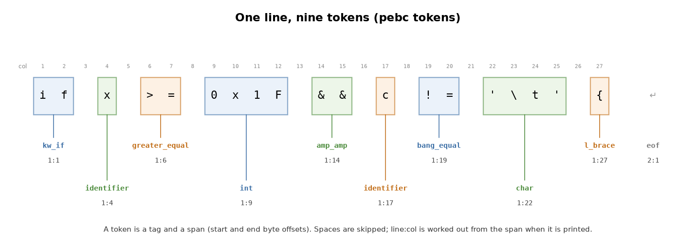

# Chapter 2 — Lexing

Chapter 1's compiler read its input one character at a time, and when something went wrong it
said `error at byte 4`. Real compilers work in two steps. A **lexer** first splits the text into
**tokens**, such as `>=`, `0x1F` or `while`, and every token remembers exactly which bytes it came
from. That one change lets every later error name the file, the line and the column, and draw a
caret under the code. In this chapter you write the lexer for the *whole* Pebble language
(keywords, strings, characters, every operator), so that no later chapter has to touch it, and a
small diagnostics module that prints errors in the `file:line:col: error: message` style of gcc,
clang and Zig. The compiler still handles a single integer expression, but it now reads tokens, a
new `pebc tokens` command shows what the lexer sees, and a second golden test suite checks the
error messages themselves.

Previous: [Chapter 1](01-a-compiler-in-one-afternoon.md). Next: [Chapter 3](03-parsing-expressions.md).

## Why tokens

Here is how Chapter 1's compiler looked at its input:

```zig
    /// Skips whitespace, then returns the next character (0 at the end).
    fn peek(c: *Compiler) u8 {
        c.skipSpace();
        return if (c.pos < c.src.len) c.src[c.pos] else 0;
    }
```

Every grammar function asked for one character. That worked because every token of that tiny
language was one character long, except numbers, which `primary` gathered with a loop of its own.
Now think of a line of real Pebble, such as `if x >= 0x1F && c != '\t' {`. The grammar wants to ask
"is the next thing `>=`?", "is it the keyword `if`?", "is it a number, and which one?". If it works
on characters, every grammar function must know how to skip spaces and comments, where a name ends,
that `>` followed by `=` is one operator, and that `\t` inside quotes is an escape. That knowledge
belongs in one place.

A **lexer** (also called a *scanner* or a *tokenizer*) is that place. It reads the characters
once and produces a list of **tokens**. Each token has a kind, which pebc calls its **tag**, and
the range of the source it covers, its **span**. This is what pebc's lexer makes of the line:



Three things happened:

- **Whitespace and comments vanished.** The parser will never see a space, a newline or a
  `// comment`. It sees nine tokens and then `eof`, an end marker that saves it from checking for
  the end of the list.
- **Characters were grouped.** `0x1F` is one `int` token and `'\t'` one `char` token. The lexer
  checks that `\t` is a valid escape, but it does not compute any values: the token is just a tag
  and a span, and whoever needs the number 31 decodes the text later.
- **Words were classified.** `if` is the keyword `kw_if`; `x` and `c` are `identifier`s.

The lexer follows one rule everywhere, called **maximal munch**: at each position, take the
longest token that fits. `>=` is one `greater_equal`, not `greater` and then `equal`. `iffy` is
one name, not the keyword `if` followed by the name `fy`. `...` is one `ellipsis`, not three dots.
And `12abc` is one (bad) number, not the number `12` followed by the name `abc`: one token gives
one clear error, "invalid integer literal '12abc'", where two tokens would give the baffling
"expected an operator, found a name".

The lexer in this chapter knows every token of the final Pebble language, including `struct`,
`...` and `&&`, although the compiler only understands integers, `+ - * / %` and parentheses so
far. Anything else lexes fine and is then rejected by the compiler with a clear message. (To
follow along, build the snapshot with `cd project/ch02 && zig build`. Small files such as `k.peb`
are not in the repository; create them there with an editor or `printf`.)

```console
$ cat k.peb
fn main() {}
$ zig-out/bin/pebc ir k.peb
k.peb:1:1: error: expected an expression, found 'fn'
fn main() {}
^~
```

## The token type

`project/ch02/src/lexer.zig` (excerpt)

```zig
pub const Token = struct {
    tag: Tag,
    span: Span,

    pub const Tag = enum {
        int,
        char,
        string,
        identifier,

        kw_as,
        kw_break,
        // ... one tag per keyword, in alphabetical order
        kw_while,

        l_paren, // (
        r_paren, // )
        // ... one tag per piece of punctuation
        greater, // >
        greater_equal, // >=

        eof,
        /// Something the lexer could not make sense of. It has already
        /// reported an error about it.
        invalid,

        // ... describe() and lexeme(), shown below
    };
};
```

That is the whole vocabulary of Pebble: four kinds of token with variable text (integers,
characters, strings, names), fourteen keywords (`as break continue else extern false fn if let
return struct true var while`), twenty-seven pieces of punctuation (`( ) { } [ ] , : ; . ... + -
* / % & && || ! != = == < <= > >=`), and two markers. Some things to notice:

- **A token holds no text and no value**, only a tag and a span. The text is
  `src[span.start..span.end]`, so there is nothing to copy or free. A token is 12 bytes: a 1-byte
  tag (47 members fit in a byte) and two 4-byte offsets.
- **Keywords are prefixed `kw_`.** `if` and `fn` are keywords in Zig too, so `.if` would need the
  `@"if"` syntax. The prefix also tells you at a glance which tags are keywords, and the code
  below uses it to recover the spelling.
- **There is no `-=`, no `<<`, no `|`.** Pebble has only what the course needs. Adding an operator
  later means adding a tag and a line in the punctuation table; an exercise in Chapter 3 adds
  `|`.

The keywords themselves live in a map from text to tag:

```zig
pub const keywords: std.StaticStringMap(Token.Tag) = .initComptime(.{
    .{ "as", .kw_as },         .{ "break", .kw_break },   .{ "continue", .kw_continue },
    .{ "else", .kw_else },     .{ "extern", .kw_extern }, .{ "false", .kw_false },
    .{ "fn", .kw_fn },         .{ "if", .kw_if },         .{ "let", .kw_let },
    .{ "return", .kw_return }, .{ "struct", .kw_struct }, .{ "true", .kw_true },
    .{ "var", .kw_var },       .{ "while", .kw_while },
});
```

`std.StaticStringMap` is built at compile time (`initComptime`), so it costs nothing at startup
and allocates nothing. Its doc comment says it is "optimized for small sets of disparate string
keys": it groups the keys by length when it is built, and a lookup only compares the word with
keywords of the same length. Looking up `main` compares it with `else` and `true` and nothing
else. The lexer does not treat keywords specially at all: it reads a whole word as if it were a
name, and then asks the map whether the word is a keyword. That is maximal munch for free:
`iffy` is read as one word before anyone checks it, and `iffy` is not in the map.

Error messages need to name tokens: "found '*'", "found end of file". The `Tag` enum has two
helpers for that, declared inside the enum:

```zig
        /// How the token is named in error messages.
        pub fn describe(tag: Tag) []const u8 {
            return switch (tag) {
                .int => "an integer",
                .char => "a character",
                .string => "a string",
                .identifier => "a name",
                .eof => "end of file",
                .invalid => "an invalid token",
                inline else => |t| "'" ++ comptime t.lexeme() ++ "'",
            };
        }

        /// The fixed spelling of a keyword or punctuation token.
        fn lexeme(comptime tag: Tag) []const u8 {
            const name = @tagName(tag);
            if (std.mem.startsWith(u8, name, "kw_")) return name[3..];
            for (punctuation) |p| if (p.tag == tag) return p.text;
            unreachable;
        }
```

Tags with variable text are described in words. Every other tag has a fixed spelling, and
`inline else` turns the last prong into one prong per remaining tag, with `t` known at compile
time in each. So `lexeme` runs inside the compiler, `"'" ++ ... ++ "'"` is concatenated at compile
time, and `describe(.star)` simply returns the constant `"'*'"`. There is no table of 47 strings to
keep in sync with the enum.

The `unreachable` at the end of `lexeme` is a compile-time check, too. Suppose you add a tag
`caret` for `^` but forget its line in the punctuation table:

```console
$ zig build
...
src/lexer.zig:84:13: error: reached unreachable code
            unreachable;
            ^~~~~~~~~~~
src/lexer.zig:75:60: note: called at comptime here
                inline else => |t| "'" ++ comptime t.lexeme() ++ "'",
                                                   ~~~~~~~~^~
...
```

## Spans and sources

A span is a range of bytes:

`project/ch02/src/diag.zig` (excerpt)

```zig
/// A range of bytes in the source: `text[start..end]`.
pub const Span = struct {
    start: u32,
    end: u32,

    /// The span that covers both `a` and `b`.
    pub fn to(a: Span, b: Span) Span {
        return .{ .start = a.start, .end = b.end };
    }
};
```

Why byte offsets and not lines and columns? Because a compiler creates spans all the time (one
per token, later one per tree node) and uses them almost never: only when it prints an error, or
when you ask for `pebc tokens`. Two `u32`s are cheap to store and to combine: in Chapter 3,
`lhs.span.to(rhs.span)` is the span of a whole binary expression, which would be messy with line
and column pairs. Lines and columns are worked out only when something is printed. (`u32` limits
a source file to 4 GiB; `main.zig` refuses to read more than 16 MiB anyway.)

The conversion is done by `Source`, which pairs a file's path with its text:

```zig
pub const Source = struct {
    path: []const u8,
    text: []const u8,

    pub const Location = struct {
        line: u32, // 1-based
        col: u32, // 1-based, counted in bytes
        line_start: u32, // offset of the first byte of the line
    };

    /// Converts a byte offset into a line and a column.
    pub fn locate(s: Source, offset: u32) Location {
        var loc: Location = .{ .line = 1, .col = 1, .line_start = 0 };
        for (s.text[0..offset], 0..) |c, i| {
            if (c == '\n') {
                loc.line += 1;
                loc.line_start = @intCast(i + 1);
            }
        }
        loc.col = offset - loc.line_start + 1;
        return loc;
    }

    /// The text of the line that starts at `line_start`, without the newline.
    pub fn lineText(s: Source, line_start: u32) []const u8 {
        const end = std.mem.findScalarPos(u8, s.text, line_start, '\n') orelse s.text.len;
        return s.text[line_start..end];
    }
};
```

`locate` counts the newlines before the offset, scanning from the start of the file on every
call: slow for a million tokens, fine for a handful of error messages. Lines and columns are
1-based, as editors show them, and `line_start` lets `lineText` cut the line out for printing.

Columns are counted in **bytes**. For ASCII that is the same as characters, but Pebble source is
UTF-8, where `é` takes two bytes. pebc does not care what is inside a string, so this program
lexes fine apart from the `$`, but look where the error points:

```console
$ cat utf.peb
"é" $ 1
$ zig-out/bin/pebc ir utf.peb
utf.peb:1:6: error: unexpected character '$'
"é" $ 1
     ^
```

The `$` is the fifth character on the line, but the sixth byte, so pebc says column 6 and puts
the caret one place too far right. This is a known limitation. Counting display columns means
decoding UTF-8 and knowing which characters are double width, more than this course needs, since
Pebble allows non-ASCII bytes only inside strings and comments.

## Diagnostics

A **diagnostic** is the compiler's word for an error, a warning or a note. pebc collects them in
a list instead of printing them on the spot:

```zig
pub const Severity = enum { @"error", note };

pub const Diagnostic = struct {
    severity: Severity,
    span: Span,
    message: []const u8,
};

/// Collects the diagnostics for one source file.
pub const Diagnostics = struct {
    /// Messages are allocated here and live as long as the arena.
    arena: std.mem.Allocator,
    source: *const Source,
    list: std.ArrayList(Diagnostic) = .empty,
    error_count: usize = 0,

    // ... init(arena, source)

    pub fn add(d: *Diagnostics, severity: Severity, span: Span, comptime fmt: []const u8, args: anytype) error{OutOfMemory}!void {
        const message = try std.fmt.allocPrint(d.arena, fmt, args);
        try d.list.append(d.arena, .{ .severity = severity, .span = span, .message = message });
        if (severity == .@"error") d.error_count += 1;
    }

    pub fn err(d: *Diagnostics, span: Span, comptime fmt: []const u8, args: anytype) error{OutOfMemory}!void {
        return d.add(.@"error", span, fmt, args);
    }

    // ... hasErrors() returns error_count > 0

    pub fn render(d: Diagnostics, w: *Writer) Writer.Error!void {
        for (d.list.items) |diag| try renderOne(d.source.*, diag, w);
    }
};
```

Collecting first has several advantages:

- **The code that finds an error doesn't decide how it is shown.** `main.zig` decides where the
  text goes, and a unit test can render into a string and compare.
- **The compiler can keep going.** The lexer reports every bad character, and `hasErrors` tells
  the caller afterwards whether to carry on.
- **Messages are formatted like `print`**, into the arena, so they live as long as the compilation
  and nobody frees anything. That is also why `err` can fail: it allocates, so it returns
  `error{OutOfMemory}!void` and every caller writes `try`.

`error` is a keyword in Zig, so the enum member is spelled `@"error"`. Notes are not used yet.
Chapter 3 adds the first one (`use && to combine two comparisons`), and in Chapter 5 an error
such as "'f' is already declared" is followed by a note pointing at the first declaration.
Diagnostics are printed in the order they were added.

### Drawing the caret

`renderOne` turns one diagnostic into three lines of text:

```zig
fn renderOne(source: Source, diag: Diagnostic, w: *Writer) Writer.Error!void {
    var start = diag.span.start;
    // An error at the very end of a file that ends with a newline is shown
    // at the end of the last line, not on an empty line after it.
    if (start == source.text.len and start > 0 and source.text[start - 1] == '\n') start -= 1;
    const loc = source.locate(start);
    try w.print("{s}:{d}:{d}: {t}: {s}\n", .{ source.path, loc.line, loc.col, diag.severity, diag.message });

    const line = source.lineText(loc.line_start);
    try w.print("{s}\n", .{line});
    // Copy tabs so that the caret lines up with the text above it.
    for (line[0 .. loc.col - 1]) |c| try w.writeByte(if (c == '\t') '\t' else ' ');
    try w.writeByte('^');
    // Underline the rest of the span, but not past the end of the line.
    const line_end = loc.line_start + line.len;
    const end = @min(diag.span.end, line_end);
    if (end > start + 1) try w.splatByteAll('~', end - start - 1);
    try w.writeByte('\n');
}
```

Line one is `path:line:col: severity: message` (`{t}` prints an enum's tag name), the format gcc,
clang and Zig all use, so editors can jump from it to the spot. Line two is the source line. Line
three puts `^` under the span's first byte and `~` under the rest, so you see the whole token:

```console
$ zig-out/bin/pebc ir tests/errors/too_large.peb
tests/errors/too_large.peb:1:1: error: integer literal is too large
99999999999999999999 + 1
^~~~~~~~~~~~~~~~~~~~
```

Three details in `renderOne` handle the cases that make naive caret printers look wrong.

**The end of the file.** Most files end with a newline. An error at end of file has a span that
starts at `text.len`, which is *after* that newline, on an empty line 2. "Line 2, column 1" over an
empty line is technically right and useless, so `renderOne` moves the position back one byte, onto
the newline, and the caret appears just after the last character:

```console
$ printf '1 +\n' > eof1.peb && zig-out/bin/pebc ir eof1.peb
eof1.peb:1:4: error: expected an expression, found end of file
1 +
   ^
```

Without the final newline (`printf '1 +'`) the output is the same. An empty file has no newline
to step back onto (`start > 0` fails), and is reported at 1:1 with an empty line and a lone `^`.

**Tabs.** The caret line is made of spaces, but a tab in the source line is copied as a tab. A tab
moves to the next tab stop, which may be 2, 4 or 8 columns away depending on the editor or
terminal, so the only way to line up with the line above, whatever the tab width, is to use the
same tab. This example indents with a tab:

`examples/ch02/tab.peb`

```
// The caret line copies the tab, so ^ lines up in any editor.
(1 +
	2) $ 3
```

```console
$ ../../project/ch02/zig-out/bin/pebc tokens tab.peb 2>&1 >/dev/null
tab.peb:3:5: error: unexpected character '$'
	2) $ 3
	   ^
```

The `$` is at byte column 5 (tab, `2`, `)`, space, `$`), and the caret line is a tab and three
spaces. (`2>&1 >/dev/null` keeps only stderr; the token list goes to stdout.)

**Spans that run past the line.** In later chapters a span can cover several lines, for example a
whole `if` statement. The underline stops at the end of the first line rather than running on.

### Writing messages

Every message pebc prints, from here to Chapter 9, follows the same rules. Keep them when you
add your own:

- lower case, no full stop: `unexpected character '$'`;
- quote source text in single quotes: `'12abc'`, `'*'`;
- say what was expected and what was found: `expected ')', found end of file`;
- point the span at the token that is wrong, not at the place where the compiler noticed;
- when another place is involved (a declaration, an earlier definition), add a `note:` there.

The "found" part comes from `describe`, which is why it says `an integer`, not `int`.

## Writing the lexer

The lexer is a cursor over the source and a place to report errors:

```zig
pub const Lexer = struct {
    src: []const u8,
    pos: u32 = 0,
    diags: *Diagnostics,

    pub fn init(src: []const u8, diags: *Diagnostics) Lexer {
        return .{ .src = src, .diags = diags };
    }

    /// Returns the next token. At the end it returns `.eof` forever.
    pub fn next(l: *Lexer) error{OutOfMemory}!Token {
        l.skipSpaceAndComments();
        const start = l.pos;
        if (l.pos >= l.src.len) return l.make(.eof, start);

        const c = l.src[l.pos];
        if (isIdentStart(c)) {
            while (l.pos < l.src.len and isIdentChar(l.src[l.pos])) l.pos += 1;
            const tag = keywords.get(l.src[start..l.pos]) orelse .identifier;
            return l.make(tag, start);
        }
        if (std.ascii.isDigit(c)) {
            // Take letters too, so that "12ab" is one bad number rather than
            // "12" followed by the name "ab". The parser checks the digits.
            while (l.pos < l.src.len and isIdentChar(l.src[l.pos])) l.pos += 1;
            return l.make(.int, start);
        }
        if (c == '"') return l.quoted('"', .string);
        if (c == '\'') return l.quoted('\'', .char);

        for (punctuation) |p| {
            if (std.mem.startsWith(u8, l.src[l.pos..], p.text)) {
                l.pos += @intCast(p.text.len);
                return l.make(p.tag, start);
            }
        }

        l.pos += 1;
        const span: Span = .{ .start = start, .end = l.pos };
        if (std.ascii.isPrint(c)) {
            try l.diags.err(span, "unexpected character '{c}'", .{c});
        } else {
            try l.diags.err(span, "unexpected byte 0x{x:0>2}", .{c});
        }
        return .{ .tag = .invalid, .span = span };
    }
    // ...

    fn make(l: *Lexer, tag: Token.Tag, start: u32) Token {
        return .{ .tag = tag, .span = .{ .start = start, .end = l.pos } };
    }
};
```

`next` skips what the parser should not see, remembers where the token starts, and then decides
what kind of token it is from its **first character**. That works because Pebble is designed so
that the first character settles it: a letter or `_` starts a name, a digit a number, a quote a
literal, anything else punctuation. Each branch moves `pos` past the token and `make` builds the
span from `start` to the new `pos`.

- **Names and keywords.** `isIdentStart` is a letter or `_`; `isIdentChar` adds digits. The loop
  takes the whole word, then the keyword map decides its tag.
- **Numbers.** A number starts with a digit and then takes *identifier* characters, not just
  digits. That is what makes `12abc` one token, and it also takes `0x1F` in one go, because `x`,
  `1` and `F` are all identifier characters. Whether the text is a valid number is not the
  lexer's problem; see below.
- **Literals** go to `quoted`, and **punctuation** is tried from a table, longest first.
- **Anything else** becomes one `invalid` token of one byte, with an error. Printable ASCII is
  quoted; any other byte (a control character, or part of a UTF-8 sequence) is shown in hex,
  because printing half a UTF-8 character would print garbage.

At the end, `next` returns `eof` with an empty span at `src.len`, and it keeps doing so if you call
it again. Callers never have to worry about reading past the end.

### Numbers are decoded later

The lexer only finds where a number is. Its value is computed when the compiler needs it:

```zig
/// The value of an integer literal: decimal, or hexadecimal with "0x".
pub fn intValue(text: []const u8) error{ Overflow, InvalidCharacter }!u64 {
    if (std.mem.startsWith(u8, text, "0x")) return std.fmt.parseUnsigned(u64, text[2..], 16);
    return std.fmt.parseUnsigned(u64, text, 10);
}
```

The result is unsigned because a literal never has a sign: in `-5`, the minus is an operator
applied to `5`. The two errors become two different messages in the compiler. So the lexer never
reports anything about numbers, and `12abc` lexes without complaint.

### Strings and characters

String and character literals share one function:

```zig
    /// Lexes a string or character literal, checking its escapes.
    fn quoted(l: *Lexer, quote: u8, tag: Token.Tag) error{OutOfMemory}!Token {
        const start = l.pos;
        l.pos += 1; // the opening quote
        var count: usize = 0; // characters between the quotes
        while (true) {
            if (l.pos >= l.src.len or l.src[l.pos] == '\n') {
                const what = if (tag == .string) "string" else "character";
                try l.diags.err(.{ .start = start, .end = l.pos }, "unterminated {s} literal", .{what});
                return .{ .tag = .invalid, .span = .{ .start = start, .end = l.pos } };
            }
            const c = l.src[l.pos];
            if (c == quote) break;
            if (c == '\\') {
                if (l.pos + 1 < l.src.len and escapeValue(l.src[l.pos + 1]) != null) {
                    l.pos += 2;
                } else {
                    const end = @min(l.pos + 2, l.src.len);
                    try l.diags.err(.{ .start = l.pos, .end = @intCast(end) }, "unknown escape sequence '{s}'", .{l.src[l.pos..end]});
                    l.pos = @intCast(end);
                }
            } else {
                l.pos += 1;
            }
            count += 1;
        }
        l.pos += 1; // the closing quote
        const token = l.make(tag, start);
        if (tag == .char and count != 1) {
            try l.diags.err(token.span, "a character literal holds exactly one character", .{});
            return .{ .tag = .invalid, .span = token.span };
        }
        return token;
    }
```

The loop walks to the closing quote, one character (or one escape) at a time:

- **A literal may not span lines.** Reaching a newline or the end of the file means the closing
  quote is missing. Stopping at the newline matters: a forgotten `"` would otherwise swallow the
  rest of the file, and every error after it would be nonsense.
- **A backslash starts an escape.** `\n \t \r \0 \\ \' \"` are valid; `escapeValue` knows them.
  An unknown escape gets its own error, with a two-byte span over the backslash and the next
  character, and lexing goes on. Note that `\'` and `\"` are why a backslash skips *two* bytes:
  the escaped quote must not end the literal.
- **`count` counts characters, not bytes**, with an escape counting as one. A character literal
  must hold exactly one, so `'ab'` and `''` are errors.

The test `l.pos + 1 < l.src.len` looks fussy, but a file can end straight after a backslash.
Without it, `l.src[l.pos + 1]` reads one byte past the end, which panics in a debug build. With it,
the file `"\` (a quote and a backslash, nothing more) gives two sensible errors:

```console
$ zig-out/bin/pebc ir bseof.peb
bseof.peb:1:2: error: unknown escape sequence '\'
"\
 ^
bseof.peb:1:1: error: unterminated string literal
"\
^~
```

You would not think to write that test case yourself, which is the point: in Chapter 8 a fuzzer
feeds pebc random bytes, and if you remove the check it finds this bug after about a thousand
tries.

`escapeValue(c)` is a `switch` that maps the letter after a backslash to the byte it stands for
(`'n'` to 10, `'0'` to 0, `'"'` to itself) and returns `null` for anything else, so it is also
the list of valid escapes.

Like numbers, literals are only checked here. `unescape(arena, literal)` in the same file strips
the quotes and decodes the escapes; it can assume the escapes are valid because the lexer checked
them. Chapter 3's parser calls it for every literal: `'\n'` becomes the byte 10 in the syntax
tree, and `"hi\n"` the three bytes `h`, `i`, 10.

### Whitespace and comments

```zig
    fn skipSpaceAndComments(l: *Lexer) void {
        while (l.pos < l.src.len) {
            const c = l.src[l.pos];
            if (c == ' ' or c == '\t' or c == '\n' or c == '\r') {
                l.pos += 1;
            } else if (std.mem.startsWith(u8, l.src[l.pos..], "//")) {
                while (l.pos < l.src.len and l.src[l.pos] != '\n') l.pos += 1;
            } else {
                return;
            }
        }
    }
```

Pebble has only `//` comments, to the end of the line. The newline itself is left for the next
round of the loop. `\r` is skipped so that files with CRLF (`\r\n`) line endings work. A lone `/` is not
a comment, so it is left for the punctuation table, where it becomes `slash`.

### Punctuation, longest first

```zig
/// Punctuation, longest first, so that "..." wins over "." and "<=" over "<".
const punctuation = [_]struct { text: []const u8, tag: Token.Tag }{
    .{ .text = "...", .tag = .ellipsis },
    .{ .text = "&&", .tag = .amp_amp },
    .{ .text = "||", .tag = .pipe_pipe },
    .{ .text = "!=", .tag = .bang_equal },
    .{ .text = "==", .tag = .equal_equal },
    .{ .text = "<=", .tag = .less_equal },
    .{ .text = ">=", .tag = .greater_equal },
    .{ .text = "(", .tag = .l_paren },
    // ... one line for each single-character token
    .{ .text = "<", .tag = .less },
    .{ .text = ">", .tag = .greater },
};
```

`next` tries the entries in order and takes the first that the remaining source starts with. Since
`<=` comes before `<`, the input `<=` matches `<=` first: maximal munch is just a matter of the
order of the table. The same table serves `lexeme`, so each spelling is written exactly once.

A table and a loop is not the fastest way to do this: `>` is the last of 27 entries, so the loop
tries 26 others before it matches. A hand-tuned lexer would `switch` on the first character and
then peek at the second. For pebc's inputs the difference doesn't matter, and the table is short,
easy to check, and hard to get wrong in any way but one (see "Common mistakes").

### All the tokens at once

`tokenize(arena, src, diags)` calls `next` until it returns `eof` and collects the tokens in an
`ArrayList`; the last token is always `eof`. So pebc lexes the whole file before compiling any of
it. A lexer can also run on demand, producing one token each time the parser asks, which saves
memory. But a slice of 12-byte tokens is small for any file you will write in Pebble, and it makes
the parser simpler: looking two tokens ahead is just `tokens[index + 2]`, and going back is just
setting `index`. It also means every lexical error in the file is reported, even when the
compiler would stop at its first error.

The five unit tests at the bottom of `lexer.zig` check the tags for short inputs such as
`"<= < ... . == = &&&"` (where `&&&` must be `amp_amp` then `amp`), and `unescape` and `intValue`.

## Bad input

The lexer never stops at an error. It reports it, returns an `invalid` token that covers the bad
text, and carries on with the next byte. The examples in `examples/ch02/` each contain a mistake,
and their `Makefile` runs `pebc tokens` on them, ignoring the failure status:

`examples/ch02/u1.peb`

```
let s = "abc
```

```console
$ cd examples/ch02
$ make u1
../../project/ch02/zig-out/bin/pebc tokens u1.peb
1:1     kw_let        let
1:5     identifier    s
1:7     equal         =
1:9     invalid       "abc
2:1     eof
u1.peb:1:9: error: unterminated string literal
let s = "abc
        ^~~~
make: [Makefile:11: u1] Error 1 (ignored)
```

`pebc tokens` prints each token's position, tag and text on stdout, then the diagnostics on
stderr, and exits with status 1 if there were errors. (If `zig-out/bin/pebc` does not exist yet,
the `Makefile` builds it first.) The unterminated string became an `invalid` token from the quote
to the end of the line, and lexing went on with `eof` on line 2.

`examples/ch02/u2.peb` has two mistakes:

```
'ab' + '\q'
```

```console
$ ../../project/ch02/zig-out/bin/pebc tokens u2.peb
1:1     invalid       'ab'
1:6     plus          +
1:8     char          '\q'
2:1     eof
u2.peb:1:1: error: a character literal holds exactly one character
'ab' + '\q'
^~~~
u2.peb:1:9: error: unknown escape sequence '\q'
'ab' + '\q'
        ^~
```

Both are reported in one run. Notice that `'\q'` is still a `char` token: the literal is
well-formed apart from its escape, whose error points at `\q` alone, not at the whole literal.

`examples/ch02/u3.peb`, `1 @ 2`, gives `int invalid int eof` and `unexpected character '@'`.
A byte that is not ASCII is shown in hex instead. `1 + é` gives two errors, because `é` is two
bytes in UTF-8: `unexpected byte 0xc3` at 1:5 and `unexpected byte 0xa9` at 1:6.

Finally, `examples/ch02/u4.peb` is `12abc + 3`, and it is *not* a lexical error:

`pebc tokens u4.peb` succeeds: the lexer makes one `int` token out of `12abc`, as designed, then
`plus`, `int` and `eof`. `make u4-ir` runs `pebc ir` instead:

```console
$ ../../project/ch02/zig-out/bin/pebc ir u4.peb
u4.peb:1:1: error: invalid integer literal '12abc'
12abc + 3
^~~~~
```

The compiler is the one that calls `intValue`, gets `InvalidCharacter`, and reports the whole token.

## Plugging it in

The compiler from Chapter 1 changes less than you might expect. Its grammar functions are the
same; they now look at tokens instead of characters. `peek()` returns the next `Token`, the loops
in `expr` and `term` switch on `c.peek().tag` (`.plus`, `.minus`, `.star`, ...) instead of on
`'+'` and `'-'`, and `c.index += 1` consumes a token where `c.pos += 1` consumed a character.
`skipSpace` is gone: the lexer already did that. `primary` is where tokens pay off:

`project/ch02/src/compiler.zig` (excerpt)

```zig
    fn primary(c: *Compiler) Error!Value {
        const token = c.peek();
        switch (token.tag) {
            .int => {
                c.index += 1;
                const text = c.src[token.span.start..token.span.end];
                const n = lexer.intValue(text) catch |err| switch (err) {
                    error.Overflow => return c.failAt(token.span, "integer literal is too large", .{}),
                    error.InvalidCharacter => return c.failAt(token.span, "invalid integer literal '{s}'", .{text}),
                };
                if (n > std.math.maxInt(i64)) return c.failAt(token.span, "integer literal is too large", .{});
                return .{ .int = @intCast(n) };
            },
            .l_paren => {
                c.index += 1;
                const inner = try c.expr();
                if (c.peek().tag != .r_paren) return c.fail("expected ')', found {s}", .{c.peek().tag.describe()});
                c.index += 1;
                return inner;
            },
            else => return c.fail("expected an expression, found {s}", .{token.tag.describe()}),
        }
    }
```

The number loop is gone; the token's text is a slice of the source. `intValue` returns a `u64`,
and Pebble's integers are `i64`, so the compiler also rejects values from 2^63 up
(`9223372036854775808` gives "integer literal is too large", `9223372036854775807` compiles).

Errors go through two helpers. `fail(fmt, args)` blames the next token, which is right for
"expected X, found Y". `failAt(span, fmt, args)` takes any span, for errors about a token already
consumed, like the bad integer. Both record a diagnostic with `try c.diags.err(...)` and then
return `error.SyntaxError`, which unwinds the recursion back to `compile` exactly as in Chapter 1.
The compiler still stops at its first error; Chapter 4 teaches the parser to recover and go on.
The error set gains `OutOfMemory`, since recording a diagnostic allocates, and the
`err_pos`/`err_msg` fields of Chapter 1 are gone.

### main.zig

`run` now builds a `Source` and a `Diagnostics`, lexes, and only then compiles:

`project/ch02/src/main.zig` (excerpt)

```zig
    const source: diag.Source = .{ .path = path, .text = src };
    var diags: diag.Diagnostics = .init(arena, &source);
    const tokens = try lexer.tokenize(arena, src, &diags);
    if (command == .tokens) {
        try printTokens(stdout, source, tokens);
        try diags.render(stderr);
        return if (diags.hasErrors()) 1 else 0;
    }

    var il: Io.Writer.Allocating = .init(arena);
    if (!diags.hasErrors()) {
        var compiler: Compiler = .init(src, tokens, &il.writer, &diags);
        compiler.compile() catch |err| switch (err) {
            error.SyntaxError => {},
            // Writing to an Allocating writer only fails when memory runs out.
            error.WriteFailed, error.OutOfMemory => return error.OutOfMemory,
        };
    }
    if (diags.hasErrors()) {
        try diags.render(stderr);
        return 1;
    }
```

If the lexer found errors, the compiler does not run at all. It could: an `invalid` token is a
token like any other, and the compiler would say "expected an expression, found an invalid token".
But that only repeats, less clearly, an error the user has already been shown. A second error
caused by the first is called a **cascading error**, and avoiding them is most of the art of error
reporting. Skipping the next phase after errors is the bluntest way to do it.

`pebc tokens` is new. Its `printTokens` loops over the tokens, calls `locate` on each start, and
prints with `"{s:<8}{s:<14}{s}\n"`: the `line:col` padded to 8 columns, the tag name padded to
14, and the token's text. `eof` has no text and is printed without padding.

Back in `project/ch02`, try it on the sample, which now begins with a comment:

```console
$ cat samples/answer.peb
// The answer, computed the long way.
6 * (3 + 4)
$ zig-out/bin/pebc tokens samples/answer.peb
2:1     int           6
2:3     star          *
2:5     l_paren       (
2:6     int           3
2:8     plus          +
2:10    int           4
2:11    r_paren       )
3:1     eof
$ zig build demo
42
```

The comment and the spaces are gone, and the IL is exactly what Chapter 1 produced. Here is
`examples/ch02/tokens.peb`, which is indented with tabs and uses tokens the compiler doesn't
understand yet (run it from `examples/ch02`):

```
fn main() {
	let s = "hi\n";
	if x >= 0x1F && c != '\t' { return; }
}
```

```console
$ ../../project/ch02/zig-out/bin/pebc tokens tokens.peb | tail -14
3:2     kw_if         if
3:5     identifier    x
3:7     greater_equal >=
3:10    int           0x1F
3:15    amp_amp       &&
3:18    identifier    c
3:20    bang_equal    !=
3:23    char          '\t'
3:28    l_brace       {
3:30    kw_return     return
3:36    semicolon     ;
3:38    r_brace       }
4:1     r_brace       }
5:1     eof
```

The tab counts as one byte, so `if` is at column 2. `'\t'` is printed as written, backslash and
all: the token is a span of the source, not a decoded value.

### Golden tests for errors

Error messages are output too, and they deserve tests. The golden runner gains a second suite,
`tests/errors/`: each `NAME.peb` there must make `pebc ir` exit with status 1 and print exactly
the contents of `NAME.err` on stderr. There are five:

| Test | Source | First line of the `.err` file |
|---|---|---|
| `bad_char` | `12 $ 3` | `errors/bad_char.peb:1:4: error: unexpected character '$'` |
| `extra_token` | `2 * (3 + 4) 5` | `errors/extra_token.peb:1:13: error: expected an operator, found an integer` |
| `missing_operand` | `1 + * 2` | `errors/missing_operand.peb:1:5: error: expected an expression, found '*'` |
| `too_large` | `99999999999999999999 + 1` | `errors/too_large.peb:1:1: error: integer literal is too large` |
| `unclosed_paren` | `(1 + 2` | `errors/unclosed_paren.peb:1:7: error: expected ')', found end of file` |

Each `.err` file is the full three-line message, caret line included, so a test fails if the
caret moves by one column. In `tests/golden.zig`, the new `checkErrors` runs `pebc ir
errors/NAME.peb`, fails the test unless pebc exited with status 1, and compares its stderr with
`errors/NAME.err`.

The path in every message is the path pebc was given, and the test can't know where your copy of
the repository lives. So the runner runs pebc *inside* the tests directory (`.cwd` in `exec`)
and passes the relative path `errors/NAME.peb`, which makes the messages the same on every
machine; its own command-line paths are first made absolute with `std.fs.path.resolve`.

```console
$ zig build test --summary all
PASS run/answer.peb
...
PASS errors/bad_char.peb
PASS errors/extra_token.peb
PASS errors/missing_operand.peb
PASS errors/too_large.peb
PASS errors/unclosed_paren.peb
golden: 9 passed, 0 failed
Build Summary: 6/6 steps succeeded; 10/10 tests passed
...
```

The ten unit tests are the five in `lexer.zig`, two in `diag.zig`, two in `compiler.zig`, and the
`test` block in `main.zig` that pulls the others in.

## Common mistakes

**Punctuation in the wrong order.** Move `<` above `<=` in the table and build. Everything still
compiles, and all nine golden tests still pass, because none of them uses `<=`. But the lexer is
now wrong:

```console
$ cat le.peb
a <= b
$ zig-out/bin/pebc tokens le.peb
1:1     identifier    a
1:3     less          <
1:4     equal         =
1:6     identifier    b
2:1     eof
```

`a <= b` became `a < = b`. The parser in Chapter 3 would reject that with a confusing message
about `=`. The unit test "longest punctuation wins" exists for exactly this, and catches it:

```console
$ zig build test
...
error: 'lexer.test.longest punctuation wins' failed:
       slices differ. first difference occurs at index 0 (0x0)
...
       [0]: .less_equal
...
       ============= instead found this: ==============  len: 10 (0xA)

       [0]: .less
       [1]: .equal
...
Build Summary: 4/6 steps succeeded (1 failed); 9/10 tests passed (1 failed)
```

Golden tests check whole programs, so they only catch what their programs happen to contain.
Small unit tests are better at pinning down rules like this one.

**Forgetting `try`.** `diags.err` allocates, so it returns an error union. Drop the `try` in front
of one call and Zig refuses to compile:

```console
$ zig build
...
src/lexer.zig:167:24: error: error union of type 'error{OutOfMemory}!void' is ignored
            l.diags.err(span, "unexpected character '{c}'", .{c});
            ~~~~~~~~~~~^~~~~~~~~~~~~~~~~~~~~~~~~~~~~~~~~~~~~~~~~~
src/lexer.zig:167:24: note: consider using 'try', 'catch', or 'if'
...
```

You will meet this error often, since every phase of pebc reports diagnostics. The fix is always
`try`: running out of memory while reporting an error is not something to recover from.

## In the wild: caret diagnostics

The format pebc prints, `file:line:col` followed by the source line and a marker underneath, is
now what most compilers print. Clang's documentation page "Expressive Diagnostics" sets out the
idea: all of Clang's diagnostics "include full column number
information", which the driver uses to print "point diagnostics" with a `^`, and Clang "captures
and accurately tracks range information" for expressions so it can underline the related code
with `~`. The page also notes that "modern versions of GCC have followed Clang's lead". Its
examples put GCC 4.9 next to Clang; with a current GCC the two look much more alike.

Here is the same mistake given to gcc 11.4 and to clang 22.1.8 (the one inside `zig cc`), in a
C file whose line starts with a tab:

```console
$ cat -A caret.c
int main(void) {$
^Ireturn 1 + * 2;$
}$
$ cc -fno-diagnostics-color -c -o /dev/null caret.c
caret.c: In function ‘main’:
caret.c:2:20: error: invalid type argument of unary ‘*’ (have ‘int’)
    2 |         return 1 + * 2;
      |                    ^~~
$ zig cc -fno-color-diagnostics -c -o /dev/null caret.c
caret.c:2:13: error: indirection requires pointer operand ('int' invalid)
    2 |         return 1 + * 2;
      |                    ^ ~
1 error generated.
```

Both show the same shape as pebc, plus a gutter with the line number. Both underline more than one
token: gcc underlines the expression `* 2`, while clang puts the `^` on the operator and the `~`
under its operand. And they disagree on the column. clang counts bytes, like pebc: the tab is one
byte, so `*` is at 13. gcc counts **display columns** by default, expanding the tab to the next
multiple of 8, so `*` is at 20; `-fdiagnostics-column-unit=byte` makes gcc say 13 too. Both
expand the tab into spaces in the snippet. pebc copies the tab instead, which lines up in any
terminal but leaves the column in bytes, the choice clang made.

Zig's own errors, which you have already seen in this chapter, use one more refinement: the `^`
can sit in the *middle* of the underlined range. In the missing-`try` error above, the range is the
whole call `l.diags.err(...)` and the caret is on the `(`, the call itself. pebc's spans have no
separate "main" position, so its caret is always at the start.

## In the wild: Zig's tokenizer

pebc's lexer is written by hand, and so is the one in the Zig compiler. It lives in the standard
library as `std.zig.Tokenizer`, so you can read it: `zig env` prints `.std_dir`, and the file is
`zig/tokenizer.zig` inside it, 1740 lines in Zig 0.17.1. Much of it will look familiar:

- `Token` is `tag` plus `loc`, and `Loc` is `start` and `end` byte offsets: the same shape as
  pebc's `Token`, with `usize` instead of `u32`.
- The keywords are a `std.StaticStringMap(Tag)`, at line 12.
- `next()` "will always" return an eof token at the end, as ours does.
- Its doc comment describes its error recovery: "After this returns invalid, it will reset on the
  next newline". pebc resumes at the next byte instead.

The main difference is the structure of `next()`. Instead of a branch per kind of token, it is a
state machine: `const State = enum { start, expect_newline, identifier, ... }` and a labeled
`state: switch (State.start)`, where each prong moves to another state with `continue :state`. The
file contains 92 of those. The language reference says this construct "can improve clarity of (for
example) state machines", and that when the next state is known at compile time a `continue` "can
be lowered to an unconditional branch to the relevant case". The tokenizer also takes a `[:0]const
u8`, a buffer with a 0 byte after its end, so it can look one byte ahead without a bounds check:
reading 0 at `index == buffer.len` means end of file. And `init` skips a UTF-8 byte order mark at
the start of the file, something pebc would report as three unexpected bytes.

## Summary

- A lexer turns characters into tokens, dropping whitespace and comments; the list ends in `eof`.
- A token is a tag and a span of byte offsets. Its text is a slice of the source; its value
  (`intValue`, `unescape`) is decoded only when needed.
- Maximal munch: take the longest token that fits. Words are read whole and then looked up in
  the keyword map; punctuation is tried longest first; a number takes identifier characters, so
  `12abc` is one bad number.
- Lines and columns are computed from offsets only when printing. Columns are bytes, which puts
  the caret too far right after non-ASCII text.
- `Diagnostics` collects errors and renders them as `path:line:col: error: message`, the source
  line, and `^~~~`, copying tabs and handling errors at end of file.
- The lexer never stops: a bad character becomes an `invalid` token plus a diagnostic. pebc skips
  the compiler when lexing failed, to avoid cascading errors.
- `pebc tokens FILE` shows the token stream. The `tests/errors/` suite checks error messages
  byte for byte; unit tests check rules that whole programs rarely exercise.

## Exercises

1. **Digit separators.** Does `1_000_000 + 1` work? Predict, try it with `pebc tokens` and
   `pebc build`, and explain. What about `_10`, `10_` and `1__0`?

   <details><summary>Solution</summary>

   It works, with no change to pebc:

   ```console
   $ zig-out/bin/pebc tokens big.peb
   1:1     int           1_000_000
   1:11    plus          +
   1:13    int           1
   2:1     eof
   $ zig-out/bin/pebc build big.peb && ./big
   1000001
   ```

   The lexer takes identifier characters after a digit, and `_` is one, so `1_000_000` is one
   `int` token. `intValue` hands the text to `std.fmt.parseUnsigned`, which ignores underscores
   between digits. It rejects one at either end, so `10_` gives `invalid integer literal '10_'`.
   `_10` starts with `_`, so the lexer reads a name, and the compiler says `expected an
   expression, found a name`. `1__0` is accepted and is 10, because the standard library only
   checks the first and last character. Zig's own compiler is stricter: `1__0` in Zig source is
   `error: repeated digit separator`. To match it, check the text in `intValue` before parsing.

   </details>

2. **Binary and octal.** Make `0b101010` and `0o17` work. Today they give
   `error: invalid integer literal '0b101010'`. Check that `0o17 + 0x10 + 0b1` prints 32 and that
   the unit tests still pass. What does `017` mean afterwards?

   <details><summary>Solution</summary>

   `std.fmt.parseUnsigned` with base 0 looks at the prefix itself: `0x` is hexadecimal, `0o`
   octal, `0b` binary, and anything else decimal. So `intValue` shrinks to one line:

   ```zig
   /// The value of an integer literal: decimal, or "0x" hex, "0o" octal, "0b" binary.
   pub fn intValue(text: []const u8) error{ Overflow, InvalidCharacter }!u64 {
       // Base 0 means: look at the prefix.
       return std.fmt.parseUnsigned(u64, text, 0);
   }
   ```

   The lexer needs no change, since `0b101010` was already one `int` token. `0b101010` prints
   42, `0o17 + 0x10 + 0b1` prints 32 (15 + 16 + 1), and `zig build test` still passes, including
   the `intValue` unit test. `0x` and `0b102` are invalid integer literals. `017` is 17: unlike C,
   where a leading 0 means octal, base 0 only treats `0o` as octal, which is a better rule.

   </details>

3. **Block comments.** Add `/* ... */` comments. Today `1 + 2 /* oops` gives
   `expected an expression, found '*'`, because `/` and `*` are tokens. A comment that is never
   closed should give `unterminated comment` pointing at its `/*`.

   <details><summary>Solution</summary>

   `skipSpaceAndComments` gets a third case. Reporting an error can fail, so the function's
   return type becomes `error{OutOfMemory}!void`, and `next` calls it with `try`:

   ```zig
       fn skipSpaceAndComments(l: *Lexer) error{OutOfMemory}!void {
           while (l.pos < l.src.len) {
               // ... spaces and // comments as before
               } else if (std.mem.startsWith(u8, l.src[l.pos..], "/*")) {
                   const close = std.mem.findPos(u8, l.src, l.pos + 2, "*/") orelse {
                       try l.diags.err(.{ .start = l.pos, .end = l.pos + 2 }, "unterminated comment", .{});
                       l.pos = @intCast(l.src.len);
                       return;
                   };
                   l.pos = @intCast(close + 2);
               } else {
                   return;
               }
           }
       }
   ```

   The search for `*/` starts after the `/*`, so `/*/` is not mistaken for a closed comment. A
   comment may span lines, and since spans are offsets, line numbers after it still come out
   right. An unclosed comment swallows the rest of the file; the error points at the opening
   two bytes:

   ```console
   $ cat c1.peb
   0o17 + 0x10 /* sixteen */ + 0b1
   $ zig-out/bin/pebc build c1.peb && ./c1
   32
   $ cat c3.peb
   1 + 2 /* oops
   $ zig-out/bin/pebc ir c3.peb
   c3.peb:1:7: error: unterminated comment
   1 + 2 /* oops
         ^~
   ```

   (This output assumes exercise 2 is done, for `0o17` and `0b1`.) A two-line comment, as in
   `1 + /* two` on one line and `lines */ 2` on the next, prints 3.

   </details>

4. **Count the errors.** After the diagnostics, print a last line such as `pebc: 2 errors` (or
   `pebc: 1 error`). Then run `zig build test`. What happens, and what does it tell you about
   golden tests?

   <details><summary>Solution</summary>

   Add a helper to `main.zig` and call it instead of `diags.render(stderr)` in both places:

   ```zig
   /// Prints the diagnostics and, if there were errors, how many.
   fn report(diags: diag.Diagnostics, stderr: *Io.Writer) !void {
       try diags.render(stderr);
       const n = diags.error_count;
       if (n > 0) try stderr.print("pebc: {d} error{s}\n", .{ n, if (n == 1) "" else "s" });
   }
   ```

   `pebc tokens u2.peb` now ends with `pebc: 2 errors`. But every error test fails:

   ```console
   $ zig build test
   ...
     expected errors:
   errors/bad_char.peb:1:4: error: unexpected character '$'
   12 $ 3
      ^
     actual errors:
   errors/bad_char.peb:1:4: error: unexpected character '$'
   12 $ 3
      ^
   pebc: 1 error
   FAIL errors/bad_char.peb
   ...
   golden: 4 passed, 5 failed
   ```

   Nothing is wrong; the expected output changed. Golden tests compare everything, so any
   intended change to the format means regenerating every golden file (inside `tests/`,
   `../zig-out/bin/pebc ir errors/NAME.peb 2> errors/NAME.err`) and reading the diff. With five
   files that is tolerable; with a hundred it is not, which is why Chapter 8 gives the runner an
   option to rewrite them itself. The rest of the course doesn't print the summary line.

   </details>

Sources for this chapter: [REFERENCES.md](REFERENCES.md#chapter-2--lexing)
