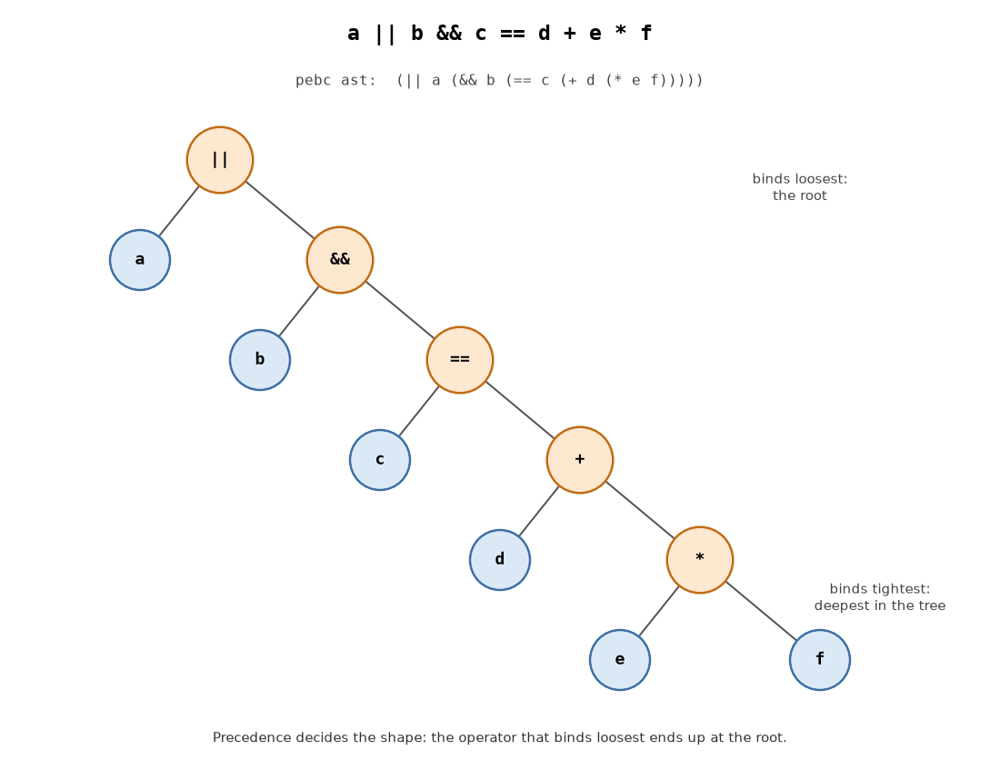

# Chapter 3 — Parsing Expressions

Up to now pebc has been a one-pass compiler: it read a token, decided what it meant and wrote
QBE IL straight away. That works for one arithmetic expression, and stops working the moment
the compiler needs to look at more than one token at a time. This chapter splits pebc into
phases. A **parser** turns the tokens into a **syntax tree**, and a separate **code generator**
walks that tree to write IL. Expressions are parsed with **precedence climbing** (a Pratt
parser): one loop and a small table of precedences instead of one function per precedence
level. The project gains the whole expression grammar of Pebble (comparisons, `&&`, `||`, `!`,
calls, indexing, fields, pointers), a `pebc ast` command that prints trees as S-expressions,
and a third golden test suite, `tests/ast/`.

Previous: [Chapter 2](02-lexing.md). Next: [Chapter 4](04-statements-and-functions.md).

## Why a tree

Here is the heart of Chapter 2's `compiler.zig`, the loop in the function for `+` and `-`:

```zig
        c.index += 1;
        const rhs = try c.term();
        lhs = try c.emit(op, lhs, rhs);
```

Recognising the input and writing the output happen in the same breath: by the time `expr`
returns, the IL for the expression is already in the output buffer. That is the style of
Crenshaw's *Let's Build a Compiler*, and it is a fine way to start. It has three limits that the
rest of this course runs straight into:

- **You can't look ahead in the program.** In Chapter 4 every variable gets a stack slot, and
  QBE wants all `alloc8` instructions in the first block of the function. A one-pass compiler
  only learns that a variable exists when it reaches the `let`, long after it has written the
  first block.
- **You can't check before you generate.** In Chapter 5, `a + b` means a 32-bit add or a
  64-bit add depending on the types of `a` and `b`. To know them, the compiler must look at
  the operands *before* it picks the instruction, and maybe complain instead.
- **You can't transform.** Chapter 9 replaces `2 * 3` with `6` before generating code. You can
  only rewrite what you have kept.

A tree keeps the whole expression. For `1 + 2 * 3` it is:

```
      +
     / \
    1   *
       / \
      2   3
```

The tree has no parentheses and no precedence: the *shape* says that `*` happens first, because
`*` is below `+`, and a node can only be computed after its children. Parsing is the job of
building that shape from a flat list of tokens. Once it exists, any number of later phases can
walk it: a printer, a type checker, a constant folder, a code generator.

The pipeline becomes:

```
source ──lexer──► tokens ──parser──► tree ──codegen──► QBE IL ──qbe──► asm ──cc──► program
         (ch2)              (ch3)              (ch3)
```

`src/compiler.zig` is gone. In its place are four files: `ast.zig` (the tree), `parser.zig`
(tokens → tree), `print.zig` (tree → text, for us and for tests) and `codegen.zig` (tree →
IL).

## The AST in Zig

The tree is called an **abstract syntax tree** (AST): *syntax* because it follows the grammar,
*abstract* because it drops what the grammar only needed for reading. Parentheses, for example,
do not appear in it; their effect is already in the shape. Here is the core of `src/ast.zig`:

`project/ch03/src/ast.zig` (excerpt)
```zig
//! The abstract syntax tree. The parser allocates every node in an arena,
//! and the whole tree is freed at once when the arena goes away.
const std = @import("std");
const Span = @import("diag.zig").Span;

pub const Expr = struct {
    span: Span,
    kind: Kind,

    pub const Kind = union(enum) {
        int: u64,
        char: u8,
        string: []const u8, // the bytes, escapes already decoded
        bool: bool,
        name: []const u8,
        unary: Unary,
        binary: Binary,
        call: Call,
        index: Index,
        field: Field,
    };

    pub const Unary = struct { op: UnaryOp, operand: *Expr };
    pub const Binary = struct { op: BinaryOp, lhs: *Expr, rhs: *Expr };
    pub const Call = struct { callee: *Expr, args: []*Expr };
    pub const Index = struct { base: *Expr, index: *Expr };
    pub const Field = struct { base: *Expr, name: []const u8, name_span: Span };
};
```

The rest of the file is two enums. `UnaryOp` is `neg` (`-x`), `not` (`!x`), `addr` (`&x`) and
`deref` (`*x`). `BinaryOp` is `add sub mul div rem`, the six comparisons `eq ne lt le gt ge`,
and `@"and"`, `@"or"` (`and` and `or` are Zig keywords, so they need the `@"..."` quoting).
Both have a `symbol` function that maps `.add` to `"+"`, `.@"and"` to `"&&"` and so on, for the
printer; `BinaryOp` also has `isComparison`.

Reading it:

- **One node type, `Expr`, with a tagged union inside.** Every node has a `span` (from
  Chapter 2: the byte range `start..end` in the source) and a `kind`. The `kind` says which sort
  of node it is and carries that sort's data. A `switch` on `e.kind` must handle all ten kinds,
  so when a later chapter adds one, the Zig compiler lists every place that forgot it.
- **Every node has a span.** The span of `1 + 2` covers `1` through `2`. Later phases report
  errors on nodes, not tokens ("pebc cannot compile calls yet" underlines the whole call), so
  the span must survive into the tree.
- **Children are pointers.** A `Binary` holds two `*Expr`. A union can't contain itself by
  value (its size would be infinite), so recursive data goes through pointers.
- **Literals are already decoded.** `int` holds the number, `string` holds the bytes with
  `\n` already turned into byte 10. Later phases never look at source text again.
- **`int` is unsigned.** The lexer has no negative numbers: `-5` is the node `neg` applied to
  `5`. A literal can be at most `9223372036854775807` (the largest `i64`), which has an odd
  consequence: the smallest `i64` can't be written directly.

```console
$ cd examples/ch03
$ cat min_int.peb
-9223372036854775808
$ ../../project/ch03/zig-out/bin/pebc ast min_int.peb
min_int.peb:1:2: error: integer literal is too large
-9223372036854775808
 ^~~~~~~~~~~~~~~~~~~
```

C has the same wart, which is why `<limits.h>` on Linux defines `INT_MIN` as an expression
rather than a literal (`(-INT_MAX - 1)`). In Pebble you write `-9223372036854775807 - 1`.

### Nodes live in an arena

The parser makes nodes with one helper:

```zig
fn node(p: *Parser, span: Span, kind: Expr.Kind) Error!*Expr {
    const e = try p.arena.create(Expr);
    e.* = .{ .span = span, .kind = kind };
    return e;
}
```

`p.arena` is the arena allocator that `main` creates at startup (Chapter 1: a compiler runs
once and exits, so one arena holds everything). No node is ever freed on its own. There is no
`deinit` that walks the tree, no ownership question about shared children, no leak if the parser
gives up halfway through. The whole tree goes away with the arena when pebc exits. This is the
arena pattern from learn-zig, and a compiler is its best use case, because almost everything it
allocates lives until the end.

Each node costs 48 bytes on x86-64 (`@sizeOf(Expr)`: an 8-byte span plus a 40-byte union whose
largest member is `Field`: a pointer, a slice and a span). A 10,000-line program has perhaps
100,000 expression nodes: under 5 MB.

## Printing trees

A tree in memory is hard to look at. `print.zig` writes it as an **S-expression**, the notation
of Lisp: a node is `(operator child child ...)`, a leaf is just its text.

`project/ch03/src/print.zig` (excerpt)
```zig
pub fn writeExpr(w: *Writer, e: *const Expr) Writer.Error!void {
    switch (e.kind) {
        .int => |n| try w.print("{d}", .{n}),
        .name => |name| try w.writeAll(name),
        // .char, .string and .bool print as you would type them
        .unary => |u| {
            try w.print("({s} ", .{u.op.symbol()});
            try writeExpr(w, u.operand);
            try w.writeByte(')');
        },
        .binary => |b| {
            try w.print("({s} ", .{b.op.symbol()});
            try writeExpr(w, b.lhs);
            try w.writeByte(' ');
            try writeExpr(w, b.rhs);
            try w.writeByte(')');
        },
        // .call, .index and .field print as (call f args...), (index a i), (. x name)
        // ...
    }
}
```

`writeEscaped` turns byte 10 back into `\n`, so a string prints the way you would type it.
`main.zig` gains a command:

```console
$ cd project/ch03
$ zig build
$ cat tests/ast/precedence.peb
1 + 2 * 3 - 4
$ zig-out/bin/pebc ast tests/ast/precedence.peb
(- (+ 1 (* 2 3)) 4)
```

Read it inside out: `(* 2 3)` first, then `(+ 1 …)`, then `(- … 4)`. The outermost operator is
the one computed last. Three more one-liners from the test suite:

```console
$ zig-out/bin/pebc ast tests/ast/logic.peb          # a || b && c == d + e * f
(|| a (&& b (== c (+ d (* e f)))))
$ zig-out/bin/pebc ast tests/ast/prefix_postfix.peb # -x.y + *p[2] * !f(1, g(2))
(+ (- (. x y)) (* (* (index p 2)) (! (call f 1 (call g 2)))))
$ zig-out/bin/pebc ast tests/ast/literals.peb       # 'a' + '\n' == "tab\t" || true
(|| (== (+ 'a' '\n') "tab\t") true)
```



The figure draws the second one. Each operator in `a || b && c == d + e * f` binds tighter than
the one to its left, so the tree leans all the way to the right: `||` binds loosest and ends at
the root, `*` binds tightest and ends deepest.

Note that `pebc ast` accepts `a`, `p[2]` and `f(1, g(2))` happily. The parser knows nothing about
names or types; it checks *form*, not meaning. Whether `f` exists is a question for a later
phase.

### Why golden tests love S-expressions

An S-expression is one line, fully parenthesised, and has exactly one reading. That makes it a
perfect **golden file**: the test runner from Chapter 1 gains a third suite, `tests/ast/`, where
`NAME.peb` is parsed with `pebc ast` and the output must equal `NAME.ast` byte for byte. In
`tests/golden.zig` that is a new `ast` member in the `Suite` enum and a ten-line `checkTree`
function next to `runProgram` and `checkErrors`: run `pebc ast`, fail if it fails, compare stdout
with the `.ast` file.

A tree test checks the parser alone. If `1 + 2 * 3 - 4` ever parses differently, this test
names the culprit directly, instead of a run test printing a wrong number three phases later.

## Recursive descent, again

Chapter 2's compiler had one function per precedence level. Written as a grammar:

```
expr    = term { ("+" | "-") term }
term    = unary { ("*" | "/" | "%") unary }
unary   = "-" unary | primary
primary = INT | "(" expr ")"
```

This is **recursive descent**: each rule becomes a function, `{ ... }` becomes a `while` loop,
and a rule that mentions another rule calls its function. Precedence comes from the nesting:
`expr` calls `term`, so a `*` is grouped before `expr` ever sees the `+`.

Now add what Pebble needs. From loosest to tightest:

```
or      = and { "||" and }
and     = compare { "&&" compare }
compare = sum [ ("==" | "!=" | "<" | "<=" | ">" | ">=") sum ]
sum     = product { ("+" | "-") product }
product = prefix { ("*" | "/" | "%") prefix }
prefix  = ("-" | "!" | "&" | "*") prefix | postfix
postfix = primary { "(" args ")" | "[" or "]" | "." NAME }
primary = INT | CHAR | STRING | "true" | "false" | NAME | "(" or ")"
```

Eight functions. The first five are the same function with a different token list and a
different callee. Adding a level (Exercise 1 adds bitwise `&` and `|`) means writing a new
function and rewiring its neighbours. Worse, every operand goes through *all* the levels: to
parse the lone literal `7`, the parser calls `or`, `and`, `compare`, `sum`, `product`,
`prefix`, `postfix` and `primary`, eight calls deep, for one token. C has ten precedence
levels for binary operators alone; a parser written this way for C has a chain of ten nearly
identical functions.

The binary levels differ only in *data*: which tokens belong to the level, and how tightly the
level binds. Data belongs in a table.

## Precedence climbing

The parser keeps recursive descent for prefix, postfix and primary expressions (they really are
different from each other) and replaces the five binary levels with one function and two small
tables.

`project/ch03/src/parser.zig`
```zig
/// How tightly a binary operator binds. Higher binds tighter.
const Prec = enum(u8) { lowest, @"or", @"and", compare, add, mul };

fn binaryOp(tag: Token.Tag) ?ast.BinaryOp {
    return switch (tag) {
        .plus => .add,
        .minus => .sub,
        // ... one line for each of the other ten operator tokens ...
        .amp_amp => .@"and",
        .pipe_pipe => .@"or",
        else => null,
    };
}

fn precedence(op: ast.BinaryOp) Prec {
    return switch (op) {
        .@"or" => .@"or",
        .@"and" => .@"and",
        .eq, .ne, .lt, .le, .gt, .ge => .compare,
        .add, .sub => .add,
        .mul, .div, .rem => .mul,
    };
}
```

`binaryOp` answers "is this token a binary operator, and which?" (`null` for anything else).
`precedence` answers "how tightly does it bind?". `Prec` is an enum with an explicit `u8`
backing type, so its members are ordered numbers: `lowest` = 0 up to `mul` = 5. `lowest` binds
looser than every operator; it is the starting point.

And the one function:

```zig
pub fn parseExpr(p: *Parser) Error!*Expr {
    return p.expression(.lowest);
}

/// Parses operators that bind tighter than `min`, left to right.
fn expression(p: *Parser, min: Prec) Error!*Expr {
    var lhs = try p.prefix();
    while (binaryOp(p.peek().tag)) |op| {
        const prec = precedence(op);
        if (@backingInt(prec) <= @backingInt(min)) break;
        const op_token = p.advance();
        // The right side only takes operators that bind tighter than
        // this one, which makes `1 - 2 - 3` group as `(1 - 2) - 3`.
        const rhs = try p.expression(prec);
        lhs = try p.node(lhs.span.to(rhs.span), .{ .binary = .{ .op = op, .lhs = lhs, .rhs = rhs } });
        // (the chained-comparison check comes here, see below)
    }
    return lhs;
}
```

That is the whole algorithm:

1. Parse one operand (`prefix()` handles `-x`, `f(x)`, literals and so on).
2. Look at the next token. If it is not a binary operator, the expression is over.
3. If the operator binds *no tighter* than `min`, it is not ours: some caller further up the
   recursion is waiting for it. Stop and return what we have.
4. Otherwise take it, and parse the right operand with `min` raised to this operator's
   precedence, so the right side only swallows operators that bind tighter.
5. The result becomes the new left operand. Go to 2.

`@backingInt` converts an enum value to its backing integer (`u8` here), so `<=` compares
precedences as numbers.

### A trace of `1 + 2 * 3 - 4`

The snapshot has no tracing, but a few `std.debug.print` calls added to `expression` in a
scratch copy of `parser.zig` show every decision the loop makes:

```console
$ zig-out/bin/pebc ast t.peb      # a scratch copy with prints added; t.peb is 1 + 2 * 3 - 4
min=lowest   next=+    prec=add  take
min=add      next=*    prec=mul  take
min=mul      next=-    prec=add  stop
min=add      next=-    prec=add  stop
min=lowest   next=-    prec=add  take
min=add      next=     stop
min=lowest   next=     stop
(- (+ 1 (* 2 3)) 4)
```

The same seven lines, with the recursion and the left operand added:

| depth | call | `lhs` so far | next | decision |
|---|---|---|---|---|
| 1 | `expression(lowest)` | `1` | `+` (add) | add > lowest: take it, parse the right side with min = add |
| 2 | `expression(add)` | `2` | `*` (mul) | mul > add: take it, parse the right side with min = mul |
| 3 | `expression(mul)` | `3` | `-` (add) | add ≤ mul: stop, return `3` |
| 2 | `expression(add)` | `(* 2 3)` | `-` (add) | add ≤ add: stop, return `(* 2 3)` |
| 1 | `expression(lowest)` | `(+ 1 (* 2 3))` | `-` (add) | add > lowest: take it, min = add |
| 2 | `expression(add)` | `4` | end | not an operator: return `4` |
| 1 | `expression(lowest)` | `(- (+ 1 (* 2 3)) 4)` | end | not an operator: done |

(The empty `next=` is the end-of-file token, whose text is empty.)

Two things to notice:

- **Precedence:** at depth 2, the `*` was taken (mul > add) but at depth 3 the `-` was refused
  (add ≤ mul). So `2 * 3` was grouped first, inside the right operand of `+`.
- **Associativity:** at depth 2 the `-` was refused even though it binds *exactly as tightly*
  as the `+` that started that call (add ≤ add). The `-` went back up to depth 1, which made
  `1 + 2 * 3` the *left* operand of `-`. Operators of equal precedence group to the left:
  `1 - 2 - 3` is `(1 - 2) - 3`.

That second point is the whole difference between `<=` and `<` in the `break` condition. With
`<` (or, equivalently, with the right side parsed at one level *below* `prec`), the inner call
would take the next `-` too and `1 - 2 - 3` would mean `1 - (2 - 3)`. Exercise 2 makes that
change and watches what breaks.

Parentheses need no special case in the loop. `primary()` sees `(`, calls `parseExpr()`
(which starts again at `lowest`), expects `)`, and returns the inner tree *as an operand*.
No node is made for the parentheses. `(1 + 2) * 3` parses as `(* (+ 1 2) 3)`: the grouping is in
the shape, as promised.

## Prefix and postfix

Prefix and postfix operators bind tighter than any binary operator, so `expression` never sees
them: they are part of "one operand".

`project/ch03/src/parser.zig`
```zig
/// Prefix operators, then a primary expression and its postfix operators.
fn prefix(p: *Parser) Error!*Expr {
    const op: ast.UnaryOp = switch (p.peek().tag) {
        .minus => .neg,
        .bang => .not,
        .amp => .addr,
        .star => .deref,
        else => return p.postfix(try p.primary()),
    };
    const op_token = p.advance();
    const operand = try p.prefix();
    return p.node(op_token.span.to(operand.span), .{ .unary = .{ .op = op, .operand = operand } });
}
```

A prefix operator applies to another `prefix()`, so they stack: `- - x`, `!*p`, `-&x` all parse.
When there is no prefix operator left, the operand is a primary expression followed by any
number of postfix operators:

```zig
fn postfix(p: *Parser, start: *Expr) Error!*Expr {
    var e = start;
    while (true) {
        switch (p.peek().tag) {
            .l_paren => {
                _ = p.advance();
                var args: std.ArrayList(*Expr) = .empty;
                while (p.peek().tag != .r_paren) {
                    try args.append(p.arena, try p.parseExpr());
                    if (p.peek().tag != .comma) break;
                    _ = p.advance();
                }
                const close = try p.expect(.r_paren, "')'");
                e = try p.node(e.span.to(close.span), .{ .call = .{ .callee = e, .args = args.items } });
            },
            .l_bracket => {
                _ = p.advance();
                const index = try p.parseExpr();
                const close = try p.expect(.r_bracket, "']'");
                e = try p.node(e.span.to(close.span), .{ .index = .{ .base = e, .index = index } });
            },
            .dot => {
                _ = p.advance();
                const name = try p.expect(.identifier, "a field name");
                e = try p.node(e.span.to(name.span), .{ .field = .{ .base = e, .name = p.text(name), .name_span = name.span } });
            },
            else => return e,
        }
    }
}
```

The loop wraps `e` in a new node each time round, so postfix operators chain left to right:
`a[i].b` is `(. (index a i) b)`, and `f(1)(2)` would call the result of `f(1)`. Each argument
and each index is a full `parseExpr()`, starting again at `lowest`: inside `(...)` and `[...]`
precedence starts afresh, just as inside plain parentheses.

Because `prefix` calls `postfix` *before* it builds the unary node, postfix binds tighter than
prefix. That is C's rule too, and it gives the readings you expect:

| source | tree | meaning |
|---|---|---|
| `-x.y` | `(- (. x y))` | negate the field, not the field of `-x` |
| `*p[2]` | `(* (index p 2))` | element 2 of `p`, then dereference it |
| `&a[i].b` | `(& (. (index a i) b))` | address of the field `b` of element `i` |
| `!f(1, g(2))` | `(! (call f 1 (call g 2)))` | call first, then "not" |

These four are the parser's unit test `"prefix and postfix operators"`, one line each:
`try expectTree("-x.y", "(- (. x y))");`. The helper `expectTree` parses the first string and
compares the printed tree with the second. The printer pays for itself again: a unit test of a
tree is a one-line string comparison.

### `primary` and the errors it reports

`primary()` takes one token and makes a leaf, or handles `(`:

```zig
fn primary(p: *Parser) Error!*Expr {
    const token = p.advance();
    switch (token.tag) {
        .int => {
            const value = lexer.intValue(p.text(token)) catch |err| switch (err) { ... };
            if (value > std.math.maxInt(i64)) return p.failAt(token.span, "integer literal is too large", .{});
            return p.node(token.span, .{ .int = value });
        },
        .string => return p.node(token.span, .{ .string = try lexer.unescape(p.arena, p.text(token)) }),
        .identifier => return p.node(token.span, .{ .name = p.text(token) }),
        .l_paren => {
            const inner = try p.parseExpr();
            _ = try p.expect(.r_paren, "')'");
            return inner;
        },
        // .char, .kw_true and .kw_false are similar
        // The lexer has already reported this one.
        .invalid => return error.ParseError,
        else => return p.failAt(token.span, "expected an expression, found {s}", .{token.tag.describe()}),
    }
}
```

`lexer.intValue` and `lexer.unescape` are Chapter 2's helpers; the parser is where their results
finally get used.

The error helpers are small. `failAt` records a diagnostic (Chapter 2) and returns
`error.ParseError`. `expect(tag, what)` consumes a token of kind `tag` or reports
`expected WHAT, found ...`, using `describe()` from Chapter 2 for the token it found. Both
`primary` and `expect` stay quiet about an `.invalid` token: the lexer already reported it, and
"expected ')', found an invalid token" on top would only add noise. The first error ends
the parse: `ParseError` propagates out of every function with `try`. (Chapter 4 teaches the
parser to recover and keep going.)

The `examples/ch03/` directory has a few inputs to try. `make trees` builds Chapter 3's pebc
and prints each `.peb` file followed by its tree (or its error); `make` also compiles and runs
`chain.c` from the next section, and `make clean` removes that program.

```console
$ cd examples/ch03
$ make trees
cd ../../project/ch03 && zig build
--- bad_field.peb: a.3
bad_field.peb:1:3: error: expected a field name, found an integer
a.3
  ^
--- deref.peb: 1 + * 2
(+ 1 (* 2))
--- left.peb: 1 - 2 - 3
(- (- 1 2) 3)
--- min_int.peb: -9223372036854775808
min_int.peb:1:2: error: integer literal is too large
-9223372036854775808
 ^~~~~~~~~~~~~~~~~~~
--- unclosed_call.peb: f(1, 2
unclosed_call.peb:1:7: error: expected ')', found end of file
f(1, 2
      ^
```

- `a.3`: after `.` the parser `expect`s a field name and finds the integer `3`.
- `1 + * 2` is **not** an error any more. In Chapter 2 it was "expected an expression, found
  '*'". Now prefix `*` is the dereference operator, so this is "1 plus whatever `2` points
  to": syntactically fine, and nonsense that a later phase must reject. Keep this one in mind;
  it reappears below as a test failure.
- `f(1, 2`: the argument loop parsed `1`, `,`, `2`, then expected `)` and found the end of the
  file. The caret sits just past the last character, where the `)` should go.

One quirk of the argument loop: after a comma it goes back to the `while` test, which stops at
`)`. So `f(1,)` parses as `(call f 1)`: a trailing comma is accepted, as in Zig and Rust.

## Comparisons don't chain

In mathematics `3 > 2 > 1` is true. In C it is false, and gcc says why:

`examples/ch03/chain.c`
```c
#include <stdio.h>

int main(void) {
    int a = 3, b = 2, c = 1;
    // Reads like "3 > 2 > 1", which is true in mathematics.
    printf("a > b > c is %d\n", a > b > c);
    return 0;
}
```

```console
$ make chain && ./chain
gcc -std=c11 -Wall -Wextra -o chain chain.c
chain.c: In function ‘main’:
chain.c:6:35: warning: comparisons like ‘X<=Y<=Z’ do not have their mathematical meaning [-Wparentheses]
    6 |     printf("a > b > c is %d\n", a > b > c);
      |                                 ~~^~~
a > b > c is 0
```

C parses `a > b > c` as `(a > b) > c`, which is `1 > 1`, which is `0`. Python goes the other
way and reads `a > b > c` as `a > b and b > c` (`python3 -c "print(3 > 2 > 1)"` prints
`True`). Pebble takes the third option and makes it an error, because both readings surprise
somebody. The check sits at the end of the loop body in `expression`:

```zig
if (op.isComparison()) {
    if (binaryOp(p.peek().tag)) |next| if (next.isComparison()) {
        try p.diags.err(p.peek().span, "comparison operators cannot be chained", .{});
        try p.diags.add(.note, op_token.span, "use && to combine two comparisons", .{});
        return error.ParseError;
    };
}
```

Right after building a comparison, if the next token is another comparison, stop. Thanks to
the `<=` rule, a second comparison at the same level always comes back to this loop (it was
refused by the recursive call), so this one check catches every chain.

```console
$ cd project/ch03
$ cat tests/errors/chained_compare.peb
a < b < c
$ zig-out/bin/pebc ir tests/errors/chained_compare.peb; echo "exit $?"
tests/errors/chained_compare.peb:1:7: error: comparison operators cannot be chained
a < b < c
      ^
tests/errors/chained_compare.peb:1:3: note: use && to combine two comparisons
a < b < c
  ^
exit 1
```

The error points at the second `<`, where the problem becomes visible; the `note:` points at
the first, and says what to write instead.

`(a < b) < c` is still allowed: the parentheses make the left side a primary expression, so
the comparison inside them was finished before the outer loop began. If you really mean C's
reading, you can say so.

## Code generation from the tree

The code generator is the old `compiler.zig` with the parsing taken out. It receives a finished
tree and walks it.

Each node becomes a `Value`: a union of `int: i64` (a constant) and `temp: u32` (a numbered
temporary), whose `format` method prints `42` or `%t3`.

`project/ch03/src/codegen.zig` (excerpt, inside `pub const CodeGen = struct { ... }`)
```zig
    /// Emits the instructions that compute `e` and returns where the
    /// result is: a constant, or the temporary that holds it.
    fn genExpr(g: *CodeGen, e: *const Expr) Error!Value {
        switch (e.kind) {
            .int => |n| return .{ .int = @intCast(n) },
            .char => |c| return .{ .int = c },
            .bool => |b| return .{ .int = @intFromBool(b) },
            .unary => |u| {
                const operand = try g.genExpr(u.operand);
                return switch (u.op) {
                    .neg => g.emit("neg", .{operand}),
                    .not => g.emit("ceql", .{ operand, Value{ .int = 0 } }),
                    .addr, .deref => g.unsupported(e, "pointers"),
                };
            },
            .binary => |b| {
                const op: []const u8 = switch (b.op) {
                    .add => "add",
                    .sub => "sub",
                    // ... mul, div, rem ...
                    .eq => "ceql",
                    .ne => "cnel",
                    .lt => "csltl",
                    .le => "cslel",
                    .gt => "csgtl",
                    .ge => "csgel",
                    .@"and", .@"or" => return g.unsupported(e, "'&&' and '||'"),
                };
                const lhs = try g.genExpr(b.lhs);
                const rhs = try g.genExpr(b.rhs);
                return g.emit(op, .{ lhs, rhs });
            },
            .string => return g.unsupported(e, "strings"),
            .name => return g.unsupported(e, "names"),
            // ... calls, indexing, fields ...
        }
    }
    // genProgram writes the `main` wrapper and the printf call, as in Chapter 1;
    // emit writes `%tN =l op a, b`; unsupported reports an error at e.span.
```

- **The walk is post-order:** children first, then the node. That is the order a stack machine
  or a CPU evaluates in, and it is why the temporaries come out numbered in evaluation order.
- **Literals cost nothing.** An `int`, `char` or `bool` node returns a constant `Value`; QBE
  accepts constants directly as operands. `'A'` is just `65`, `true` is `1`.
- **Comparisons are ordinary instructions.** QBE's `csltl` means "compare, signed, less than,
  on `l` (64-bit) operands" and produces 0 or 1. `!x` is "x equals 0": `ceql x, 0`. (In this
  chapter every value is a 64-bit `l`, results included. Chapter 5 gives every value a real
  type.)
- **`neg` replaces Chapter 2's `sub 0, x`.** QBE has a negation instruction.
- **Unsupported nodes are errors, not crashes.** The parser accepts calls, names, strings and
  pointers; the code generator can't compile them yet, and says so with a span.

The `switch` has no `else`. Every one of the ten kinds is listed, and so is every one of the
13 binary operators. Delete a line and `zig build` refuses with "switch must handle all
possibilities". That is the safety net for the coming chapters, which add new kinds of nodes.

Here is `compare.peb`, which exercises every comparison:

```console
$ cat tests/run/compare.peb
(1 < 2) + (2 <= 2) + (3 > 4) * 10 + !(5 == 5) * 100 + (6 != 7) * 1000
$ zig-out/bin/pebc ir tests/run/compare.peb
data $fmt = { b "%ld\n", b 0 }

export function w $main() {
@start
	%t1 =l csltl 1, 2
	%t2 =l cslel 2, 2
	%t3 =l add %t1, %t2
	%t4 =l csgtl 3, 4
	%t5 =l mul %t4, 10
	%t6 =l add %t3, %t5
	%t7 =l ceql 5, 5
	%t8 =l ceql %t7, 0
	%t9 =l mul %t8, 100
	%t10 =l add %t6, %t9
	%t11 =l cnel 6, 7
	%t12 =l mul %t11, 1000
	%t13 =l add %t10, %t12
	call $printf(l $fmt, ..., l %t13)
	ret 0
}
$ zig-out/bin/pebc build tests/run/compare.peb -o compare && ./compare
1002
$ grep 1002 compare.s
	movl $1002, %esi
```

1 + 1 + 0·10 + 0·100 + 1·1000 = 1002. pebc wrote 13 instructions; QBE folded every one of them
into the constant `$1002`, loaded into `%esi`, the second argument register of `printf`. There
is no compare or multiply instruction anywhere in `main`. As in Chapter 1,
the backend does constant folding for us whenever all the inputs are constants. (Delete
`compare`, `compare.ssa` and `compare.s` afterwards; `pebc build` leaves the IL and the
assembly next to the program on purpose, so you can read them.)

And a node the backend can't handle:

```console
$ zig-out/bin/pebc ast tests/errors/unsupported_call.peb
(+ 1 (call f 2))
$ zig-out/bin/pebc ir tests/errors/unsupported_call.peb; echo "exit $?"
tests/errors/unsupported_call.peb:1:5: error: pebc cannot compile calls yet
1 + f(2)
    ^~~~
exit 1
```

The parse succeeds; the code generator rejects the `call` node and underlines its whole span,
`f(2)`. That span was assembled by `postfix` from the span of `f` to the span of `)`.

### The pipeline in `main.zig`

`main.zig` now runs the phases in order. Its comment states the rule: "Each phase runs only if
the ones before it found no errors." If the lexer reported anything, the parser never runs; if
`parseProgram` fails, the code generator never runs; then, if `diags` has any errors, they are
rendered and pebc exits with 1. `pebc ast` stops after the parser and prints the tree.

`parseProgram` is `parseExpr` followed by `expect(.eof, "end of file")`: a program is still
one expression, and nothing may follow it. Each phase reports into the same `Diagnostics`, and
the error kinds say who failed: `ParseError` (the message is already recorded), `CodegenError`
(same), or `OutOfMemory` (a real failure, passed up to `main`).

## Golden tests catch behaviour changes

Moving from Chapter 2's compiler to the parser, the old golden tests were run unchanged. Two of
them failed:

```console
$ zig build test   # ch03 work in progress, before updating tests/errors
...
PASS errors/bad_char.peb
  expected errors:
errors/extra_token.peb:1:13: error: expected an operator, found an integer
2 * (3 + 4) 5
            ^
  actual errors:
errors/extra_token.peb:1:13: error: expected end of file, found an integer
2 * (3 + 4) 5
            ^
FAIL errors/extra_token.peb
  expected errors:
errors/missing_operand.peb:1:5: error: expected an expression, found '*'
1 + * 2
    ^
  actual errors:
errors/missing_operand.peb:1:5: error: pebc cannot compile pointers yet
1 + * 2
    ^~~
FAIL errors/missing_operand.peb
PASS errors/too_large.peb
...
```

Neither failure is a crash, and nobody would have noticed either one by trying a few programs
by hand. Both are *decisions* the change made silently, and the golden files forced them into
the open:

- **`extra_token`:** the old compiler knew it was inside an expression and said "expected an
  operator". The new `parseProgram` only knows that the expression ended and something is
  left over: "expected end of file". The message is still correct, a little less helpful, and
  we accept it. (In Chapter 4 the same input inside a statement becomes "expected ';', found an
integer".) Its `.err` file was updated.
- **`missing_operand`:** `1 + * 2` is now a dereference, as seen above. The test was meant to
  check a *missing operand*, so its input changed to `1 + / 2`, which is still a syntax error.
  If nobody had looked, a test called "missing operand" would have quietly started testing
  "pointers are not supported yet".

This is what golden tests are for. A compiler has thousands of small behaviours that nobody
writes down; a golden file writes each one down, and any change has to be accepted on purpose.
Chapter 8 adds `zig build test -Dupdate` to rewrite the files when a change is intended.

## The project at the end of the chapter

`src/compiler.zig` is replaced by four new files: `ast.zig` (85 lines), `parser.zig` (254,
with its unit tests), `print.zig` (69) and `codegen.zig` (105). `main.zig` (139) gains the
`ast` command and the phase pipeline; `tests/golden.zig` gains the `ast` suite. `lexer.zig`,
`diag.zig` and `driver.zig` are unchanged: Chapter 2's lexer already knew every token.

New tests: `run/char.peb` (`'A' + 1` prints 66), `run/compare.peb`, `errors/chained_compare`,
`errors/unsupported_call`, and the four `tests/ast/` files. Build and run everything:

```console
$ cd project/ch03
$ zig build && zig build test --summary all 2>&1 | grep -v ^PASS
golden: 17 passed, 0 failed
Build Summary: 6/6 steps succeeded; 11/11 tests passed
test success
+- run test 11 pass (11 total) 7ms MaxRSS:4M
|  +- compile test debug native success 598ms MaxRSS:158M
+- run exe golden (golden) success 265ms
   +- compile exe golden debug native success 527ms MaxRSS:153M
   +- compile exe pebc debug native cached 7ms MaxRSS:41M
$ zig build demo
42
```

(Times are from this machine and vary.) Seventeen golden tests and eleven unit tests: seven
from Chapter 2 (lexer and diagnostics), the parser's three, and the anonymous `test { ... }`
block in `main.zig` that imports the other files so that their tests run.

Remember `qbe` must be on your `PATH` for the `run/` suite. If it isn't, the unit tests still
pass, and every `run/` test fails with pebc's message `pebc: cannot run 'qbe': FileNotFound`.

## In the wild: Pratt parsing

The loop in `expression` has a name and a history.

- **Vaughan Pratt, "Top Down Operator Precedence" (1973).** Pratt presented the technique at
  the first ACM Symposium on Principles of Programming Languages (POPL), pages 41–51 of the
  proceedings. His idea was to attach the parsing behaviour to *tokens* rather than to grammar
  rules: each token knows how tightly it binds and what to do when it appears at the start of
  an expression or after one. Our `binaryOp`/`precedence` pair and the `switch` in `prefix`
  are a small, fixed version of that table. Pratt's loop is ours too: the parser is called with
  a "right binding power" (`rbp`, our `min`) and keeps taking tokens while `rbp < lbp`, the
  next token's "left binding power" (our `prec`).
- **Douglas Crockford, "Top Down Operator Precedence".** Crockford's essay, chapter 9 of the
  book *Beautiful Code*, builds a parser for "Simplified JavaScript", written in Simplified
  JavaScript. It uses Pratt's names: a token's *nud* ("null denotation", what it does at the
  start of an expression, like our `prefix`) and *led* ("left denotation", what it does after a
  left operand, like one turn of our loop), and a *left binding power* per token.
- **Aleksey Kladov (matklad), "Simple but Powerful Pratt Parsing" (2020).** A widely read modern
  write-up, with companion code in the `minipratt` repository. Kladov, who
  has written a production Pratt parser for rust-analyzer, calls it "the monad tutorial of
  syntactic analysis" because so many explanations exist, and prefers "binding power" to
  "precedence". He handles associativity with a *pair* of powers per operator (left and
  right, one slightly higher than the other) instead of `<=` versus `<`. Same idea, different
  bookkeeping; his version also handles right-associative and postfix operators in the same
  loop.
- **Zig's own parser.** Open `lib/std/zig/Parse.zig` in your Zig 0.17.1 install. Near line
  1536 is `operTable`, a table from token tag to precedence (`or` 10, `and` 20, comparisons 30,
  bitwise 40, shifts 50, `+` 60, `*` 70), and right after it `parseExprPrecedence(p, min_prec)`,
  a loop that breaks when `info.prec < min_prec` and recurses with `info.prec + 1`: our
  `<=` and `prec`, written the other way round. It even forbids chained comparisons, with the
  same message as pebc:

```console
$ cat chain.zig
export fn f(a: i32, b: i32, c: i32) bool {
    return a < b < c;
}
$ zig ast-check chain.zig
chain.zig:2:18: error: comparison operators cannot be chained
    return a < b < c;
                 ^
```

Zig does it with a `banned_prec` variable: after a comparison, a second operator of the
comparison level is an error. Pebble's check is the same rule in a different place.

## Summary

- A **syntax tree** separates understanding the program from generating code; later phases walk
  it as often as they like.
- The AST is one `Expr` struct with a **tagged union** of kinds and a **span** per node; nodes
  live in an **arena**. `pebc ast` prints trees as one-line **S-expressions**.
- **Precedence climbing** replaces one function per level with one loop:
  `while (prec(next) > min) { take it; rhs = expression(prec(next)) }`. Precedence comes from
  `min`; **left associativity** comes from refusing operators of *equal* precedence (`<=`).
- **Prefix** operators wrap a `prefix()`; **postfix** operators (calls, `[i]`, `.x`) loop
  around a primary and bind tightest. Parentheses produce no node.
- **Chained comparisons** are an error with a note, unlike C (`(a < b) < c`) and Python
  (`a < b and b < c`).
- The **code generator** walks the tree post-order, one constant or temporary per node.
- **Golden tests** turn silent behaviour changes into failures you must accept on purpose.

## Exercises

1. **Bitwise `&` and `|`.** Add binary `&` (bitwise and) and `|` (bitwise or). Make them bind
   tighter than comparisons and looser than `+`. `12 & 10 | 1` should print 9, and prefix `&`
   must still mean "address of". Where does C put these operators, and why?

<details><summary>Solution</summary>

Four small changes. The lexer needs a token for a single `|` (a single `&` already exists, as
`amp`):

```zig
// src/lexer.zig: in Token.Tag, after pipe_pipe
        pipe, // |
// in `punctuation`, after "&" (longest first: "||" is already above it)
    .{ .text = "|", .tag = .pipe },
```

The tree needs two operators, with symbols `&` and `|` (`bit_and`, `bit_or` in `BinaryOp`,
and two lines in `symbol`). The parser gets a new level between `compare` and `add`:

```diff
-const Prec = enum(u8) { lowest, @"or", @"and", compare, add, mul };
+const Prec = enum(u8) { lowest, @"or", @"and", compare, bit, add, mul };
@@ fn binaryOp(tag: Token.Tag) ?ast.BinaryOp {
         .pipe_pipe => .@"or",
+        .amp => .bit_and,
+        .pipe => .bit_or,
         else => null,
@@ fn precedence(op: ast.BinaryOp) Prec {
         .eq, .ne, .lt, .le, .gt, .ge => .compare,
+        .bit_and, .bit_or => .bit,
         .add, .sub => .add,
```

And the code generator maps them to QBE's `and` and `or`:

```zig
                    .bit_and => "and",
                    .bit_or => "or",
```

Because `switch (b.op)` in `codegen.zig` and `precedence` have no `else`, the Zig compiler
refuses to build until both handle the new operators. Results:

```console
$ cat b.peb c.peb d.peb
12 & 10 | 1
&x | *p & 3
x & 1 == 0
$ for f in b c d; do zig-out/bin/pebc ast $f.peb; done
(| (& 12 10) 1)
(& (| (& x) (* p)) 3)
(== (& x 1) 0)
$ zig-out/bin/pebc build b.peb -o b && ./b
9
$ zig build test 2>&1 | grep golden:
golden: 17 passed, 0 failed
```

Before the change, `12 & 10 | 1` failed in the lexer with `unexpected character '|'`.

Prefix and infix `&` don't collide because they are looked up in different places: `prefix()`
sees `&` where an operand must start, the loop in `expression` sees it where an operator must
come. `&x | *p & 3` shows both.

`x & 1 == 0` means "x is even", as you would hope. In C, `&` binds *looser* than `==`, so the
same text means `x & (1 == 0)`, which is always 0. Dennis Ritchie explains this in "The
Development of the C Language". B had no `&&`: one wrote `if (a==b & c)`, and in a condition
like that it is better for `&` to bind looser than `==`. When C added `&&`, "to make the
conversion less painful, we decided to keep the precedence of the & operator the same relative
to ==". He adds that "it would have been preferable to move the relative precedences of & and
==". Zig did, and so did we. (Our `&` and `|` share one level, as in Zig, so `a | b & c` is
`(a | b) & c`. C gives `&` its own, tighter level.)

</details>

2. **Right associativity.** Change one line so that every binary operator becomes
   right-associative. What does `1 - 2 - 3` print now? Which tests fail, and what happens to
   `a < b < c`?

<details><summary>Solution</summary>

Parse the right side one level *below* the operator's own precedence, so the recursive call
also takes operators of equal precedence:

```diff
-            const rhs = try p.expression(prec);
+            const rhs = try p.expression(@enumFromInt(@backingInt(prec) - 1));
```

(`prec` is at least `or` = 1 here, so `- 1` can't underflow.)

```console
$ zig-out/bin/pebc ast l.peb
(- 1 (- 2 3))
$ zig-out/bin/pebc build l.peb -o l && ./l
2
$ zig-out/bin/pebc ast c.peb; echo "exit $?"
(< a (< b c))
exit 0
$ zig build test --summary all 2>&1 | grep -E 'FAIL|golden:|Build Summary'
FAIL errors/chained_compare.peb
FAIL ast/precedence.peb
golden: 15 passed, 2 failed
Build Summary: 3/6 steps succeeded (2 failed); 9/11 tests passed (2 failed)
```

`1 - 2 - 3` is now `1 - (2 - 3)` = 2 instead of -4. `1 + 2 * 3 - 4` became
`(+ 1 (- (* 2 3) 4))`. The run test `precedence.peb` (`1 + 2 * 3 - 4 / 2`) still passes, by
luck: `1 + (6 - 2)` and `(1 + 6) - 2` are both 5. Only the tree test notices. The two failing
unit tests are "precedence and associativity" (`1 - 2 - 3`) and "comparisons do not chain".

`a < b < c` is no longer an error: the recursive call for the right side of the first `<` now
takes the second `<` itself and builds `b < c`. When control comes back to the outer loop, the
next token is the end of the file, and the chain check never fires. The check relies on
left associativity sending every same-level operator back to the outer loop. Revert the line.

</details>

3. **`pebc infix`.** Add a command that prints the tree back as Pebble source with as few
   parentheses as possible: `((1 - 2)) - 3` becomes `1 - 2 - 3`, but `1 - (2 - 3)` keeps its
   parentheses. Check that the output parses to the same tree as the input.

<details><summary>Solution</summary>

Give each binary operator a number (1 for `||` up to 5 for `*`), and pass down the
precedence of the *surrounding* operator as `min`. A binary node needs parentheses when it binds
no tighter than `min`. The left operand may have the same precedence as its parent (that is
left associativity), so it gets `p - 1`; the right operand gets `p`. Comparisons are the
exception: they never chain, so both sides get `p`. Prefix operators count as level 6; a
postfix operator's base is printed with `min` = 6, so `(-x).y` and `(a + b).x` keep their
parentheses.

```zig
// src/print.zig
/// Writes `e` back as Pebble source with as few parentheses as possible.
/// A binary node needs parentheses when it binds no tighter than `min`.
pub fn writeInfix(w: *Writer, e: *const Expr, min: u8) Writer.Error!void {
    switch (e.kind) {
        .binary => |b| {
            const p = precedence(b.op);
            if (p <= min) try w.writeByte('(');
            // Left operands may have the same precedence (left associativity),
            // except comparisons, which never chain.
            try writeInfix(w, b.lhs, if (b.op.isComparison()) p else p - 1);
            try w.print(" {s} ", .{b.op.symbol()});
            try writeInfix(w, b.rhs, p);
            if (p <= min) try w.writeByte(')');
        },
        .unary => |u| {
            // A prefix operator as the base of a postfix one: (-x).y
            if (prefix_prec <= min) try w.writeByte('(');
            try w.writeAll(u.op.symbol());
            try writeInfix(w, u.operand, prefix_prec - 1);
            if (prefix_prec <= min) try w.writeByte(')');
        },
        .call => |c| {
            try writeInfix(w, c.callee, prefix_prec);
            try w.writeByte('(');
            for (c.args, 0..) |arg, i| {
                if (i > 0) try w.writeAll(", ");
                try writeInfix(w, arg, 0);
            }
            try w.writeByte(')');
        },
        // .index is like .call: the base with prefix_prec, then `[`, the index with 0, `]`
        .field => |f| {
            try writeInfix(w, f.base, prefix_prec);
            try w.print(".{s}", .{f.name});
        },
        // Literals and names print the same way in both notations.
        else => try writeExpr(w, e),
    }
}

/// Binds tighter than every binary operator.
const prefix_prec = 6;

fn precedence(op: ast.BinaryOp) u8 {
    return switch (op) {
        .@"or" => 1,
        .@"and" => 2,
        .eq, .ne, .lt, .le, .gt, .ge => 3,
        .add, .sub => 4,
        .mul, .div, .rem => 5,
    };
}
```

In `main.zig`, add `infix` to `Command` and the usage text, and print with
`print.writeInfix(stdout, tree, 0)` where `ast` prints with `writeExpr`. To check, a shell loop
reads one expression per line from `inputs.txt` (the 14 inputs in the left column below) and
prints each input, its `infix` output, and whether `pebc ast` gives the same tree for both:

```console
$ P=zig-out/bin/pebc
$ while IFS= read -r s; do
>   printf '%s\n' "$s" > i.peb; $P infix i.peb > o.peb
>   r=different; [ "$($P ast i.peb)" = "$($P ast o.peb)" ] && r=same
>   printf '%-30s -> %-30s %s\n' "$s" "$(cat o.peb)" "$r"
> done < inputs.txt
((1 - 2)) - 3                  -> 1 - 2 - 3                      same
1 - (2 - 3)                    -> 1 - (2 - 3)                    same
a || (b && c)                  -> a || b && c                    same
(a || b) && c                  -> (a || b) && c                  same
-(a + b) * !(c < d)            -> -(a + b) * !(c < d)            same
(a < b) == (c < d)             -> (a < b) == (c < d)             same
(a + b).x[(i)]                 -> (a + b).x[i]                   same
(-x).y                         -> (-x).y                         same
-(-x)                          -> --x                            same
*(p[1])                        -> *p[1]                          same
(*p)[1]                        -> (*p)[1]                        same
f(1, (2 + 3) * 4)(5)           -> f(1, (2 + 3) * 4)(5)           same
-x.y + *p[2] * !f(1, g(2))     -> -x.y + *p[2] * !f(1, g(2))     same
'a' + '\n' == "tab\t" || true  -> 'a' + '\n' == "tab\t" || true  same
```

Two easy mistakes this check catches: printing `(-x).y` as `-x.y` (which means `-(x.y)`), and
giving the left side of `==` the usual `p - 1`, which prints `a < b == (c < d)`, a chained
comparison and a syntax error. "Print, parse again, compare" is a cheap and strong test for any
pretty-printer.

</details>

4. **`pebc eval`.** Add a command that computes the value of a constant expression without
   compiling it: a tree-walking interpreter. It must agree with the compiled programs in
   `tests/run/`, and report names (and division by zero) as errors.

<details><summary>Solution</summary>

A new file, `src/eval.zig`. It uses wrapping arithmetic (`+%`, `-%`, `*%`) because that is
what the compiled program does with 64-bit `add`, and it short-circuits `&&` and `||`, which the
compiled code will do from Chapter 4 on:

```zig
//! A tree-walking interpreter for constant expressions.
const std = @import("std");
const Expr = @import("ast.zig").Expr;

pub const Error = error{ NotConstant, DivisionByZero, Overflow };

/// Computes the value of `e` the way the compiled program would:
/// 64-bit wrapping arithmetic, comparisons give 0 or 1.
pub fn eval(e: *const Expr) Error!i64 {
    switch (e.kind) {
        .int => |n| return @intCast(n),
        .char => |c| return c,
        .bool => |b| return @intFromBool(b),
        .unary => |u| {
            const v = try eval(u.operand);
            return switch (u.op) {
                .neg => 0 -% v,
                .not => @intFromBool(v == 0),
                .addr, .deref => error.NotConstant,
            };
        },
        .binary => |b| {
            const lhs = try eval(b.lhs);
            // && and || skip the right side, as compiled code will.
            switch (b.op) {
                .@"and" => return if (lhs == 0) 0 else @intFromBool(try eval(b.rhs) != 0),
                .@"or" => return if (lhs != 0) 1 else @intFromBool(try eval(b.rhs) != 0),
                else => {},
            }
            const rhs = try eval(b.rhs);
            return switch (b.op) {
                .add => lhs +% rhs,
                .sub => lhs -% rhs,
                .mul => lhs *% rhs,
                .div => try std.math.divTrunc(i64, lhs, rhs),
                .rem => if (rhs == 0) error.DivisionByZero else if (rhs == -1) 0 else @rem(lhs, rhs),
                .eq => @intFromBool(lhs == rhs),
                // ... .ne, .lt, .le, .gt and .ge the same way ...
                .@"and", .@"or" => unreachable,
            };
        },
        .string, .name, .call, .index, .field => return error.NotConstant,
    }
}
```

`std.math.divTrunc` returns `error.DivisionByZero` or `error.Overflow` (for the one overflowing
case, the smallest `i64` divided by -1) instead of panicking. In `main.zig`, add `eval` to
`Command` and the usage text. After a successful parse, `if (command == .eval)` calls `eval(tree)`,
prints the value and returns 0; on an error it prints `pebc: ` and one of "eval only handles
constant expressions", "division by zero" or "integer overflow", and returns 1.

The interpreter agrees with every compiled test program:

```console
$ for f in tests/run/*.peb; do
>   printf '%-24s eval=%-6s run=%s\n' $f "$(zig-out/bin/pebc eval $f)" "$(cat ${f%.peb}.out)"; done
tests/run/answer.peb     eval=42     run=42
tests/run/char.peb       eval=66     run=66
tests/run/compare.peb    eval=1002   run=1002
tests/run/division.peb   eval=-4     run=-4
tests/run/parens.peb     eval=13     run=13
tests/run/precedence.peb eval=5      run=5
$ for s in 'x + 1' '7 / (3 - 3)' '0 && 1 / 0' '9223372036854775807 + 1'; do
>   echo "$s" > e.peb; printf '%-26s' "$s"; zig-out/bin/pebc eval e.peb 2>&1; done
x + 1                     pebc: eval only handles constant expressions
7 / (3 - 3)               pebc: division by zero
0 && 1 / 0                0
9223372036854775807 + 1   -9223372036854775808
```

The two errors exit with status 1; `&&` never evaluated `1 / 0`; and the addition wrapped
around, as the 64-bit `add` instruction does.

An interpreter and a compiler share the front end and differ only in what they do with the
tree: compute the value now, or write instructions that compute it later. The compiled
`7 / (3 - 3)` would die at run time with `SIGFPE` (Chapter 1); the interpreter does the
division itself, so it can check the divisor first and report an error instead. Chapter 9 uses
the same idea inside pebc, as
constant folding.

</details>

Sources for this chapter: [REFERENCES.md](REFERENCES.md#chapter-3--parsing-expressions)
