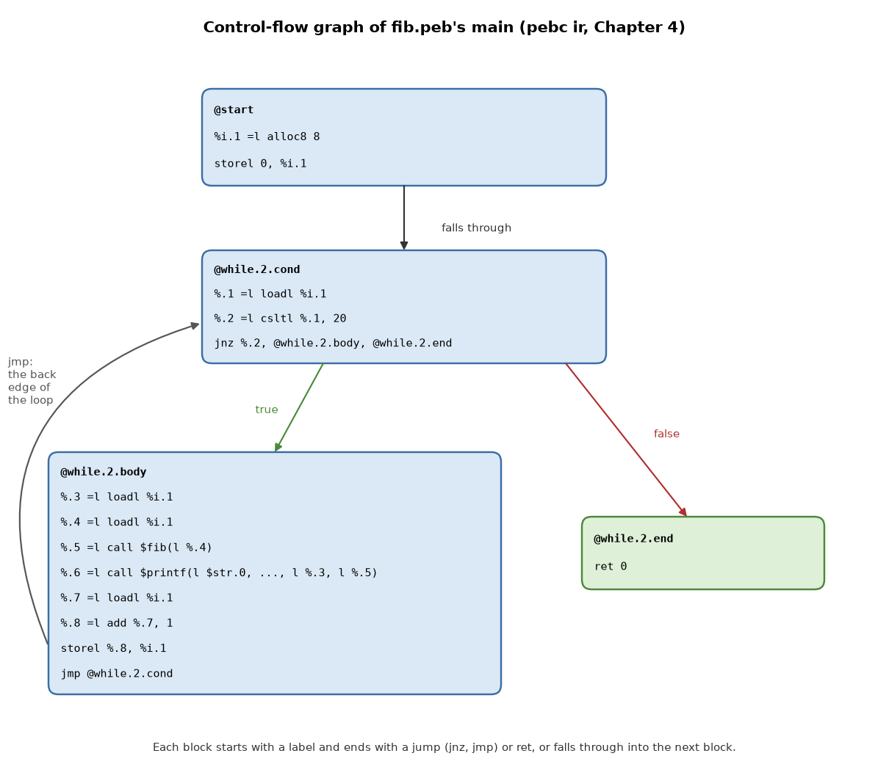

# Chapter 4 — Statements and Functions

At the end of Chapter 3 a Pebble program was one expression, and the compiled program printed
its value. This chapter turns Pebble into a language you can write real programs in. It adds
functions, `extern fn` declarations for C library functions (including the variadic `printf`),
`let` and `var`, assignment, `if`/`else`, `while`, `break`, `continue`, `return`, blocks,
string literals, and `&&`/`||` that really short-circuit. Pebble has no types yet: every value
is a 64-bit integer, the way every value in B was a machine word.

Three compiler techniques come with these features. The parser grows a recursive-descent layer
for statements and learns to **recover** after a syntax error, so that one run reports every
mistake. The code generator puts every variable in a **stack slot** and leaves QBE to move it
into a register. And `if`, `while`, `&&` and `||` become **control flow**: labelled blocks joined
by `jnz` and `jmp`.

Previous: [Chapter 3](03-parsing-expressions.md). Next: [Chapter 5](05-names-and-types.md).

Commands in this chapter run in `project/ch04`, except the `make` commands, which run in
`examples/ch04`. Its Makefile builds pebc first when it needs it.

## A program is a list of declarations

Here is the program this chapter's compiler is built to handle, `samples/fib.peb`:

```
// The first 20 Fibonacci numbers, the slow recursive way.
extern fn printf(format, ...);

fn fib(n) {
    if n < 2 {
        return n;
    }
    return fib(n - 1) + fib(n - 2);
}

fn main() {
    var i = 0;
    while i < 20 {
        printf("fib(%ld) = %ld\n", i, fib(i));
        i = i + 1;
    }
}
```

At the top level a file holds only declarations, and the only kind of declaration so far is a
function. A function either has a body, or it is `extern`: declared here and defined somewhere
else, in this case the C library. Parameters have names but no types. The tree says exactly that:

```zig
// project/ch04/src/ast.zig (excerpt)
/// A whole source file: a list of declarations.
pub const Program = struct {
    decls: []Decl,
};

pub const Decl = union(enum) {
    func: *Func,
};

/// `fn name(a, b) { ... }` or `extern fn name(a, ...);`
pub const Func = struct {
    name: []const u8,
    name_span: Span,
    params: []Param,
    /// The parameter list ends with `...` (only allowed on extern functions).
    variadic: bool,
    /// null for an extern function, which is defined somewhere else (in libc).
    body: ?Block,
};
```

`Decl` is a union with one member. That looks silly now, but Chapter 6 adds global variables
and Chapter 7 adds `struct` declarations. With a union, each new kind of declaration is
one more member, and Zig's exhaustive `switch` points at every place that has to handle it.

`body: ?Block` uses an optional rather than a separate `is_extern` flag, so "extern" and "has no
body" can't disagree. `name_span` and `Param.span` are there for error messages: when a call has
the wrong number of arguments, pebc points at the function's name in its declaration.

The grammar is at the top of `parser.zig`, in the EBNF style from Chapter 3. `{ x }` means zero
or more `x`, and `[ x ]` means an optional `x`:

```
program   = { decl } EOF
decl      = "fn" NAME params block
          | "extern" "fn" NAME params ";"
params    = "(" [ param { "," param } [ "," "..." ] ] ")"
block     = "{" { stmt } "}"
stmt      = ("let" | "var") NAME "=" expr ";"
          | "if" expr block [ "else" ( block | if-stmt ) ]
          | "while" expr block
          | "break" ";" | "continue" ";"
          | "return" [ expr ] ";"
          | block
          | expr [ "=" expr ] ";"
```

Two choices here follow Go and Rust and differ from C. First, the condition of `if` and `while`
has no parentheses. Second, the body must be a block, so `if x > 0 return 1;` is an error. The
braces are what let the parser drop the parentheses: in C, `if (x) -y;` needs the `)` to show
where the condition ends. In Pebble the condition ends at the `{`. Mandatory braces also rule out
C's "dangling else" ambiguity: every `else` belongs to the block just before it.

`function` in `parser.zig` follows the `decl` and `params` rules one token at a time.
Only `extern` functions may be variadic, because a Pebble function body would have no way to
read the extra arguments. C does that with `va_arg`, and Pebble has nothing like it. The `...`
token itself has been in the lexer since Chapter 2 (`lexer.zig` is unchanged in this chapter),
which is why the punctuation table lists `"..."` before `"."`.

## Statements

A statement is a tagged union, like an expression:

```zig
// project/ch04/src/ast.zig (excerpt)
pub const Stmt = struct {
    span: Span,
    kind: Kind,

    pub const Kind = union(enum) {
        let: Let,
        assign: Assign,
        expr: *Expr,
        @"if": If,
        @"while": While,
        @"break",
        @"continue",
        @"return": ?*Expr,
        block: Block,
    };
    // ... Let, Assign, If and While: one struct each ...
};
```

`if`, `while`, `break`, `continue` and `return` are Zig keywords, so the member names are
written `@"if"` and so on. `break` and `continue` carry no data (a `void` member). `return`
carries an optional expression, because `return;` is allowed.

The parser is the same recursive descent as Chapter 3's: look at the first token and pick a
rule. Each keyword starts exactly one kind of statement, and anything else must be an expression:

```zig
// project/ch04/src/parser.zig (excerpt)
    fn statement(p: *Parser) Error!*ast.Stmt {
        const first = p.peek();
        switch (first.tag) {
            .kw_if => return p.ifStatement(),
            // ... let, var, while, break, continue, return and { block } ...
            else => {
                const e = try p.parseExpr();
                if (p.peek().tag == .equal) {
                    _ = p.advance();
                    const value = try p.parseExpr();
                    const semi = try p.expect(.semicolon, "';'");
                    return p.newStmt(e.span.to(semi.span), .{ .assign = .{ .target = e, .value = value } });
                }
                const semi = try p.expect(.semicolon, "';'");
                return p.newStmt(e.span.to(semi.span), .{ .expr = e });
            },
        }
    }
```

Look at the last case. An assignment and an expression statement both start with an expression,
and the parser can't tell which one it has until it reaches the `=` (or the `;`). So it parses an
expression first and then looks at the next token. The left side of `=` is therefore any
expression, including nonsense like `1 + 2 = 3`. The parser doesn't reject that, because it has
no idea yet what the left side means. Later, the code generator checks that the target is
something it can store into, and reports `cannot assign to this expression` if not. In Chapters
6 and 7 the allowed targets grow to `*p`, `a[i]` and `p.x`, and this part of the parser doesn't
change at all.

The precedence table explains why `=` is not an operator in Pebble. In C, `=` is the loosest
binary operator, so `if (x = 0)` is legal and assigns. In Pebble `=` only appears at statement
level, so `if x = 0 { }` is a syntax error.

`else if` doesn't need a rule of its own. After `else`, `ifStatement` checks for the `if` keyword
and, if it is there, calls itself to parse the else branch. That is why `If.@"else"` is a `?*Stmt`
and not a `?Block`. The `pebc ast` command now prints whole programs, with one statement per line,
indented by depth. Here it is on `tests/ast/statements.peb` (open the file next to it):

```console
$ cd project/ch04
$ zig build
$ zig-out/bin/pebc ast tests/ast/statements.peb
(extern fn printf (format ...))
(fn sign (n)
  (if (< n 0)
    (block
      (return (- 1)))
    (if (== n 0)
      (block
        (return 0))
      (block
        (return 1)))))
(fn main ()
...
```

The `else if` chain shows up as an `if` nested in the else position of another `if`. `-1` is
`(- 1)`: Pebble has no negative literals, only a prefix minus applied to `1`.

## When the parser meets an error

Chapter 3's parser stopped at the first error. That was fine for one-line programs, but with
whole files it means fix one mistake, recompile, find the next. A compiler should report as many
real errors as it can in one run. The standard technique is **panic-mode recovery**. When a rule
fails, report the error, throw away tokens until a point where parsing can sensibly start again
(a **synchronisation point**), and carry on from there.

pebc has two levels of synchronisation point. Inside a block it is the next statement. At the top
level it is the next declaration. The loop in `block` remembers the token index where each statement
starts, and when `statement` returns `error.ParseError` it calls `skipToStatement(start)` and goes
round again. `parseProgram` does the same with `skipToDeclaration`. Its return type is now
`error{OutOfMemory}!ast.Program`: a syntax error is no longer an error *of the function*. It is a
diagnostic in `diags`, and `main.zig` checks `diags.hasErrors()` before using the tree. The broken
statement is simply not added to `stmts`, so the tree that comes back is incomplete but well-formed.

Where to stop skipping is the whole art:

```zig
// project/ch04/src/parser.zig (excerpt)
    /// Error recovery inside a block: skip past the next `;` or `{...}`
    /// group, or up to a `}` or a keyword that starts a statement. `start`
    /// is where the broken statement began; we always skip at least one
    /// token so that we can't get stuck on the same error forever.
    fn skipToStatement(p: *Parser, start: usize) void {
        if (p.index == start) p.skipTokenOrGroup();
        while (true) switch (p.peek().tag) {
            .semicolon => {
                _ = p.advance();
                return;
            },
            // A block ends the broken statement, as in `if x > { ... }`.
            .l_brace => {
                p.skipTokenOrGroup();
                return;
            },
            .r_brace, .eof, .kw_let, .kw_var, .kw_if, .kw_while, .kw_return, .kw_break, .kw_continue => return,
            else => _ = p.advance(),
        };
    }
```

Each case has a reason:

- **`;` ends a statement**, so consume it and start fresh after it.
- **`{` starts a group** that belongs to the broken statement (the body of a broken `if`, say).
  `skipTokenOrGroup` counts brace depth and skips the whole `{ ... }`, nested braces included.
  Otherwise the body's statements would be parsed as if they stood on their own, and its `}`
  would close the *function*.
- **`}` and end of file** are left alone, so that `block` sees its closing brace.
- **A statement keyword** means a new statement starts here, probably because the broken one
  was missing its `;`.

The first line guarantees progress. Chapter 3 made `primary` leave a bad token where it is ("error
recovery decides what to skip"), so a statement can fail without consuming anything. If it fails
on a token that `skipToStatement` would stop at (a stray `else`, say), the loop would parse the
same statement again and fail the same way, forever. Skipping at least one token makes that
impossible. `skipToDeclaration` is simpler: skip at least one token, then stop at `fn`, `extern`
or the end of the file.

Here is `tests/errors/recovery.peb`, which has five mistakes:

```
// One run reports every syntax error, not just the first.
fn main() {
    let x = ;
    var y = 2
    if x > { y = 1; }
    return x +;
}

fn helper(a, b {
    return a;
}

fn ok() {
    return 1;
}
```

```console
$ zig-out/bin/pebc ir tests/errors/recovery.peb
tests/errors/recovery.peb:3:13: error: expected an expression, found ';'
    let x = ;
            ^
tests/errors/recovery.peb:5:5: error: expected ';', found 'if'
    if x > { y = 1; }
    ^~
tests/errors/recovery.peb:5:12: error: expected an expression, found '{'
    if x > { y = 1; }
           ^
tests/errors/recovery.peb:6:15: error: expected an expression, found ';'
    return x +;
              ^
tests/errors/recovery.peb:9:16: error: expected ')', found '{'
fn helper(a, b {
               ^
$ echo $?
1
```

Follow the recovery step by step:

1. `let x = ;` fails at the `;`, which `primary` doesn't consume. `skipToStatement` consumes the
   `;` and the parser starts again at `var`.
2. `var y = 2` has no `;`. The parser notices only when it sees the next token, so the error
   points at `if` on line 5, not at the end of line 4. Recovery stops at the `if` keyword
   without skipping anything. GCC does the same: given C with the same mistake, it reports
   `error: expected ‘,’ or ‘;’ before ‘if’` at the `if` on the next line.
3. `if x > {` fails at the `{`. Recovery skips the whole group `{ y = 1; }`, so the `}` there
   doesn't end `main`.
4. `return x +;` fails at the `;`, which is consumed. The `}` on line 7 then closes `main`.
5. `fn helper(a, b {` fails while parsing the parameters. That is a declaration-level error, so
   `skipToDeclaration` throws away all of `helper` up to `fn ok`, and `ok` parses cleanly.

Each of the five errors is a real mistake, and each is reported once. The unit test
`"statements recover after an error"` in `parser.zig` checks a smaller version: three broken
statements give exactly three errors, and both functions are still in the tree.

Recovery is a guess, though, and simple recovery guesses wrong sometimes. Here is
`examples/ch04/cascade.peb`, which forgets one `{`:

```
fn main() {
    var y = 0;
    if y > 1
        y = 2;
    }
    return y;
}
```

```console
$ make cascade
cd ../../project/ch04 && zig build
../../project/ch04/zig-out/bin/pebc ir cascade.peb
cascade.peb:4:9: error: expected '{', found a name
        y = 2;
        ^
cascade.peb:6:5: error: expected a declaration, found 'return'
    return y;
    ^~~~~~
make: [Makefile:36: cascade] Error 1 (ignored)
```

The first error is right. To recover, the parser skips to the `;` after `y = 2`. Then the `}`
meant to close the `if` closes `main` instead, and `return y;` lands at the top level, where it
is "expected a declaration". The second error is a **cascade**: a consequence of the parser's
wrong guess, not a second mistake, and fixing the first error makes it go away. Real compilers
spend a lot of code on heuristics against cascades and still produce some. Hence the rule for
compiler users: read the first error first.

## From tree to IL: variables live in memory

A variable can be assigned in a loop, or on one branch of an `if` and not the other. That
doesn't fit SSA form, where every temporary is assigned exactly once (Chapter 1). There are two
ways out, and the QBE documentation names both:

> First and foremost, phi instructions are NOT necessary when writing a frontend to QBE. One
> solution to avoid having to deal with SSA form is to use stack allocated variables for all
> source program variables and perform assignments and lookups using Memory operations. This is
> what LLVM users typically do.

The other way is to assign temporaries more than once, which QBE also accepts (Chapter 1's
`fact.ssa` did it). pebc uses memory for variables because it is the easiest thing to get right.
Every variable gets an 8-byte stack slot made by `alloc8`. A `let` stores into it with `storel`,
and a use loads from it with `loadl`:

```zig
// project/ch04/src/codegen.zig (excerpt)
    /// Makes a stack slot for a new variable.
    fn declare(g: *CodeGen, name: []const u8, span: Span, mutable: bool) Error!Local {
        const local: Local = .{ .name = name, .span = span, .mutable = mutable, .id = g.nextId() };
        try g.locals.append(g.arena, local);
        try g.allocs.writer.print("\t{f} =l alloc8 8\n", .{local});
        return local;
    }
```

A slot is named after the variable plus a unique number, `%i.1`, so that two variables called
`x` in different scopes get different slots. Temporaries are `%.1`, `%.2`, ...: a Pebble name
can't start with a dot, so the two never clash.

The `alloc8` goes into a separate buffer, `g.allocs`, not into the function's code.
`genFunction` writes all the allocs right after `@start`, before any code. The reason is a QBE
rule that isn't enforced. An `alloc` anywhere else is legal, but it runs every time control
passes through it. Put one inside a loop and the stack grows on every iteration.
`examples/ch04/alloc.ssa` does exactly that:

```
# An alloc8 inside a loop is legal, but the stack grows on every iteration.
export function w $main() {
@start
	%i =l copy 0
@loop
	%p =l alloc8 8
	storel %i, %p
	%i =l add %i, 1
	%c =l csltl %i, 3
	jnz %c, @loop, @end
@end
	ret 0
}
```

```console
$ make alloc
qbe alloc.ssa | sed -n '/^main:/,/end function/p'
...
.Lbb2:
	subq $16, %rsp
	movq %rsp, %rcx
	movq %rax, (%rcx)
	addq $1, %rax
	cmpq $3, %rax
	jl .Lbb2
...
```

`subq $16, %rsp` is inside the loop: a `let` in a loop body that ran a million times would use
16 MB of stack and crash. A slot made in `@start` is made once per call, wherever the variable
is declared.

Parameters arrive in temporaries named after them (`%n`). `genFunction` first copies each one
into a slot (`storel %n, %n.1`), so a parameter can be assigned like any `var`. If the body can
fall off its end, it adds `ret 0`.

Here is the IL for `fib`, from the test program `tests/run/fib.peb` (the same `fib` as in the
sample):

```console
$ zig-out/bin/pebc ir tests/run/fib.peb
function l $fib(l %n) {
@start
	%n.1 =l alloc8 8
	storel %n, %n.1
	%.1 =l loadl %n.1
	%.2 =l csltl %.1, 2
	jnz %.2, @if.2.then, @if.2.end
@if.2.then
	%.3 =l loadl %n.1
	ret %.3
@if.2.end
	%.4 =l loadl %n.1
	%.5 =l sub %.4, 1
	%.6 =l call $fib(l %.5)
	%.7 =l loadl %n.1
	%.8 =l sub %.7, 2
	%.9 =l call $fib(l %.8)
	%.10 =l add %.6, %.9
	ret %.10
}
...
```

It is naive: four loads of `n`, which never changes. That is fine, because QBE removes them.
Compile and look at the assembly (`pebc build` leaves `fib.s` next to the executable):

```console
$ zig-out/bin/pebc build tests/run/fib.peb -o fib && ./fib
0 1 1 2 3 5 8 13 21 34 55 89 144 233 377 610 
$ sed -n '/^fib:/,/end function/p' fib.s
fib:
	pushq %rbp
	movq %rsp, %rbp
	subq $8, %rsp
	pushq %rbx
	movq %rdi, %rbx
	cmpq $2, %rbx
	jl .Lbb2
	movq %rbx, %rdi
	subq $1, %rdi
	callq fib
	xchgq %rax, %rbx
	movq %rax, %rdi
	subq $2, %rdi
	callq fib
	addq %rbx, %rax
	jmp .Lbb3
.Lbb2:
	movq %rbx, %rax
.Lbb3:
	popq %rbx
	leave
	ret
```

There is **no memory access left**: no `(%rbp)` addressing anywhere. QBE noticed that the slot
`%n.1` is only ever loaded from and stored to, and that its address never escapes. So it
promoted the slot to a register, `%rbx`, and every `loadl %n.1` became a use of `%rbx`. This is
the same idea as LLVM's `mem2reg` pass, and it is why front ends can afford to be simple.
(Exercise 4 asks what the `xchgq` is for.) `pebc build` leaves `fib.ssa` and `fib.s` next to the
executable; delete all three when you are done.

The promotion stops working in Chapter 6, when `&x` lets a variable's address escape. Then the
slot really has to be in memory, and it will be.

## Names and scopes

Every use of a name has to be **resolved**: which declaration does this `x` mean? Pebble scopes
are lexical and nest with blocks, and an inner declaration **shadows** an outer one. pebc keeps a
stack of the variables in scope, `g.locals`. `declare` pushes. A block remembers the height of
the stack and cuts it back on the way out: `genBlock` does that with
`defer g.locals.shrinkRetainingCapacity(scope_start)`. `lookup` searches the stack:

```zig
// project/ch04/src/codegen.zig (excerpt)
    fn lookup(g: *CodeGen, name: []const u8) ?Local {
        // Search from the innermost scope outwards, so inner variables
        // shadow outer ones.
        var i = g.locals.items.len;
        while (i > 0) {
            i -= 1;
            if (std.mem.eql(u8, g.locals.items[i].name, name)) return g.locals.items[i];
        }
        return null;
    }
```

A linear search backwards is the simplest symbol table there is. Functions have a few dozen
variables at most, and the search finds the innermost match first, which is what shadowing
means. The stack only has to be right *while* the code generator walks the tree: once a block
is done, its slots live on in `@start`, but no name refers to them any more.

`tests/run/scopes.peb` shadows a `let` inside a block:

```
    let x = 1;
    {
        let x = x + 10;
        printf("inner %ld\n", x);
    }
    printf("outer %ld\n", x);
```

The first lines of its IL show the two `x`s with different slots:

```
	%x.1 =l alloc8 8
	%x.2 =l alloc8 8
	...
	storel 1, %x.1
	%.1 =l loadl %x.1
	%.2 =l add %.1, 10
	storel %.2, %x.2
	%.3 =l loadl %x.2
	%.4 =l call $printf(l $str.0, ..., l %.3)
	%.5 =l loadl %x.1
	%.6 =l call $printf(l $str.1, ..., l %.5)
```

In `let x = x + 10;` the `x` on the right is the *outer* one (`loadl %x.1`), and the program
prints `inner 11` and `outer 1`. That follows from the order in `genStmt`: generate the value
first, *then* declare the new variable. Rust has the same rule, and C does it the other way
round. In C, `int x = x + 10;` inside a block reads the new, uninitialised `x`, because its
scope starts at its own declarator.

The code generator also enforces `let`. `assignable` looks up the target of `=` and, if it was
declared with `let`, reports an error plus a **note**: a second diagnostic that points
somewhere else, here at the declaration, where the fix goes. `tests/errors/names.peb` makes four
name mistakes:

```console
$ zig-out/bin/pebc ir tests/errors/names.peb
tests/errors/names.peb:5:5: error: cannot assign to 'count', which was declared with 'let'
    count = count + 1;
    ^~~~~
tests/errors/names.peb:4:9: note: use 'var' here to make it a variable
    let count = 1;
        ^~~~~
tests/errors/names.peb:6:21: error: unknown name 'cuont'
    printf("%ld\n", cuont);
                    ^~~~~
tests/errors/names.peb:7:5: error: 'printf' is a function, not a variable
    printf = 3;
    ^~~~~~
...
```

The code generator recovers too. `genStmts` catches `error.CodegenError` from each statement
and goes on to the next, and `genProgram` does the same for each function. The IL is thrown
away anyway once there is an error. One detail avoids a cascade. If the value of a `let` has an
error, `genStmt` still declares the variable before returning the error. Otherwise every later
use of it would be one more "unknown name".

Name resolution in the *code generator* is a stopgap. In Chapter 5, types need the same
information, so resolution moves into a separate checker phase, and the code generator gets a
tree in which every name is already known to be fine.

## Control flow: labels, `jnz` and `jmp`

QBE has no `if` or `while`. A function is a list of **blocks**, and the QBE documentation
describes them precisely:

> All blocks have a name that is specified by a label at their beginning. Then follows a sequence
> of instructions that have "fall-through" flow. Finally one jump terminates the block.

Structured control flow becomes blocks and jumps. An `if` without `else` is a conditional jump
over the "then" block:

```zig
// project/ch04/src/codegen.zig (excerpt)
            .@"if" => |i| {
                const id = g.nextId();
                const cond = try g.genCond(i.cond);
                const no = if (i.@"else" != null) "else" else "end";
                try g.emit("jnz {f}, @if.{d}.then, @if.{d}.{s}", .{ cond, id, id, no });
                try g.label("@if.{d}.then", .{id});
                try g.genBlock(i.then);
                if (i.@"else") |else_branch| {
                    try g.emit("jmp @if.{d}.end", .{id});
                    try g.label("@if.{d}.else", .{id});
                    try g.genStmt(else_branch);
                }
                try g.label("@if.{d}.end", .{id});
            },
            .@"while" => |w| {
                const id = g.nextId();
                try g.label("@while.{d}.cond", .{id});
                const cond = try g.genCond(w.cond);
                try g.emit("jnz {f}, @while.{d}.body, @while.{d}.end", .{ cond, id, id });
                try g.label("@while.{d}.body", .{id});
                try g.loops.append(g.arena, id);
                try g.genBlock(w.body);
                _ = g.loops.pop();
                try g.emit("jmp @while.{d}.cond", .{id});
                try g.label("@while.{d}.end", .{id});
            },
```

Every `if` and `while` takes a fresh number from `nextId` (the same counter as the slots), so
nested statements get distinct labels. The "then" block of an `if` without `else` doesn't jump
to `@if.N.end`. It doesn't have to, because QBE adds a jump to the next block when a block runs
off its end ("fall-through"). The CFG of `fib.peb`'s `main` shows all four blocks of a `while`.
The test `i < 20` is at the top, and the body ends with a jump back to it:



`break` and `continue` need to know which loop they are in. The code generator keeps a stack,
`g.loops`, of the label numbers of the enclosing loops. `break` jumps to the innermost loop's
`.end`, and `continue` to its `.cond`:

```zig
// project/ch04/src/codegen.zig (excerpt)
            .@"break" => {
                const id = g.loops.getLastOrNull() orelse return g.fail(s.span, "'break' outside of a loop", .{});
                try g.emit("jmp @while.{d}.end", .{id});
            },
```

Outside any loop the stack is empty, and `break` reports `'break' outside of a loop`
(`tests/errors/loops.peb`).

`tests/run/primes.peb` uses `while true`, `break` and `continue` in two nested loops. In its IL,
`break` inside the inner loop is `jmp @while.6.end`, and `continue` in the outer loop is
`jmp @while.2.cond`. The condition `true` becomes `jnz 1, @while.2.body, @while.2.end`, a jump
whose answer QBE knows at compile time.

### Code after a jump needs a label

What about a statement after `return`? `scopes.peb` ends with `return 0;` and then
`printf("never printed\n");`, which can never run. A naive code generator would write the `call`
right after the `ret`, and QBE would refuse: a block ends with its jump, and the next thing must
be a label. To see the error, go to `examples/ch04`, take `jnz.ssa` (shown below) and delete its `@dead.1` label line:

```console
$ grep -v '^@dead.1' jnz.ssa > nolabel.ssa
$ qbe nolabel.ssa > /dev/null
qbe:nolabel.ssa:11: label or } expected
```

The code generator tracks whether the current block is still open. `emit`, which writes one
instruction, closes it after any `jmp`, `jnz` or `ret`, and `label` opens a new one. Before
writing an instruction into a closed block, `ensureBlock` makes up a label:

```zig
// project/ch04/src/codegen.zig (excerpt)
    /// Code after `return`, `break` or `continue` can never run, but QBE
    /// still wants it in a block of its own.
    fn ensureBlock(g: *CodeGen) Error!void {
        if (!g.block_open) try g.label("@dead.{d}", .{g.nextId()});
    }
```

`emit` decides whether an instruction ends the block by looking at its format string at compile time
(`comptime std.mem.startsWith(u8, fmt, "jmp")`, and so on). The end of `scopes.peb`'s IL shows the
result:

```
@if.4.end
	%.11 =l call $putchar(l 10)
	ret 0
@dead.5
	%.12 =l call $printf(l $str.2, ...)
	ret 0
}
```

Nothing jumps to `@dead.5`, so QBE drops the block. The assembly has no call for the `printf` (only
the string `str.2` is still there, in the data section). The second `ret 0` comes from
`genFunction`: the block was open at the end of the function, so falling off the end returns 0.
Exercise 3 turns this dead code into a warning.

### The `jnz` trap

`scopes.peb` also has `var big = 4294967296;` (2^32), then `if big` prints `y` or `n`. That test
is there because of a QBE detail that is easy to miss. The documentation of `jnz` says:

> When its word argument is non-zero, it jumps to its first label argument; otherwise it jumps
> to the other.

A *word* is 32 bits. Given a 64-bit `l` value, `jnz` looks only at the low 32 bits, and the low
32 bits of 2^32 are all zero. `examples/ch04/jnz.ssa` shows it with no compiler in the way:

```
data $fmt = { b "big=%ld", b 10, b 0 }
export function w $main() {
@start
	%x.1 =l alloc8 8
	storel 4294967296, %x.1
	%t1 =l loadl %x.1
	jnz %t1, @yes, @no
@yes
	call $printf(l $fmt, ..., l 1)
	ret 3
@dead.1
	%t2 =l add 1, 2
@no
	call $printf(l $fmt, ..., l 0)
	%t3 =l copy 7
	ret %t3
}
```

```console
$ make
qbe -o jnz.s jnz.ssa
cc -o jnz jnz.s
./jnz; echo "exit $?"
big=0
exit 7
```

A non-zero value took the "false" branch. QBE didn't even wait for run time: it propagated the
constant, decided the branch at compile time, and threw `@yes` away. `qbe jnz.ssa` shows a
`main` with a single `callq printf`, preceded by `movl $0, %esi` (the argument 0) and followed
by `movl $7, %eax` (the exit status). The `@dead.1` block shows the label rule: it follows a
`ret`, so it needs a label of its own. Nothing jumps to it, so it is gone from the assembly too.

So pebc never hands `jnz` a raw value. It branches on a comparison instead, which is always
exactly 0 or 1:

```zig
// project/ch04/src/codegen.zig (excerpt)
    /// Computes a condition as 0 or 1. `jnz` only looks at the low 32 bits
    /// of its argument, so a 64-bit value like 1 << 32 must be compared
    /// with 0 first.
    fn genCond(g: *CodeGen, e: *const Expr) Error!Value {
        const v = try g.genExpr(e);
        const is_0_or_1 = switch (e.kind) {
            .bool => true,
            .unary => |u| u.op == .not,
            .binary => |b| b.op.isComparison() or b.op == .@"and" or b.op == .@"or",
            else => false,
        };
        if (is_0_or_1) return v;
        return g.result("cnel {f}, 0", .{v});
    }
```

When the expression is already a comparison (`n < 2`), `genCond` uses it directly and costs
nothing. Otherwise it adds `cnel v, 0` ("not equal, long"). `examples/ch04/big.peb` is the same
test in Pebble:

```console
$ make run-big
cd ../../project/ch04 && zig build
../../project/ch04/zig-out/bin/pebc build big.peb -o big
./big
big=1
$ grep -A2 'loadl %big' big.ssa
	%.1 =l loadl %big.1
	%.2 =l cnel %.1, 0
	jnz %.2, @if.2.then, @if.2.else
$ make clean
rm -f jnz jnz.s nolabel.ssa big big.ssa big.s status status.ssa status.s
```

This is the sort of bug a compiler can carry for years: only numbers with zero low bits trigger
it, and only when they are used directly as conditions. A test for exactly that case is cheap,
which is why it is in `scopes.peb`.

## Short circuit: `&&` and `||` are control flow

In Chapter 3, `a && b` computed both sides and combined them. That gives the right *value*
but the wrong *behaviour*: `b` must not run at all when `a` is false. In `p != 0 && *p > 0`,
running the right side when `p` is 0 would crash. So `&&` and `||` are really little `if`
statements that produce a value:

```zig
// project/ch04/src/codegen.zig (excerpt)
    fn genLogical(g: *CodeGen, b: Expr.Binary) Error!Value {
        const id = g.nextId();
        const name = @tagName(b.op);
        const result_temp = g.newTemp();
        const lhs = try g.genCond(b.lhs);
        try g.emit("{f} =l copy {f}", .{ result_temp, lhs });
        if (b.op == .@"and") {
            try g.emit("jnz {f}, @and.{d}.rhs, @and.{d}.end", .{ lhs, id, id });
        } else {
            try g.emit("jnz {f}, @or.{d}.end, @or.{d}.rhs", .{ lhs, id, id });
        }
        try g.label("@{s}.{d}.rhs", .{ name, id });
        const rhs = try g.genCond(b.rhs);
        try g.emit("{f} =l copy {f}", .{ result_temp, rhs });
        try g.label("@{s}.{d}.end", .{ name, id });
        return result_temp;
    }
```

The result is the left side's truth value (0 or 1, from `genCond`). If that doesn't decide the
answer (true for `&&`, false for `||`), the right side's truth value replaces it.
`tests/run/short_circuit.peb` makes each operand announce itself:

```
fn say(name, value) {
    printf("%s ", name);
    return value;
}

// in main:
    printf("= %ld\n", say("a", 1) && say("b", 0) && say("c", 1));
    printf("= %ld\n", say("a", 0) || say("b", 7) || say("c", 1));
    printf("= %ld\n", say("a", 0) && say("b", 1) || say("c", 1));
```

```console
$ zig-out/bin/pebc build tests/run/short_circuit.peb -o sc && ./sc
a b = 0
a b = 1
a c = 1
$ rm sc sc.s sc.ssa
```

`c` is skipped in the first line, because `a && b` is already false. In the second line, `b`
returns 7 and `||` gives 1, not 7: Pebble's logical operators produce 0 or 1, like C's and
unlike Python's. Here is the IL for the first line:

```
	%.3 =l call $say(l $str.2, l 1)
	%.4 =l cnel %.3, 0
	%.2 =l copy %.4
	jnz %.4, @and.2.rhs, @and.2.end
@and.2.rhs
	%.5 =l call $say(l $str.3, l 0)
	%.6 =l cnel %.5, 0
	%.2 =l copy %.6
@and.2.end
	%.1 =l copy %.2
	jnz %.2, @and.1.rhs, @and.1.end
...
```

`a && b && c` is `(a && b) && c`, so the inner `&&` (id 2) is generated inside the outer one
(id 1). Look at `%.2`: it is assigned twice, on two different paths. That isn't SSA, and pebc
doesn't care. The documentation sentence after the one quoted earlier is:

> Another solution is to simply emit code that is not in SSA form! Contrary to LLVM, QBE is able
> to fixup programs not in SSA form without requiring the boilerplate of loading and storing in
> memory.

QBE builds the SSA form itself and inserts the **phi** at `@and.2.end` that picks the right
`%.2` depending on which block control came from. pebc never writes a `phi`. Variables could
have used this trick too, but slots work for every case, including the address-taking of
Chapter 6, and QBE promotes them anyway.

## Calls and the C library

A call evaluates its arguments left to right, then emits one `call`. Since every value is an
`l`, every argument is `l` and so is every result. For a variadic function, the call writes
`...` before the first argument beyond the `n` declared parameters (or at the end, if there
are none). QBE's `...` marks where the variadic arguments start,
and it matters on x86-64. A variadic C function expects `%al` to hold the number of vector
registers used for arguments (an upper bound, to be exact). QBE sets it (`movl $0, %eax`
before `callq printf` in the assembly above) only for calls that it knows are variadic. Without
the `...`, `%al` would hold whatever was left in it.

pebc has no `extern` in its IL: QBE doesn't need one. A `$printf` that isn't defined in the
file is just a symbol, and the linker finds it in libc when `cc` links the program. So an
`extern fn` declaration exists only for pebc's benefit. It says that the name is a function, how
many arguments it takes, and whether it is variadic.

String literals become data. `writeStringData` writes printable runs in quotes and everything
else as numbers, followed by the terminating zero that C expects:

```console
$ zig-out/bin/pebc ir tests/run/hello.peb
export function w $main() {
@start
	%.1 =l call $printf(l $str.0, ...)
	%.2 =l call $printf(l $str.1, ..., l $str.2, l 6)
	ret 0
}

data $str.0 = { b "Hello, world!", b 10, b 0 }
data $str.1 = { b "%s has %ld letters", b 10, b 0 }
data $str.2 = { b "Pebble", b 0 }
```

A string expression's value is its address, `$str.N`, which is an `l` like everything else. The
first call has no variadic arguments, so the `...` comes last. Every literal gets its own data
item, even when two are equal (`short_circuit.peb` has three copies of `"a"`). Merging them
would be easy, but it isn't needed.

Function names are collected in a first pass over the declarations, before any code is
generated. That lets `main` call a function defined below it, and it catches duplicates.
Argument counts are checked at each call, with a note pointing at the declaration:

```console
$ zig-out/bin/pebc ir tests/errors/calls.peb
tests/errors/calls.peb:8:5: error: 'add' takes 2 arguments, but 1 was given
    add(1);
    ^~~~~~
tests/errors/calls.peb:3:4: note: 'add' is declared here
fn add(a, b) {
   ^~~
...
```

The rest of the file checks `printf()` ("takes at least 1 argument, but 0 were given") and calling a
variable. The message is grammatical ("1 was", "0 were") because the format arguments include the
plural endings. A compiler's messages are its user interface. These are cheap to get right, and they
are tested by the golden files, so they stay right.

What pebc can't check is *what* the arguments are. `add("one", 2)` compiles and adds an address
to 2. Chapter 5 adds types, and with them the checks that catch this.

## `main` and the exit status

`main` is special in three ways. It must exist, it must have a body, and it takes no
parameters. These rules are checked in the first pass:

```console
$ zig-out/bin/pebc ir tests/errors/no_main.peb
tests/errors/no_main.peb:7:4: error: 'helper' is already declared
fn helper() {
   ^~~~~~
tests/errors/no_main.peb:3:4: note: the first declaration is here
fn helper() {
   ^~~~~~
tests/errors/no_main.peb:1:1: error: the program has no 'main' function
extern fn puts(s);
^
```

A missing `main` has no place in the source to point at, so the error goes at 1:1.

`main` is also generated differently. Other functions are `function l $f(...)`, local to the
file. `main` is `export function w $main()`: exported so that the C runtime can find it, and
returning `w` because C's `main` returns an `int`. Its return value becomes the process's exit
status, and falling off the end returns 0, which is why every program so far exits with 0.

Returning a 64-bit value from a function declared `w` keeps the low 32 bits, and the operating
system then keeps only the low 8 bits of those (`return 300;` exits with 44).
`examples/ch04/status.peb` returns a number bigger than 32 bits:

```
fn main() {
    let x = 4294967338;
    return x;
}
```

```console
$ make status
cd ../../project/ch04 && zig build
../../project/ch04/zig-out/bin/pebc build status.peb -o status
status.s: Assembler messages:
status.s:6: Warning: 0x000000010000002a shortened to 0x000000000000002a
./status; echo "exit $?"
exit 42
```

4294967338 is 2^32 + 42, so the low 32 bits are 42. QBE propagated the constant into
`movl $4294967338, %eax` (line 6 of `status.s`), and the assembler warns that the number doesn't
fit in a 32-bit `movl`. The exit status is right, but a compiler shouldn't make the assembler
complain. In Chapter 5, `main` returns `i32` or nothing, and a 64-bit value must be converted
explicitly with `as`.

## The project at the end of the chapter

Every front-end file changed. `ast.zig` (147 lines) gains `Program`, `Func`, `Block` and
`Stmt`. `parser.zig` (482) gains declarations, statements and recovery. `codegen.zig` (470)
now generates whole functions, with scopes, control flow, calls and strings. `print.zig` (140)
prints whole programs. `main.zig` (137) runs the phases one after another, stopping after any
phase that reported an error. `lexer.zig`, `diag.zig`, `driver.zig` and the golden runner are
unchanged.

The golden tests are now whole programs that print with `printf`: eight `run/` tests (`answer`,
`arithmetic`, `fib`, `fizzbuzz`, `hello`, `primes`, `scopes`, `short_circuit`), eleven
`errors/` tests and two `ast/` tests.

```console
$ cd project/ch04
$ zig build test --summary all 2>&1 | grep -v ^PASS
golden: 21 passed, 0 failed
Build Summary: 6/6 steps succeeded; 13/13 tests passed
test success
+- run test 13 pass (13 total) 7ms MaxRSS:4M
|  +- compile test debug native success 466ms MaxRSS:157M
+- run exe golden (golden) success 273ms
   +- compile exe golden debug native cached 6ms MaxRSS:39M
   +- compile exe pebc debug native cached 6ms MaxRSS:40M
$ zig build demo -Dsample=samples/fib.peb
fib(0) = 0
fib(1) = 1
fib(2) = 1
...
fib(19) = 4181
```

The thirteen unit tests are Chapter 3's eleven plus two new ones: the recovery test in
`parser.zig` and the `writeStringData` test in `codegen.zig`. (`errors/pointer.peb` checks that
`&x` gives `pebc cannot compile pointers yet`. The parser already knows pointers from Chapter 3,
and Chapter 6 teaches the code generator.)

This is the first Pebble that can compute anything interesting. It is also very close to a
historical language.

## In the wild: B, a language with one type

Every value in this chapter's Pebble is a 64-bit integer. Numbers, truth values, string addresses
and function results all share one type, and the operation decides what the bits mean. `+`
adds them, `printf`'s `%s` treats them as an address. That was exactly the design of **B**, the
language C grew out of.

Dennis Ritchie told the story in "The Development of the C Language" (HOPL-II, 1993).
Unix first ran on the PDP-7 in 1969, and soon afterwards Ken Thompson decided it needed a system
programming language. "After a rapidly scuttled attempt at Fortran", he created B. Ritchie
describes it like this:

> B can be thought of as C without types; more accurately, it is BCPL squeezed into 8K bytes of
> memory and filtered through Thompson's brain.

B kept the semantics of its parent BCPL:

> Both languages are typeless, or rather have a single data type, the 'word,' or 'cell,' a
> fixed-length bit pattern. Memory in these languages consists of a linear array of such cells,
> and the meaning of the contents of a cell depends on the operation applied.

On the word-addressed machines that BCPL and B were designed for, one type was enough. The
PDP-11 broke the model. It addressed bytes, so characters packed into words were "awkward, even
silly". It also had 16-bit words, too small to hold the floating-point numbers that were
promised for it. So in 1971 Ritchie "began to extend the B language by adding a character type",
and at the same time rewrote the compiler to produce PDP-11 machine code instead of the threaded
code of the PDP-7 B compiler. He called the result NB, "new B". Over the next two years NB grew
into C. Ritchie dates C to 1969–1973, with "the most creative period" in 1972.

This chapter's short-circuit operators have a history too. In B, `&` and `|` were bitwise in
ordinary expressions, but inside an `if` condition they short-circuited, which "was difficult
to explain and use". "At the suggestion of Alan Snyder", after the language had been named C,
Ritchie "introduced the && and || operators to make the mechanism more explicit". Chapter 3
told the precedence problem this left behind.

Pebble follows the same road as C. Chapter 5 gives every value a real type (`i64`, `i32`, `u8`,
`bool` and pointers), and with types come `w`-sized arithmetic, sign and zero extension, and
error messages when a value of one type is used where another is needed.

## Summary

- A **program** is a list of declarations. A function has a body, or is `extern` and
  defined elsewhere (`body: ?Block`); only `extern` functions may be variadic.
- **Statements** are a tagged union, parsed by recursive descent on the first token.
  Assignment is parsed as "expression, then maybe `=`", and the code generator checks the
  target. `else if` is an `if` in the `else` position.
- **Panic-mode recovery** reports an error, skips to a synchronisation point (`;`, a `{...}`
  group, `}`, a statement keyword, or the next `fn`), and continues. It must always make
  progress. Wrong guesses cause **cascades**, so read the first error first.
- Every variable lives in an **`alloc8` slot in `@start`**, used with `storel`/`loadl`. QBE
  promotes slots whose address doesn't escape to registers. An `alloc` inside a loop grows the
  stack on every iteration.
- **Scopes** are a stack of locals searched innermost-first. A `let` value is generated before
  the new name is declared. Errors carry **notes** that point at the fix.
- `if`/`while` become **labelled blocks** joined by `jnz`/`jmp`. A stack of loop labels serves
  `break`/`continue`. Code after a terminator needs a label (`@dead.N`).
- **`jnz` reads only the low 32 bits**, so conditions are compared with 0 (`cnel`) unless they
  are already 0 or 1.
- **`&&`/`||`** are control flow: a temporary assigned on two paths, and QBE builds the phi.
- **Calls** pass every value as `l`. `...` marks the variadic arguments, and strings become
  `data $str.N`. `main` is `export function w $main()`.

## Exercises

1. **`loop { ... }`.** Add an infinite loop statement, `loop { ... }`, that behaves like
   `while true { ... }`, including `break` and `continue`. Do it without changing the code
   generator. Test it with a program that adds up the odd numbers from 1 to 10 and prints `11 25`
   (the final counter and the sum).

<details><summary>Solution</summary>

Desugar it: the parser builds the tree of `while true { ... }`, and nothing after the parser
can tell the difference. Add the keyword to the lexer: `kw_loop` in `Token.Tag` (between
`kw_let` and `kw_return`, keeping the alphabetical order) and `.{ "loop", .kw_loop }` in
`keywords`. In `statement`, make the condition a `bool` literal node with the span of the keyword:

```zig
            .kw_loop => {
                // `loop { ... }` is `while true { ... }`.
                _ = p.advance();
                const cond = try p.node(first.span, .{ .bool = true });
                const body = try p.block();
                return p.newStmt(first.span.to(body.end), .{ .@"while" = .{ .cond = cond, .body = body } });
            },
```

Also add `.kw_loop` to the keywords that `skipToStatement` stops at, since `loop` starts a
statement. The test program:

```
extern fn printf(format, ...);

fn main() {
    var i = 0;
    var sum = 0;
    loop {
        i = i + 1;
        if i > 10 { break; }
        if i % 2 == 0 { continue; }
        sum = sum + i;
    }
    printf("%ld %ld\n", i, sum);
}
```

```console
$ zig-out/bin/pebc ast loop.peb | sed -n 5p
  (while true
$ zig-out/bin/pebc build loop.peb -o loop && ./loop
11 25
```

`pebc ast` shows the loop as `(while true ...)`, indistinguishable from the real thing, and the IL
starts its loop with `jnz 1, @while.3.body, @while.3.end`, exactly like `primes.peb`. All 21 golden
tests still pass. One cost: `loop` is now a keyword, so a variable can no longer be called `loop`.
Desugaring is how many real compilers handle convenience syntax. The Rust Reference defines a `for`
loop as equivalent to a `loop` containing a `match`, the reverse direction from ours.

</details>

2. **`+=` and `-=`.** Add the compound assignments `a += e` and `a -= e`. Which entries does
   the lexer's punctuation table need, and where? What would go wrong with a desugaring to
   `a = a + e` once Pebble has arrays and you write `a[f()] += 1`?

<details><summary>Solution</summary>

Two tokens in `Token.Tag` (`plus_equal` and `minus_equal`), and two entries in the punctuation
table with the other two-character tokens, *above* `"+"` and `"-"`. The table is searched in
order, so a `"+"` above `"+="` would win and the lexer would produce `+` then `=`:

```zig
// src/lexer.zig, in `punctuation`
    .{ .text = ">=", .tag = .greater_equal },
    .{ .text = "+=", .tag = .plus_equal },
    .{ .text = "-=", .tag = .minus_equal },
```

In `statement`, after the check for `=`, desugar `a += e` to `a = a + e`. The target node `e`
is used twice: as the target and as the left operand of the `+`:

```zig
                if (p.peek().tag == .plus_equal or p.peek().tag == .minus_equal) {
                    // `a += e` is `a = a + e`: both sides share the node `a`.
                    const op_token = p.advance();
                    const rhs = try p.parseExpr();
                    const semi = try p.expect(.semicolon, "';'");
                    const op: ast.BinaryOp = if (op_token.tag == .plus_equal) .add else .sub;
                    const value = try p.node(e.span.to(rhs.span), .{ .binary = .{ .op = op, .lhs = e, .rhs = rhs } });
                    return p.newStmt(e.span.to(semi.span), .{ .assign = .{ .target = e, .value = value } });
                }
```

```
extern fn printf(format, ...);

fn main() {
    var total = 100;
    var i = 1;
    while i <= 4 {
        total -= i * 10;
        i += 1;
    }
    printf("%ld %ld\n", total, i);
}
```

```console
$ zig-out/bin/pebc tokens compound.peb | grep equal
7:15    minus_equal   -=
8:11    plus_equal    +=
$ zig-out/bin/pebc ast compound.peb | grep '(= total'
      (= total (- total (* i 10)))
$ zig-out/bin/pebc build compound.peb -o compound && ./compound
0 5
```

Error messages come for free, because the code generator sees an ordinary assignment. `n += 2`
on a `let n` gives `cannot assign to 'n', which was declared with 'let'`, with the usual note.

The desugaring is only correct when evaluating the target twice is harmless. For a name it is.
For `a[f()] += 1` the tree would contain `a[f()]` twice, so `f` would be **called twice**, and
the two calls could even return different indices. C defines `E1 op= E2` to evaluate `E1` only
once. A correct implementation needs a compound-assignment statement in the tree, with code
generation that computes the target's *address* once and then loads, adds and stores through
it.

History: B had these operators, but spelled them `=+`. Ritchie writes that the notation came
from Algol 68, and that the spelling was a "mistake, repaired in 1976", "induced by a seductively
easy way of handling the first form in B's lexical analyzer".

</details>

3. **Warn about unreachable code.** Report a **warning**, not an error, for the first statement
   that follows a `return`, `break` or `continue` in the same block, with a note pointing at the
   jump. The program must still compile. What does the warning find in the existing tests?

<details><summary>Solution</summary>

Add a severity to `diag.zig`. `renderOne` prints it with `{t}`, the tag name, so nothing else
there changes. `hasErrors` counts only errors, so warnings don't stop compilation:

```zig
pub const Severity = enum { @"error", warning, note };
```

In `genStmts`, remember the first jump in the block, and warn once for the statement after it:

```zig
    fn genStmts(g: *CodeGen, stmts: []const *Stmt) Error!void {
        var failed = false;
        // The first return, break or continue in the block, if any.
        var jump: ?*const Stmt = null;
        var warned = false;
        for (stmts) |s| {
            if (jump != null and !warned) {
                try g.diags.add(.warning, s.span, "unreachable code", .{});
                try g.diags.add(.note, jump.?.span, "any code after this statement never runs", .{});
                warned = true;
            }
            switch (s.kind) {
                .@"return", .@"break", .@"continue" => if (jump == null) {
                    jump = s;
                },
                else => {},
            }
            g.genStmt(s) catch |err| switch (err) {
                error.CodegenError => failed = true,
                else => |e| return e,
            };
        }
        if (failed) return error.CodegenError;
    }
```

(A `break` to stop warning would be wrong: inside a `switch` inside a `for`, it leaves the
loop and skips generating the rest of the block. Hence the `warned` flag.)

The catch is in `main.zig`: it only renders diagnostics when there are errors, so a warning on
a successful compile would never be seen. Render them before the output too:

```zig
    if (diags.hasErrors()) return fail(diags, stderr);
    // No errors, but there may be warnings.
    try diags.render(stderr);
```

The warning immediately finds the deliberate dead `printf` in `run/scopes.peb`:

```console
$ cd tests
$ ../zig-out/bin/pebc ir run/scopes.peb > /dev/null; echo "exit $?"
run/scopes.peb:19:5: warning: unreachable code
    printf("never printed\n");
    ^~~~~~~~~~~~~~~~~~~~~~~~~~
run/scopes.peb:18:5: note: any code after this statement never runs
    return 0;
    ^~~~~~~~~
exit 0
```

That test still passes, because the runner only compares the compiled program's output. One
golden test fails, and it is right to fail. In `errors/loops.peb` the `while` loop after the
misplaced `break;` is now reported as unreachable:

```
errors/loops.peb:3:5: warning: unreachable code
    while true {
    ^~~~~~~~~~~~
```

Look at it, accept it by writing the new output to `tests/errors/loops.err`, and all 21 pass
again. The check is purely syntactic. It misses code after an `if` whose branches both return,
and code after `while true` with no `break`. Catching those needs the control-flow graph, and
that is how real compilers do it. Clang's `-Wunreachable-code` is implemented in
`clang/lib/Analysis/ReachableCode.cpp`, which marks every block of the CFG reachable from the
entry and reports the rest.

</details>

4. **Read the `fib` assembly.** In the `fib` assembly earlier in this chapter: where did the
   stack slot `%n.1` go? Why `%rbx` and not, say, `%rcx`? What does `xchgq %rax, %rbx` do, and
   why is it there? And why `subq $8, %rsp` before `pushq %rbx`?

<details><summary>Solution</summary>

- **The slot** was promoted to a register. `movq %rdi, %rbx` copies the argument `n` (the first
  integer argument arrives in `%rdi`) into `%rbx`, and from then on every `loadl %n.1` is a read
  of `%rbx`: `cmpq $2, %rbx`, `movq %rbx, %rdi`, `movq %rbx, %rax`. The `storel %n, %n.1` is
  that first `movq`.
- **`%rbx`** because `n` must survive the call `fib(n - 1)`. The System V x86-64 ABI makes
  `%rbx` *callee-saved*: any function that uses it must restore it before returning. `%rcx` is
  caller-saved, so a call may destroy it. That is also why `fib` itself saves `%rbx` with
  `pushq` at the start and restores it with `popq` at the end.
- **`xchgq %rax, %rbx`** comes after the first call. At that point `%rax` holds `fib(n - 1)`
  and `%rbx` holds `n`. The program needs `fib(n - 1)` somewhere safe across the second call
  (`%rbx`), and it needs `n` to compute `n - 2` (it goes to `%rax`, then `%rdi`). One swap does
  both. `addq %rbx, %rax` at the end adds `fib(n - 1)` to `fib(n - 2)`.
- **`subq $8, %rsp`**: the ABI requires `%rsp` to be a multiple of 16 at every `call`. The
  return address (8 bytes) and `pushq %rbp` (8) leave it aligned. `pushq %rbx` would push 8
  more, so QBE subtracts 8 first to keep the total a multiple of 16.
- Also note `cmpq $2, %rbx` / `jl .Lbb2`: the `csltl` and the `jnz` became one compare and one
  conditional jump. The 0-or-1 value of `%.2` never exists in a register.

</details>

Sources for this chapter: [REFERENCES.md](REFERENCES.md#chapter-4--statements-and-functions)
