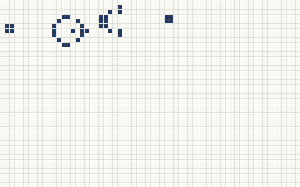

# Chapter 7 — Structs and libc

Chapter 6 gave Pebble pointers and arrays, so a program can now walk through memory. What it
still can't do is describe a *record*: a point with an x and a y, a list node with a value and
a pointer to the next node. This chapter adds `struct` declarations, field access with `.`,
`null`, `sizeof(T)` and pointer casts with `as`. Together they let Pebble call the C library
the way C programs do: `malloc` a struct, link structs into a list, `free` them again. The
compiler ideas are four. **Layout**: the checker works out where each field lives, using the
same rules as a C compiler. **Field addresses**: a field is its struct's address plus a
constant, one `add` in the code generator. **Copying aggregates**: a struct assignment becomes
a QBE `blit`. And a checker that now needs **four passes** over the declarations, because any
type may mention any struct, in any order. The chapter ends with the two programs every small
compiler wants to run: Conway's Game of Life and the Mandelbrot set.

Previous: [Chapter 6](06-pointers-and-arrays.md). Next: [Chapter 8](08-testing-a-compiler.md).

## Declaring structs

A struct declaration sits at the top level, next to functions and globals:

```
decl   = func | global | "struct" IDENT "{" [field {"," field} [","]] "}"
field  = IDENT ":" type
```

The keyword `struct` has been a token since Chapter 2; the lexer now also knows `null` and
`sizeof`. Fields are separated by commas, and a trailing comma is allowed, so each field can
sit on its own line the way Zig writes them. The parser's `structDecl` is a direct
transcription of the grammar: expect a name and `{`, then loop over `name : type` pairs until
there is no comma, then expect `}`.

The tree gains a third kind of declaration, `Decl.struct`, and an `ast.StructDecl` holding
the name, the fields as written and a `type` pointer that the checker fills in later. Error
recovery needs one more stop: after a syntax error at the top level, `skipToDeclaration`
skips tokens until something that starts a declaration, and `struct` at brace depth 0 now
counts. In expressions there are two new leaves, `null` and `sizeof(T)`, and the `.field`
node (`s.x`), which Chapter 6's parser already built but its checker refused with "pebc cannot
compile fields yet". `pebc ast` shows all of them:

```console
$ zig-out/bin/pebc ast tests/ast/structs.peb
(struct Node (value i64) (next *Node) (tags [4]u8))
(fn main ()
  (var n Node)
  (= (. n next) null)
  (let p (& (index (. n tags) 2)))
  (let size (+ (sizeof [4]*Node) (* (. (. a b) c) 2)))
  (let q (as (call malloc (sizeof Node)) *Node))
  (= (. (. q next) value) (- (. n value))))
```

`(. n next)` is a field access. `a.b.c` nests to the left, `(. (. a b) c)`, because `.` is a
postfix operator with the highest binding power, like `[` and `(`. The names `a` and `malloc`
are not declared anywhere in this file: `pebc ast` only parses, it doesn't check names.

## Layout

A struct is its fields, one after the other in memory. "One after the other" hides a choice.
x86-64 can load an 8-byte value from any address, but the System V ABI, which every C compiler
on Linux follows, says an `i64` should sit at an address that is a multiple of 8, an `i32` at a
multiple of 4. An aligned load never straddles two cache lines; a misaligned one can, and on
some CPUs it isn't allowed at all. Every C compiler on the platform lays out structs by the
same rules, which is what lets a struct pass between programs built by different compilers.
Pebble follows them too, so a Pebble struct can be handed to C (exercise 4 does exactly that):

1. Each field starts at the next offset that is a multiple of the field's alignment.
2. The struct's alignment is the largest alignment of its fields.
3. The size is rounded up to a multiple of the struct's alignment.

Rule 3 is the surprising one. It exists for arrays: element 1 of a `[4]S` starts at offset
`sizeof(S)`, so if the size weren't a multiple of the alignment, element 1's fields would be
misaligned.

The alignment of a scalar in Pebble is its size; an array has its element's alignment; a
struct has the alignment that layout computed. `types.zig` grows a `Struct` type:

```zig
pub const Struct = struct {
    name: []const u8,
    fields: []Field = &.{},
    size: u64 = 0,
    alignment: u64 = 1,
    /// The checker lays out structs one by one; `in_progress` catches
    /// a struct that contains itself.
    layout: enum { not_started, in_progress, done } = .not_started,

    pub const Field = struct { name: []const u8, type: Type, offset: u64 };

    pub fn find(s: *const Struct, name: []const u8) ?Field {
        for (s.fields) |f| if (std.mem.eql(u8, f.name, name)) return f;
        return null;
    }
};
```

and `Type` gets a new case, `@"struct": *Struct` (`struct` is a Zig keyword, so the tag needs
the `@"..."` quoting). Two struct types are equal only if they are the *same* `Struct`, the one
made for their declaration. A `Point` and a `Vec2` with identical fields are different types,
as in C. This is called *nominal* typing, as opposed to *structural*.

The rules in action, on two structs from `tests/run/structs.peb`:

```
Padded                       Small
offset 0   a  (8 bytes)      offset 0   tag   (1 byte)
offset 8   b  (1 byte)       offset 1   3 bytes of padding
offset 9   7 bytes padding   offset 4   count (4 bytes)
offset 16  c  (8 bytes)      offset 8   flag  (1 byte)
size 24, alignment 8         offset 9   3 bytes of padding (rule 3)
                             size 12, alignment 4
```

`Padded` wastes 7 of its 24 bytes; `Small` holds 6 bytes of data in 12. The program prints the
sizes, and measures the offsets with pointer arithmetic (`(&pad.b) as i64 - (&pad) as i64`,
the address of a field minus the address of the struct):

```console
$ zig-out/bin/pebc build tests/run/structs.peb -o structs && ./structs | tail -2
sizeof: Point 16, Rect 32, Padded 24, Small 12, [4]Point 64, *Rect 8
offsets in Padded: 0 8 16
```

The checker's `layoutStruct` implements the three rules with `std.mem.alignForward`, which
rounds a number up to a multiple of a power of two:

```zig
fn layoutStruct(c: *Checker, s: *ast.StructDecl) Error!void {
    const st = s.type;
    if (st.layout != .not_started) return;
    st.layout = .in_progress;
    defer st.layout = .done;
    if (s.fields.len == 0) try c.diags.err(s.name_span, "a struct needs at least one field", .{});

    var fields: std.ArrayList(Type.Struct.Field) = .empty;
    var offset: u64 = 0;
    for (s.fields, 0..) |field, i| {
        // (a duplicate field name is reported here; left out)
        var t = try c.resolveType(field.type);
        // A struct inside this one (perhaps in an array) must be laid
        // out first, because we need its size. If it is being laid
        // out right now, it contains itself: it would be infinitely big.
        var inner = t;
        while (inner == .array) inner = inner.array.elem.*;
        if (inner == .@"struct") {
            if (inner.@"struct".layout == .in_progress) {
                try c.diags.err(field.type.span, "'{s}' cannot contain itself; use a pointer, '*{s}'", .{ inner.@"struct".name, inner.@"struct".name });
                t = .invalid;
            } else {
                try c.layoutStruct(c.structs.get(inner.@"struct".name).?);
            }
        }
        if (t == .invalid) continue;
        offset = std.mem.alignForward(u64, offset, t.alignment());
        try fields.append(c.arena, .{ .name = field.name, .type = t, .offset = offset });
        offset += t.size();
        st.alignment = @max(st.alignment, t.alignment());
    }
    st.fields = fields.items;
    st.size = std.mem.alignForward(u64, offset, st.alignment);
}
```

A unit test in `check.zig`, "struct layout", pins the rules down with `struct Outer { c: u8,
inner: Inner, next: *Outer, d: u8 }` declared *before* `struct Inner { b: u8, n: i32 }`. `Inner`
is `b` at 0, three bytes of padding, `n` at 4: size 8, alignment 4. In `Outer`, `c` is at 0;
`inner` needs alignment 4, so 4; it is 8 bytes, which ends at 12; `next` is a pointer, alignment
8, so 16; `d` at 24; the size, 25, rounds up to 32.

One Pebble detail differs from C: `sizeof(bool)` is 4 in Pebble, because a `bool` is kept in a
`w` temporary and stored with `storew` (Chapter 5). In C, `sizeof(_Bool)` is 1 on this
platform. A struct that holds a `bool` will not have the same layout as the C struct with a
`bool` field; use `u8` for a field that C code must read.

## Four passes

Chapter 5's checker made two passes: first every function signature and global, then every
body. That let a function call a function declared below it. Structs need two more passes in
front, and `checkProgram` now reads:

```zig
pub fn checkProgram(c: *Checker, program: ast.Program) Error!void {
    // Pass 1: struct names, so that any type can mention any struct.
    for (program.decls) |decl| switch (decl) {
        .@"struct" => |s| try c.declareStruct(s),
        else => {},
    };
    // Pass 2: struct layouts: the offset of every field.
    for (program.decls) |decl| switch (decl) {
        .@"struct" => |s| try c.layoutStruct(s),
        else => {},
    };
    // Pass 3: function signatures and global variables, so a function
    // can use the ones declared after it.
    for (program.decls) |decl| switch (decl) {
        .func => |f| try c.declareFunction(f),
        .global => |s| try c.declareGlobal(s),
        .@"struct" => {},
    };
    // Pass 4: function bodies.
    for (program.decls) |decl| switch (decl) {
        .func => |f| {
            if (std.mem.eql(u8, f.name, "main")) try c.checkMain(f);
            if (f.body) |body| try c.checkFunction(f, body);
        },
        .global, .@"struct" => {},
    };
    // (then: "the program has no 'main' function", if so)
}
```

Why each pass must finish before the next starts:

- **Names before layouts.** A field's type may name any struct: `next: *Node` names the
  struct being declared, `inner: Inner` names one declared further down. `resolveType` can only
  turn the name `Inner` into a type if pass 1 has already put it in `c.structs`.
- **Layouts before signatures.** A global `var worlds: [2]World;` needs `World`'s size, and
  so does every local variable's stack slot.
- **Layouts in any order.** Laying out `Outer` needs `Inner`'s size, so `layoutStruct`
  recurses into `Inner` when it meets it. The `layout` field records which structs are done.
  If the recursion arrives at a struct whose layout is `in_progress`, that struct contains
  itself, directly or through others, and would be infinitely big. This is the classic
  three-colour trick for finding a cycle in a graph during a depth-first search: white (not
  started), grey (on the current path), black (done). Meeting a grey node means a cycle.
- **Pointers break the cycle.** `next: *Node` needs only the size of a pointer, 8, so a struct
  may point to itself. That is how linked lists and trees are built.

The order of the error messages *shows* the passes. `tests/errors/structs.peb` makes one
mistake of each kind, in an order that has nothing to do with the passes. Each message also
quotes its source line with a caret; `grep` keeps just the headlines:

```console
$ zig-out/bin/pebc check tests/errors/structs.peb | grep -E 'error|note'
tests/errors/structs.peb:10:8: error: struct 'Point' is already declared
tests/errors/structs.peb:4:8: note: the first declaration is here
tests/errors/structs.peb:20:8: error: 'i64' is already the name of a type
tests/errors/structs.peb:7:5: error: 'Point' already has a field named 'x'
tests/errors/structs.peb:5:5: note: the first one is here
tests/errors/structs.peb:15:11: error: 'Loop' cannot contain itself; use a pointer, '*Loop'
tests/errors/structs.peb:18:8: error: a struct needs at least one field
tests/errors/structs.peb:24:14: error: a struct cannot be passed to a function; pass a pointer to it
tests/errors/structs.peb:28:13: error: a function cannot return a struct; fill one in through a pointer parameter instead
tests/errors/structs.peb:35:7: error: 'Point' has no field named 'z'
tests/errors/structs.peb:4:8: note: 'Point' is declared here
tests/errors/structs.peb:37:13: error: a value of type 'i64' has no fields
tests/errors/structs.peb:38:13: error: the type of 'null' is unknown here; give the variable a pointer type, as in 'var p: *u8 = null;'
tests/errors/structs.peb:41:13: error: cannot convert 'Point' to 'i64' with 'as'
tests/errors/structs.peb:42:16: error: '==' cannot be used on 'Point'
tests/errors/structs.peb:43:21: error: a struct cannot be passed to a function; pass a pointer to it
tests/errors/structs.peb:44:23: error: unknown type 'Pont'
```

Lines 10 and 20 come first (pass 1: names), then 7, 15 and 18 (pass 2: layouts), then 24 and
28 (pass 3: signatures), then the bodies in source order (pass 4). The second `Point` is
reported and dropped, so the first one stays, and `p.z` on line 35 is checked against the
`Point` of line 4, the one without a `z`. Line 40 produces no error: converting one pointer
type to another is allowed.

## Field access

`s.f` works on a struct, and also on a *pointer* to a struct: if `p` is a `*Rect`, `p.max`
means `(*p).max`. C needs a separate operator for this, `p->max`; Zig, Go and Rust follow the
pointer automatically, and so does Pebble. It is one level only: on a `**S` the checker says
`a value of type '**S' has no fields`; write `(*pp).x`.

The checker's `.field` case finds the struct, then the field:

```zig
.field => |f| {
    const base = try c.checkExpr(f.base, null);
    const s = switch (base) {
        .invalid => return .invalid,
        .@"struct" => |s| s,
        // Through a pointer to a struct: p.x means (*p).x.
        .pointer => |p| if (p.* == .@"struct") p.@"struct" else null,
        else => null,
    } orelse return c.fail(f.base.span, "a value of type '{f}' has no fields", .{base});
    const field = s.find(f.name) orelse {
        try c.diags.err(f.name_span, "'{s}' has no field named '{s}'", .{ s.name, f.name });
        try c.diags.add(.note, c.structs.get(s.name).?.name_span, "'{s}' is declared here", .{s.name});
        return .invalid;
    };
    return field.type;
},
```

A field is also a *place*: something you can assign to and take the address of. `checkPlace`
(Chapter 6) gets one line. A field of a struct is a place if the struct is; through a pointer,
it always is, because the pointer says where the memory is:

```zig
.field => |f| return f.base.type != .@"struct" or try c.checkPlace(f.base, action),
```

So `let r = a; r.x = 1;` is still an error ("cannot assign to 'r', which was declared with
'let'": a `let` is a constant, and so are its fields), while `p.x = 1` through a pointer is
fine.

The code generator computes addresses in `genAddr` (Chapter 6), and a field is the easiest
case yet. The field's address is the struct's address plus the field's offset, which the
checker has worked out:

```zig
.field => |f| {
    // A struct's address is the address of its first byte; a
    // pointer to a struct holds that address.
    const s = switch (f.base.type) {
        .@"struct" => |s| s,
        else => f.base.type.pointer.@"struct",
    };
    const base = if (f.base.type == .@"struct") try g.genAddr(f.base) else try g.genExpr(f.base);
    const offset = s.find(f.name).?.offset;
    if (offset == 0) return base;
    return g.result(.i64, "add {f}, {d}", .{ base, offset });
},
```

The only difference between `s.f` and `p.f` is where the base address comes from: the
*address* of the struct variable (`genAddr`), or the *value* of the pointer (`genExpr`). That
is all auto-deref costs.

Here is a small program that uses both, and copies structs three ways:

`examples/ch07/rect.peb`
```
extern fn printf(format: *u8, ...) i32;
extern fn malloc(size: i64) *u8;

struct Point {
    x: i64,
    y: i64,
}

struct Rect {
    min: Point,
    max: Point,
}

fn width(r: *Rect) i64 {
    return r.max.x - r.min.x;
}

fn main() {
    var a: Rect;
    a.max.x = 10;
    var b = a;
    b.max = a.min;
    let heap = malloc(sizeof(Rect)) as *Rect;
    *heap = a;
    printf("%ld %ld %ld\n", width(&a), width(&b), width(heap));
}
```

The `Makefile` builds Chapter 7's pebc if needed; `make` prints the IL, `make run` compiles
and runs the program, `make asm` shows QBE's output:

```console
$ make
cd ../../project/ch07 && zig build
../../project/ch07/zig-out/bin/pebc ir rect.peb
function l $width(l %r) {
@start
	%r.1 =l alloc8 8
	storel %r, %r.1
	%.1 =l loadl %r.1
	%.2 =l add %.1, 16
	%.3 =l loadl %.2
	%.4 =l loadl %r.1
	%.5 =l loadl %.4
	%.6 =l sub %.3, %.5
	ret %.6
}

export function w $main() {
@start
	%a.1 =l alloc8 32
	%b.2 =l alloc8 32
	%heap.3 =l alloc8 8
	call $memset(l %a.1, w 0, l 32)
	%.1 =l add %a.1, 16
	storel 10, %.1
	blit %a.1, %b.2, 32
	%.2 =l add %b.2, 16
	blit %a.1, %.2, 16
	%.3 =l call $malloc(l 32)
	storel %.3, %heap.3
	%.4 =l loadl %heap.3
	blit %a.1, %.4, 32
	%.5 =l call $width(l %a.1)
	%.6 =l call $width(l %b.2)
	%.7 =l loadl %heap.3
	%.8 =l call $width(l %.7)
	%.9 =w call $printf(l $str.0, ..., l %.5, l %.6, l %.8)
	ret 0
}

data $str.0 = { b "%ld %ld %ld", b 10, b 0 }
$ make run
../../project/ch07/zig-out/bin/pebc build rect.peb
./rect
10 0 10
```

- In `width`, `r.max.x` is two field accesses: `max` at offset 16 of the `Rect`, then `x` at
  offset 0 of the `Point`. The second one emits nothing (`if (offset == 0) return base`), so
  the whole chain is one `add %.1, 16` and a load. `r.min.x` is offset 0 + 0: no `add` at all,
  just `loadl %.4`.
- `a.max.x = 10` is `add %a.1, 16` then `storel`. `a` is a local, so the base is the slot
  `%a.1` itself.
- `var a: Rect;` became `call $memset(l %a.1, w 0, l 32)`; `var b = a;` became `blit`. Both
  are the subject of the next section.
- The three widths: `a` is 10 wide; `b` had its `max` overwritten by `a.min`, so it is 0 wide;
  the heap copy was taken before that, so it is 10 wide.

QBE turns `width` into five instructions:

```console
$ make asm        # excerpt: width
width:
	pushq %rbp
	movq %rsp, %rbp
	movq 16(%rdi), %rax
	movq (%rdi), %rcx
	subq %rcx, %rax
	leave
	ret
```

The slot `%r.1` is gone (the parameter's address never escapes, so QBE keeps it in `%rdi`),
and `add %.1, 16` plus `loadl %.2` became one instruction with an addressing mode,
`16(%rdi)`. pebc can emit the plain `add` and leave the folding to QBE.

## Structs are values (sort of)

Since Chapter 5 every Pebble value fits in a QBE temporary: a `w` or an `l`. A 32-byte `Rect`
doesn't. pebc's answer is the one Chapter 6 gave for arrays: an aggregate **lives in memory,
and its address stands for it**. `genExpr` of a struct-typed place returns its address instead
of loading from it:

```zig
// A variable, `*p`, `a[i]` and `s.x` are all places in memory:
// work out the address, then load from it. A struct is too
// big to load; its address stands for it.
.name, .index, .field => {
    const addr = try g.genAddr(e);
    if (t.isAggregate()) return addr;
    return g.result(t, "{s} {f}", .{ loadOp(t), addr });
},
```

(`isAggregate` is new in `types.zig`: true for arrays and structs.) Every statement that
writes a value goes through one function, `store()`, and that is where a struct's "value",
an address, turns into a copy:

```zig
/// Writes `value` of type `t` to memory at `addr`. A struct's "value"
/// is the address of its bytes, so it is copied with `blit`.
fn store(g: *CodeGen, t: Type, value: Value, addr: Value) Error!void {
    if (t == .@"struct") {
        try g.emit("blit {f}, {f}, {d}", .{ value, addr, t.size() });
    } else {
        try g.emit("store{s} {f}, {f}", .{ storeSuffix(t), value, addr });
    }
}
```

QBE's `blit src, dst, N` copies N bytes, where N is a constant. Assignment, initialisation and
`*p = s` all call `store()`, so all of them copy structs for free. No new kind of QBE value was
needed: only `store()` and `genAddr` ever look inside a struct. QBE 1.2 expands a `blit` into
load/store pairs, 8 bytes at a time. Here is `var b = a;` (a `blit` of 32 bytes) in `rect`'s
`main`:

```console
$ make asm        # excerpt: main
	movq $10, -48(%rbp)
	movq -64(%rbp), %rax
	movq %rax, -32(%rbp)
	movq -56(%rbp), %rax
	movq %rax, -24(%rbp)
	movq -48(%rbp), %rax
	movq %rax, -16(%rbp)
	movq -40(%rbp), %rax
	movq %rax, -8(%rbp)
```

`a` is at -64 and `b` at -32; four 8-byte moves copy it. A C compiler does the same for a
small struct assignment; for a large one it typically calls `memcpy`.

A struct variable without a value starts as all zeros, like every Pebble variable. For a
scalar that is one `store` of 0. For an aggregate pebc emits a call to libc's `memset`,
`call $memset(l %a.1, w 0, l 32)` in `rect`.

Some things are *not* allowed on structs, and each has a reason:

- `p == p` (`'==' cannot be used on 'Point'`). Comparing two structs byte by byte would
  compare the padding too, and padding holds whatever was in memory. C forbids `==` on structs
  for the same reason.
- Struct parameters, struct return values and structs as variadic arguments. Passing a struct
  by value is the most intricate part of the C calling convention: a 16-byte struct of two
  integers travels in two registers, a 32-byte one on the stack, a returned 32-byte one
  through a hidden pointer. pebc could get this wrong in a dozen ways. The error says what to
  do instead: pass a pointer. Exercise 4 lifts the restriction, with QBE doing the hard part.
- Arrays are still not values (`var b = a;` on an array is an error). Exercise 1 shows that
  the struct machinery makes them values with three small changes.

## `null`, `sizeof` and `as`

Three small features make the C library usable.

**`null`** is the pointer to nothing, address 0. Its type is whatever pointer type the context
wants. `typeOf` already receives a `want` parameter, the type the context expects, which
Chapter 5 used so that `let b: u8 = 200;` gives the literal the type `u8`. `null` uses it the
same way: if `want` is a pointer type, that is `null`'s type; otherwise it is an error.

`var p: *Node = null;` works; so do `p != null` and `null == p`, because a comparison checks
its non-literal side first and passes that type as `want` to the literal side (Chapter 5's
rule for `x < 10`). `let q = null;` has no context and is
an error. The code generator emits the constant 0.

**`sizeof(T)`** is the size in bytes of a type, known while compiling. The checker doesn't
just compute the type of the node; it *replaces the node* with an integer literal:

```zig
.sizeof => |te| {
    const t = try c.resolveType(te);
    if (t == .invalid) return .invalid;
    // The size is known now, so the code generator only sees
    // a number.
    e.kind = .{ .int = t.size() };
    return .i64;
},
```

So `malloc(sizeof(Rect))` reaches the code generator as `malloc(32)`, and the IL above says
`call $malloc(l 32)`. The `.sizeof` case of `genExpr` is `unreachable`. This is the first time
a phase *rewrites* the tree for a later phase. Chapter 9 does the same thing systematically.

**`as`** learns two new conversions. Any pointer converts to any other pointer, and pointers
convert to and from `i64`: the checker's `as` case gains
`if ((from == .pointer or from == .i64) and (to == .pointer or to == .i64)) return to;`.

All of these are `l` values in QBE, so the conversion emits no instruction. It only changes
what the checker believes. That is exactly what C's cast does with pointers, and it is just as
unchecked.

## Calling libc for real

`malloc` returns `*u8` in Pebble's declaration of it: "some bytes". A cast tells the checker
what they are for. `tests/run/list.peb` builds a linked list on the heap (shortened):

```
extern fn printf(format: *u8, ...) i32;
extern fn malloc(size: i64) *u8;
extern fn free(p: *u8);

struct Node {
    value: i64,
    next: *Node,
}

fn push(head: *Node, value: i64) *Node {
    let node = malloc(sizeof(Node)) as *Node;
    node.value = value;
    node.next = head;
    return node;
}

fn reverse(head: *Node) *Node {
    var done: *Node = null;
    var rest = head;
    while rest != null {
        let next = rest.next;
        rest.next = done;
        done = rest;
        rest = next;
    }
    return done;
}

// print(head) walks the list with printf; main pushes the squares
// 1, 4, 9, 16, 25, prints, reverses, prints, then frees every node:
fn main() {
    // ...
    while list != null {
        let next = list.next;
        free(list as *u8);
        list = next;
        count = count + 1;
    }
    printf("freed %ld nodes\n", count);
}
```

```console
$ zig-out/bin/pebc build tests/run/list.peb -o list && ./list
25 16 9 4 1 
1 4 9 16 25 
freed 5 nodes
```

`push` adds at the front, so the list comes out backwards; `reverse` turns it around in place
by flipping each `next` pointer; the last loop saves `next` *before* freeing the node, because
after `free` the node's memory isn't ours any more. This is the C idiom, line for line.

Forget the cast and the checker notices, because a `*u8` has no fields and is not a `*Node`
(throwaway file):

```console
$ zig-out/bin/pebc check nocast.peb
nocast.peb:10:5: error: a value of type '*u8' has no fields
    node.value = 1;
    ^~~~
nocast.peb:11:23: error: expected '*Node', found '*u8'
    var head: *Node = malloc(sizeof(Node));
                      ^~~~~~~~~~~~~~~~~~~~
```

C would accept the second line without a word: `void *` converts to any pointer type
implicitly. Pebble has no `void *`, and no implicit conversions at all.

One detail of the calls is handled entirely by QBE. Look at the end of `rect`'s `main` again:

```console
$ make asm        # excerpt: the printf call
	leaq str.0(%rip), %rdi
	movl $0, %eax
	callq printf
```

The System V ABI says that before calling a *variadic* function, `%al` must hold the number of
vector registers used for arguments (floating-point arguments travel in `%xmm0`–`%xmm7`), so
that `printf` knows how many to save. Pebble has no floats, so the answer is always 0. pebc
never had to know this rule: the `...` in `call $printf(l $str.0, ..., l %.5, ...)` tells QBE
which call is variadic, and QBE emits the `movl $0, %eax`.

## History: structures and the Unix kernel

Structures are what turned C from an experiment into a systems language. Dennis Ritchie's
account, "The Development of the C Language", tells how B, C's typeless predecessor, couldn't
grow them. Ritchie's trouble began "when I tried to extend the type notation, especially to
add structured (record) types. Structures, it seemed, should map in an intuitive way onto
memory in the machine". His example is an early Unix directory entry,
`struct { int inumber; char name[14]; }`: he wanted the structure "not merely to characterize
an abstract object but also to describe a collection of bits that might be read from a
directory". In B an array was a pointer to its elements, stored somewhere, and a struct
containing one would have needed a hidden pointer that nothing could initialise. C's answer,
an array that *is* its elements, is the one Pebble uses.

The payoff came quickly. "By early 1973, the essentials of modern C were complete. The
language and compiler were strong enough to permit us to rewrite the Unix kernel for the
PDP-11 in C during the summer of that year." Ken Thompson had tried in 1972, "in an early
version of C—before structures", and "gave up the effort". Structures were not first-class at
first. Only after the first edition of Kernighan and Ritchie's book (1978) did C compilers
support "assigning them, passing them to and from functions": the same two steps Pebble takes
in this chapter (assignment, with `blit`) and in exercise 4 (passing and returning).

Field layout, by contrast, was never the C standard's business. The standard only promises
that fields appear in the order declared and that the first one is at offset 0. The padding
rules above come from each platform's ABI document, which for Linux on x86-64 is the System V
psABI. That is why two compilers on one platform agree, and why the same struct can have
different sizes on different machines.

## The Game of Life

With structs, pointers, `malloc` and `putchar`, Pebble can run a real simulation. Conway's
Game of Life is a grid of cells, each alive or dead. In each generation, a live cell with two
or three live neighbours (of its eight) survives, a dead cell with exactly three is born, and
every other cell is dead in the next generation. The golden test `tests/run/life.peb` keeps
two grids in a global array of structs, `var worlds: [2]World;` with
`struct World { cells: [8][10]bool }`, prints five generations of a glider and a blinker, and
alternates between `worlds[0]` and `worlds[1]` with `gen % 2`. The heart of its `step`:

```
let n = alive(from, x - 1, y - 1) + alive(from, x, y - 1) + alive(from, x + 1, y - 1)
    + alive(from, x - 1, y) + alive(from, x + 1, y)
    + alive(from, x - 1, y + 1) + alive(from, x, y + 1) + alive(from, x + 1, y + 1);
to.cells[y][x] = n == 3 || (n == 2 && from.cells[y][x]);
```

`to.cells[y][x]` is a field access through a pointer, then two index operations: `genAddr`
handles the chain one step at a time, exactly as it was written.

`samples/life.peb` is the bigger version. Its grid is a struct on the heap, sized at run time;
`newGrid` `malloc`s the struct and `width * height * sizeof(bool)` bytes of cells:

```
struct Grid {
    width: i64,
    height: i64,
    cells: *bool,
}

// Off the edge on one side means back in on the other.
fn get(g: *Grid, x: i64, y: i64) bool {
    let wx = (x + g.width) % g.width;
    let wy = (y + g.height) % g.height;
    return g.cells[wy * g.width + wx];
}
```

The edges wrap around (`(x + g.width) % g.width` turns -1 into `width - 1`), so the grid is a
torus. `main` draws Bill Gosper's glider gun from a pattern string of `.`, `#` and `/` (a new
row) onto a 64×40 grid and prints generations 0 to 120:

```console
$ zig-out/bin/pebc build samples/life.peb -o life && ./life | head -11
generation 0
................................................................
.........................#......................................
.......................#.#......................................
.............##......##............##...........................
............#...#....##............##...........................
.##........#.....#...##.........................................
.##........#...#.##....#.#......................................
...........#.....#.......#......................................
............#...#...............................................
.............##.................................................
$ ./life | wc -l
4961
```

121 generations of 41 lines each. Rendered as frames, the gun fires a new glider every 30
generations, and the gliders travel down and to the right:



Each grid takes 64 × 40 × `sizeof(bool)` = 64 × 40 × 4 = 10240 bytes. With `cells: *u8` it
would be a quarter of that; with one bit per cell, a thirty-second.

## The Mandelbrot set with integers

The Mandelbrot set is the set of complex numbers c for which the sequence z₀ = 0,
zₙ₊₁ = zₙ² + c stays bounded. Once |z| > 2 it is known to escape, so a program iterates up to
some limit and records how many steps it took to escape; points that never escape are in the
set. Writing z = re + i·im and c = cre + i·cim, one step is

```
re' = re² − im² + cre
im' = 2·re·im + cim
```

and |z| > 2 is re² + im² > 4.

Pebble has no floating point. The classic answer is **fixed point**: pick a scale, say
one = 4096, and let the integer n stand for n / 4096. Then 1.5 is 6144, and -2.2 is -9011.
Adding two fixed-point numbers is plain addition. Multiplying them needs a correction, because
(a/one)·(b/one) = (a·b/one)/one, so `mul(a, b)` is `a * b / one`. With one = 4096 = 2¹², a
value up to about 4 needs 14 bits plus a sign, and a product of two of them fits easily in 64
bits. `tests/run/mandelbrot.peb` keeps z and c in a `Complex` struct:

```
let one = 4096;

fn mul(a: i64, b: i64) i64 {
    return a * b / one;
}

struct Complex {
    re: i64,
    im: i64,
}

// How many steps of z = z*z + c before |z| > 2, up to `limit`.
fn escape(c: *Complex, limit: i64) i64 {
    var z: Complex;
    var n = 0;
    while n < limit {
        let re2 = mul(z.re, z.re);
        let im2 = mul(z.im, z.im);
        if re2 + im2 > 4 * one {
            return n;
        }
        z.im = 2 * mul(z.re, z.im) + c.im;
        z.re = re2 - im2 + c.re;
        n = n + 1;
    }
    return limit;
}
```

`main` walks a 64×25 grid of c values, re from -2.2 to 0.8 and im from -1.2 to 1.2, and prints
one character per point, from `.` (escaped at once) through `,:;-=+*#%` to `@` (never escaped
in 50 steps):

```console
$ zig-out/bin/pebc build tests/run/mandelbrot.peb -o mandelbrot && ./mandelbrot
................................................................
.........................................,,:,,,.................
.......................................,,,,,;,:,,...............
......................................,,,,,:;-:,,,,.............
...................................,,,,,,:%@@@#;,,,,,,..........
...............................,,,,,,,,,::-@@@@::,,,,,,,........
..........................,,,,,,,,:*@@@@@@@@@@@@@@*::=:+,,......
.....................,,,,,,,,,,,,;:;@@@@@@@@@@@@@@@@@@;,,,,.....
.................,,,:,,,,,,,,,,,:;@@@@@@@@@@@@@@@@@@@@#:,,,.....
...............,,,,,,:-*:;@=:,::-@@@@@@@@@@@@@@@@@@@@@@-:,,.....
.............,,,,,,,::@@@@@@@@;;@@@@@@@@@@@@@@@@@@@@@@@*-,,.....
..........,,,,,,,::;;@@@@@@@@@@@@@@@@@@@@@@@@@@@@@@@@@@@,,,.....
.....@@@@@@@@@@@@@@@@@@@@@@@@@@@@@@@@@@@@@@@@@@@@@@@@;,,,,,.....
..........,,,,,,,::;;@@@@@@@@@@@@@@@@@@@@@@@@@@@@@@@@@@@,,,.....
.............,,,,,,,::@@@@@@@@;;@@@@@@@@@@@@@@@@@@@@@@@*-,,.....
...............,,,,,,:-*:;@=:,::-@@@@@@@@@@@@@@@@@@@@@@-:,,.....
.................,,,:,,,,,,,,,,,:;@@@@@@@@@@@@@@@@@@@@*:,,,.....
.....................,,,,,,,,,,,,;:;@@@@@@@@@@@@@@@@@@;,,,,.....
..........................,,,,,,,,:*@@@@@@@@@@@@@@+::-:%,,......
...............................,,,,,,,,,::-@@@@::,,,,,,,........
...................................,,,,,,:%@@@#;,,,,,,..........
......................................,,,,,:;-:,,,,.............
.......................................,,,,,;,:,,...............
.........................................,,:,,,.................
................................................................
```

The set is symmetric about the real axis (row 12), and so should the picture be. It almost is.
Rows 6 and 18 differ (`*::=:+` against `+::-:%`), and so do rows 8 and 16 (`#` against `*`).
The cause is integer division. `a * b / one` truncates toward zero, so `mul(-x, y)` is
`-mul(x, y)` only when the division is exact. A positive product is rounded down, a negative
one *up*, so the top half of the picture (im < 0) and the bottom half are computed with
slightly different rounding. A few points near the boundary escape one step earlier on one
side. Floating point has rounding error too, but it rounds symmetrically, so this particular
asymmetry is a fixed-point artefact. Fixed point was how games and demos did fractional
arithmetic before every CPU had a fast FPU, and this kind of off-by-one-ulp bug came with it.

`samples/mandelbrot.peb` makes a picture instead. With one = 65536 and a limit of 256 steps it
computes a 600×400 image and writes it as a binary PPM: the header `P6\n600 400\n255\n`, then
three bytes (red, green, blue) per pixel, written with `putchar`. A palette of four `Color`
structs, `var stops: [4]Color;`, is blended 16 steps at a time. `shade` picks `let from =
&stops[t / 16];`, a pointer to an element of a global array of structs, and reads `from.r`,
`from.g` and `from.b` through it.

```console
$ zig-out/bin/pebc build samples/mandelbrot.peb -o mandelbrot && time ./mandelbrot > mandelbrot.ppm

real	0m0.140s
user	0m0.139s
sys	0m0.000s
$ head -c 15 mandelbrot.ppm; wc -c mandelbrot.ppm
P6
600 400
255
720015 mandelbrot.ppm
```

600 × 400 × 3 = 720000 bytes of pixels plus 15 of header.
0.14 s on this machine, for up to 256 iterations of each of 240000 points; your time will
differ. Converted to PNG:


## The project at the end of the chapter

The changes since Chapter 6, file by file:

| File | Lines | What changed |
|---|---|---|
| `lexer.zig` | 318 | keywords `null`, `sizeof` |
| `ast.zig` | 219 | `Decl.struct`, `StructDecl`; expressions `.null`, `.sizeof` |
| `types.zig` | 145 | `Type.struct` and `Type.Struct` (fields with offsets, size, alignment, `layout`), `find`, `isAggregate` |
| `parser.zig` | 599 | `structDecl`, `null`, `sizeof(T)`; `skipToDeclaration` stops at `struct` |
| `print.zig` | 198 | `(struct ...)`, `null`, `(sizeof T)` |
| `check.zig` | 764 | four passes, `declareStruct`, `layoutStruct`, struct names in `resolveType`, `.null`, `.sizeof`, `.field`, pointer casts, struct-specific errors |
| `codegen.zig` | 542 | `store()` with `blit`, `memset` for aggregates, `genAddr(.field)` |

New tests: `run/structs`, `run/list`, `run/life`, `run/mandelbrot`, `errors/structs`,
`ast/structs`, and the unit test "struct layout". New samples: `samples/life.peb`,
`samples/mandelbrot.peb`. Every older golden file is unchanged.

```console
$ zig build test --summary all 2>&1 | head -2
golden: 36 passed, 0 failed
Build Summary: 6/6 steps succeeded; 19/19 tests passed
```

## Summary

- A struct's layout follows the platform ABI: each field at the next multiple of its
  alignment, the size rounded up to the struct's alignment so arrays of structs stay aligned.
  The checker computes every offset; the code generator only adds them.
- The checker makes four passes: struct names, struct layouts, signatures and globals,
  bodies. Layout recurses into inner structs, and an `in_progress` mark detects a struct that
  contains itself. A pointer to itself is fine.
- `s.f` and `p.f` (auto-deref, one level) compile to the base address plus a constant offset;
  QBE folds the `add` into an addressing mode.
- A struct value is represented by its address. `store()` copies it with `blit`, so
  assignment, initialisation and `*p = s` all work; `var s: S;` is zeroed with `memset`.
  `==`, struct parameters and struct returns are errors.
- `null` takes its type from the context, `sizeof(T)` is replaced by a number in the checker,
  and `as` converts between pointers and `i64` without an instruction.
- With these, Pebble calls `malloc` and `free`, builds linked lists, and runs the Game of Life
  and a fixed-point Mandelbrot renderer. Truncating division makes fixed-point results
  slightly asymmetric between positive and negative values.

## Exercises

1. **Copy whole arrays.** Make `var b = a;`, `grid[1] = grid[0];` and `board.cells = grid;`
   work for arrays, the way they work for structs. Keep `a + 1` and assigning a `[5]i64` to a
   `[4]i64` as errors, and keep arrays out of variadic arguments. Which golden file changes?

<details><summary>Solution</summary>

The code generator already treats arrays as aggregates: `genExpr` returns an array's address.
Only `store()` picks `blit` by looking for a struct. Three changes:

```diff
--- a/src/codegen.zig
+++ b/src/codegen.zig
     fn store(g: *CodeGen, t: Type, value: Value, addr: Value) Error!void {
-        if (t == .@"struct") {
+        if (t.isAggregate()) {
             try g.emit("blit {f}, {f}, {d}", .{ value, addr, t.size() });
```

In `check.zig`, delete the two checks that make arrays non-values: "an array cannot be used as
a value" in `checkValue`, and "cannot assign a whole array" in the `.assign` case. `checkValue`
used to stop arrays from reaching a variadic call, so the call check now needs its own line,
next to the struct one:

```diff
                 const t = try c.checkValue(arg, null);
                 if (t == .@"struct") try c.diags.err(arg.span, "a struct cannot be passed to a function; pass a pointer to it", .{});
+                if (t == .array) try c.diags.err(arg.span, "an array cannot be passed to a function; pass a pointer to its first element", .{});
```

A test program, `arrays.peb`, does `var b = a;` on a `[5]i64` and then sets `a[0] = 99`,
copies `grid[1] = grid[0];` in a `[3][3]u8` after setting `grid[0][1] = 7`, and copies the
whole grid into a struct field, `board.cells = grid;`:

```console
$ zig-out/bin/pebc build arrays.peb && ./arrays
a[0] = 99, b[0] = 0
grid[1][1] = 7
board.cells[1][1] = 7
$ grep blit arrays.ssa
	blit %a.1, %b.2, 40
	blit %grid.3, %.5, 3
	blit %grid.3, %board.4, 9
```

`b` is a copy: changing `a` afterwards doesn't change it. The errors that must stay:

```console
$ zig-out/bin/pebc check arrays_bad.peb
arrays_bad.peb:6:13: error: '+' cannot be used on '[5]i64'
    let c = a + 1;
            ^
arrays_bad.peb:7:13: error: expected '[4]i64', found '[5]i64'
    small = a;
            ^
arrays_bad.peb:8:21: error: an array cannot be passed to a function; pass a pointer to its first element
    printf("%ld\n", a);
                    ^
```

`zig build test` fails on `errors/pointers.peb`: its `b = c;` and `let d = b;` are no longer
errors, and its `printf` of an array gets the new message. Look at the diff, agree with it,
and regenerate `errors/pointers.err`.

</details>

2. **libc's global variables.** C's `stdout` and `stderr` are global variables in libc.
   Add `extern let stderr: *u8;` so that this program writes to both streams:

   ```
   extern fn fprintf(stream: *u8, format: *u8, ...) i32;
   extern fn fputs(s: *u8, stream: *u8) i32;
   extern let stdout: *u8;
   extern let stderr: *u8;

   fn main() {
       fputs("to stdout\n", stdout);
       fprintf(stderr, "to stderr: %ld\n", 42);
   }
   ```

   An extern variable must have a type and must not have a value.

<details><summary>Solution</summary>

`Stmt.Let` gets `is_extern: bool = false`. In the parser's `declaration`, `extern` followed
by `let` or `var` is a variable, anything else a function. The parser reads the variable with
`letStatement`, sets `is_extern`, and reports "an extern variable needs a type" if the type is
missing and "an extern variable cannot have a value; it is defined somewhere else" if a value
is present.

The checker's "a 'let' needs a value" becomes `else if (!l.mutable and !l.is_extern)`.
`genGlobal` starts with `if (l.is_extern) return;`: no `data` definition, so `$stderr` is an
undefined symbol that the linker resolves in libc, exactly like `$printf`. `writeLet` in
`print.zig` writes `(extern let stdout *u8)` when the flag is set.

```console
$ zig-out/bin/pebc build streams.peb && ./streams 2>/dev/null
to stdout
$ ./streams >/dev/null
to stderr: 42
$ grep 'loadl \$stderr' streams.ssa; grep 'movq stderr' streams.s
	%.3 =l loadl $stderr
	movq stderr(%rip), %rdi
$ zig-out/bin/pebc check streams_bad.peb
streams_bad.peb:1:12: error: an extern variable needs a type
extern let errno = 0;
           ^~~~~
streams_bad.peb:2:25: error: an extern variable cannot have a value; it is defined somewhere else
extern var count: i64 = 3;
                        ^
```

The variable is loaded from `stderr(%rip)`, like any Pebble global. `stdout` and `stderr` are
really `FILE *`; `*u8` is a fine stand-in, because Pebble only passes the pointer on.

</details>

3. **`offsetof`.** C has `offsetof(type, field)`. Add it as a keyword expression that the
   checker replaces with a number, as it does `sizeof`. Test it on
   `struct Padded { tag: u8, value: i64, flag: bool, count: i32 }`, and report a missing
   field, a non-struct type and an unknown type.

<details><summary>Solution</summary>

Add `kw_offsetof` to the lexer's keyword list, and `offsetof: OffsetOf` to `Expr.Kind` with
`pub const OffsetOf = struct { type: *TypeExpr, field: []const u8, field_span: Span };`. The
parser reads it among the primary expressions: `offsetof`, `(`, a type (`parseType`), `,`, an
identifier, `)`.

The checker resolves the type, finds the field and rewrites the node:

```zig
.offsetof => |o| {
    const t = try c.resolveType(o.type);
    if (t == .invalid) return .invalid;
    if (t != .@"struct") return c.fail(o.type.span, "'offsetof' needs a struct type, not '{f}'", .{t});
    const field = t.@"struct".find(o.field) orelse {
        try c.diags.err(o.field_span, "'{s}' has no field named '{s}'", .{ t.@"struct".name, o.field });
        try c.diags.add(.note, c.structs.get(t.@"struct".name).?.name_span, "'{s}' is declared here", .{t.@"struct".name});
        return .invalid;
    };
    e.kind = .{ .int = field.offset };
    return .i64;
},
```

In `genExpr` the case becomes `.sizeof, .offsetof => unreachable`, and `print.zig` writes
`(offsetof Padded tag)`.

```console
$ zig-out/bin/pebc build offsets.peb && ./offsets
0 8 16 20 of 24
$ zig-out/bin/pebc check offsets_bad.peb
offsets_bad.peb:7:30: error: 'Padded' has no field named 'size'
    let a = offsetof(Padded, size);
                             ^~~~
offsets_bad.peb:1:8: note: 'Padded' is declared here
struct Padded {
       ^~~~~~
offsets_bad.peb:8:22: error: 'offsetof' needs a struct type, not 'i64'
    let b = offsetof(i64, tag);
                     ^~~
offsets_bad.peb:9:22: error: unknown type 'Nope'
    let c = offsetof(Nope, tag);
                     ^~~~
```

`flag` is at 16 and `count` at 20, because Pebble's `bool` is 4 bytes. Reordering a struct
saves space: `Small { tag: u8, count: i32, flag: u8 }` is 12 bytes, while
`{ count: i32, tag: u8, flag: u8 }` is 8, because both `u8`s fit in the tail padding.

</details>

4. **(Challenge) Structs by value, compatible with C.** Allow struct parameters and struct
   return values, and make them follow the C ABI so a Pebble program can call C functions
   that take and return structs. QBE knows the ABI: declare the struct's layout with an
   *aggregate type*, `type :Point = { l, l }`, and use `:Point` in place of `w`/`l` in
   function signatures, call arguments and call results. Test with C functions
   `Point c_mid(Rect)`, `Rect c_square(Point, int64_t)` and `Pixel c_invert(Pixel)`.

<details><summary>Solution</summary>

In QBE, an aggregate parameter arrives as the *address* of a copy, and an aggregate result is
also an address. That is exactly pebc's rule "a struct value is its address", so most of the
code generator works unchanged.

1. In `declareFunction`, remove the struct-parameter error and narrow the return error to
   arrays. Keep the variadic error: C passes structs to `printf` in a way `%ld` can't read.
2. Before the functions, emit a `type` for every struct, inner structs first. Fields become
   `b`, `w` or `l`, a nested struct becomes `:Name`, and an array becomes a count (`[2][3]u8`
   is `b 6`):

   ```zig
   fn genType(g: *CodeGen, st: *const Type.Struct, written: *std.AutoHashMapUnmanaged(*const Type.Struct, void)) Error!void {
       if ((try written.getOrPut(g.arena, st)).found_existing) return;
       for (st.fields) |f| {
           const inner = innermost(f.type);
           if (inner == .@"struct") try g.genType(inner.@"struct", written);
       }
       try g.out.print("type :{s} = {{ ", .{st.name});
       for (st.fields, 0..) |f, i| {
           if (i > 0) try g.out.writeAll(", ");
           // An array is its elements one after the other: `[2][3]u8` is `b 6`.
           var count: u64 = 1;
           var t = f.type;
           while (t == .array) : (t = t.array.elem.*) count *= t.array.len;
           if (t == .u8) try g.out.writeByte('b') else try g.out.print("{f}", .{abi(t)});
           if (count > 1) try g.out.print(" {d}", .{count});
       }
       try g.out.writeAll(" }\n\n");
   }
   ```

3. A small formatter `abi(t)` prints `:Name` for a struct and `t.base()` otherwise. Use it
   for the return type and parameter types in the function header, for `={f} call`, and for
   each call argument.
4. A struct parameter is copied into its slot with `blit %{s}, {f}, {d}` instead of
   `store{s}`.

`return a;` needs no change: `genExpr(a)` is the slot's address, and `ret %a.1` returns it.

```console
$ zig-out/bin/pebc ir byvalue.peb | head -12
type :Point = { l, l }

type :Rect = { :Point, :Point }

type :Pixel = { b, b, b, w }

function :Point $add(:Point %a, :Point %b) {
@start
	%a.1 =l alloc8 16
	%b.2 =l alloc8 16
	blit %a, %a.1, 16
	blit %b, %b.2, 16
$ zig-out/bin/pebc build byvalue.peb && ./byvalue
a = (1, 2), a + b = (11, 22)
area 200, grown 264, r still 200
50 25 12 255
```

`byvalue.peb` declares `Point`, `Rect` and `Pixel { r: u8, g: u8, b: u8, alpha: i32 }`, and
functions `add(a: Point, b: Point) Point`, `area(r: Rect) i64`, `grow(r: Rect, by: i64) Rect`
and `darker(p: Pixel) Pixel` that modify their parameter and return it. "r still 200" shows
that `grow` changed a copy.

The real test is C. `cside.c`:

```c
#include <stdint.h>

typedef struct { int64_t x, y; } Point;
typedef struct { Point min, max; } Rect;
typedef struct { uint8_t r, g, b; int32_t alpha; } Pixel;

Point c_mid(Rect r) {
    Point p = { (r.min.x + r.max.x) / 2, (r.min.y + r.max.y) / 2 };
    return p;
}

// c_square(corner, side) returns { corner, corner + (side, side) };
// c_invert(p) returns { 255 - r, 255 - g, 255 - b, alpha }.
```

`interop.peb` declares the same three structs and
`extern fn c_mid(r: Rect) Point;`, `extern fn c_square(corner: Point, side: i64) Rect;` and
`extern fn c_invert(p: Pixel) Pixel;`, then calls `c_square` on (4, 6) with side 10, `c_mid`
on the result, and `c_invert` on the pixel (200, 100, 50, 7):

```console
$ zig-out/bin/pebc ir interop.peb > interop.ssa && qbe -o interop.s interop.ssa
$ cc -o interop interop.s cside.c && ./interop
square (4,6)-(14,16), middle (9,11)
55 155 205 7
$ grep -n 'call \$c_' interop.ssa
18:	%.2 =:Rect call $c_square(:Point %corner.1, l 10)
20:	%.3 =:Point call $c_mid(:Rect %sq.2)
42:	%.19 =:Pixel call $c_invert(:Pixel %p.4)
```

QBE applied three different System V rules. Excerpts from `interop.s`:

```
	movq -64(%rbp), %rsi        # c_square: the 16-byte Point in two registers,
	movq -56(%rbp), %rdx
	leaq -96(%rbp), %rdi        # the 32-byte Rect result through a hidden pointer
	callq c_square
	...
	subq $32, %rsp              # c_mid: the 32-byte Rect argument on the stack
	movq %rsp, %rcx
	movq -48(%rbp), %rax
	movq %rax, 0(%rcx)
	...
	callq c_mid
	movq %rax, %rcx             # the 16-byte Point result in %rax and %rdx
	movq %rdx, %rax
```

(The `#` comments are annotations, not QBE output.) Structs of up to 16 bytes made of integers
travel in integer registers; bigger ones go through memory, and a big result is written to a
buffer the caller passes as a hidden first argument in `%rdi`. That is why `side`, the
second Pebble argument, went into `%ecx`. pebc's part was one line of `type` per struct.
Finally, `errors/structs.err` loses its two errors for lines 24 and 28; regenerate it.

</details>

Sources for this chapter: [REFERENCES.md](REFERENCES.md#chapter-7--structs-and-libc)
