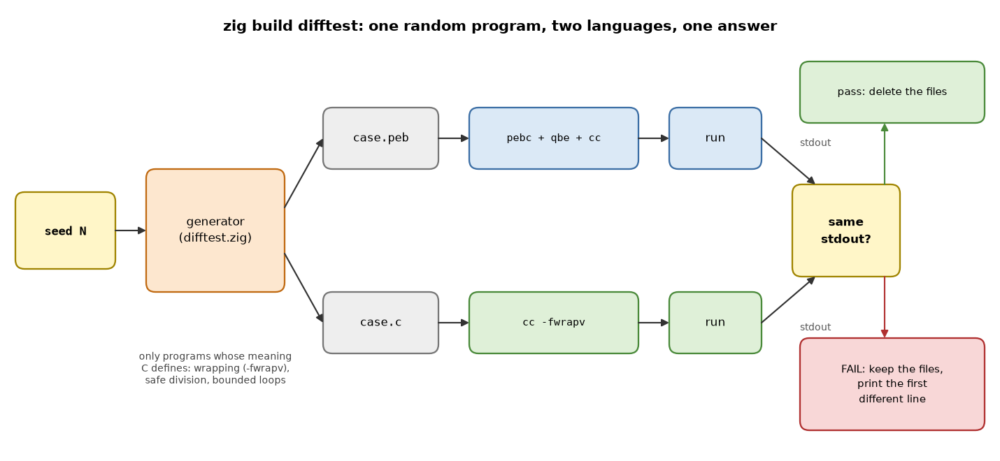

# Chapter 8 — Testing a Compiler

pebc now compiles real programs: linked lists, the Game of Life, the Mandelbrot set. Every
chapter so far has also changed code that earlier chapters' tests depend on, and every
chapter has trusted the golden tests to say that nothing broke. This chapter adds no language
features. It is about finding the bugs a compiler still has. The golden test runner learns to
print a diff, to rewrite its files on request and to stop programs that never end. A *fuzzer*
throws garbage at every phase of pebc and waits for a crash. A *differential tester* writes
random programs twice, once in Pebble and once in C, and lets `cc` say what they should
print. The punch line is a real bug, `continue` jumping to the wrong loop, that all 36 golden
tests miss and `zig build difftest` finds in seconds. The chapter ends by looking inside QBE
with `qbe -d`, to see what happens to pebc's lazy IL.

Previous: [Chapter 7](07-structs-and-libc.md). Next: [Chapter 9](09-constant-folding-and-where-to-go-next.md).

## Why compilers are hard to test

A test needs to know the right answer. For a function that sorts a list, the right answer is
easy to state and easy to check. For a compiler, the right answer to "compile this program" is
an executable whose behaviour matches the language's definition, and the only thing that knows
what a program should do is... a correct compiler. This is called the **oracle problem**: the
*oracle* is whatever tells a test what the right answer is, and for most programs we don't
have one.

There are four practical answers, and pebc ends this chapter with all four:

| Kind | The oracle | What it catches | In pebc |
|---|---|---|---|
| Unit tests | We write the right answer down, for a small piece | wrong logic in one function | 22 `test` blocks in `src/` |
| Golden tests | We checked the output once, by hand; now it must not change | any change in behaviour | 37 files in `tests/` |
| Fuzzing | "Never crash", whatever the input | panics, out-of-bounds indexes, `unreachable` | 1 fuzz test in `src/fuzz.zig` |
| Differential testing | Another compiler | wrong code | `zig build difftest` |

They are listed in order of how much of the oracle problem they dodge. A unit test says
exactly what is right, which is precise and expensive: someone has to work it out. A golden
test says "what it did last time, after I looked at it". A fuzzer can't say whether the output
is right at all, but it can run millions of inputs. A differential tester gets real answers for
free, as long as another compiler exists and you can generate programs both compilers agree on
the meaning of. That last condition is most of the work, as we'll see.

## Golden tests that help

Since Chapter 1, `tests/golden.zig` has compiled every program in `tests/run/`, run it and
compared its output with a `.out` file; compiled every program in `tests/errors/`, expecting
failure, and compared the messages with an `.err` file; and printed every tree in `tests/ast/`.
When a test failed, it printed the whole expected output and the whole actual output and left
you to spot the difference. That is fine for three lines and useless for forty.

The runner is rewritten in this chapter. To see everything it does now, four things were
broken on purpose in a scratch copy: `structs.peb` prints `area: ` instead of `area = `, a new
test `run/new.peb` has no `.out` file yet, `run/forever.peb` is `while true {}`, `run/spam.peb`
calls `putchar(120)` forever, and someone added a `!` to one line of `errors/structs.err`:

```console
$ time zig build test 2>&1 | grep -v ^PASS
  the program ran for more than 10 seconds
FAIL run/forever.peb
  run/new.out is missing; `zig build test -Dupdate` creates it
FAIL run/new.peb
  the program printed more than 1 MiB
FAIL run/spam.peb
  --- run/structs.out (expected)
  +++ actual
  - area = 12
  + area: 12
    area = 30, saved area = 12
    r.min = (-1, -1)
FAIL run/structs.peb
  --- errors/structs.err (expected)
  +++ actual
        next: Loop,
              ^~~~
  - errors/structs.peb:18:8: error: a struct needs at least one field!
  + errors/structs.peb:18:8: error: a struct needs at least one field
    struct Empty {}
           ^~~~~
FAIL errors/structs.peb
golden: 35 passed, 5 failed
...
real	0m12.196s
```

Each failure says what went wrong in one or two lines:

- **A diff, not two outputs.** `-` is a line only in the golden file, `+` a line only in the
  actual output, and two lines of context around each change. A run of unchanged lines
  between two changes is shown as `...`.
- **A missing golden file is a failure,** with a hint. Earlier runners crashed on it.
- **A time limit.** A program that loops forever is killed after 10 seconds. Before this, it
  hung the test suite, and since `zig build test` hides the program's output, nothing said
  which test it was. The 12 seconds of `real` time are mostly this one test.
- **An output limit.** A program that prints forever is stopped at 1 MiB. Without a limit the
  runner would collect output until it ran out of memory.

Both limits come from the standard library. `std.process.run` starts a program, waits for it
and collects its output; two options bound it:

```zig
/// Runs a program inside the tests directory and collects its output,
/// at most 1 MiB of each stream.
fn exec(r: *Runner, argv: []const []const u8, timeout: Io.Timeout) !std.process.RunResult {
    return std.process.run(r.arena, r.io, .{
        .argv = argv,
        .cwd = .{ .path = r.tests_path },
        .timeout = timeout,
        .stdout_limit = .limited(1 << 20),
        .stderr_limit = .limited(1 << 20),
    });
}
```

When a limit is hit, `run` kills the child and returns `error.Timeout` or
`error.StreamTooLong`, which `runProgram` turns into the two messages above. Only the test
program gets a timeout, `.{ .duration = .{ .raw = .fromSeconds(10), .clock = .awake } }`;
pebc itself gets `.none`, because a pebc that hangs is a bug we'd rather see as a hang.

Two new options make the runner pleasant to use. `-Dfilter=TEXT` runs only the tests whose
path contains TEXT:

```console
$ zig build test -Dfilter=structs 2>&1 | grep -v ^PASS | head -20
  --- run/structs.out (expected)
  ...
FAIL errors/structs.peb
golden: 1 passed, 2 failed
```

(The middle is the same two diffs.) `-Dupdate` makes the actual output the new golden file,
for every test that differs:

```console
$ zig build test -Dupdate 2>&1 | grep -v ^PASS
  updated run/new.out
  updated run/structs.out
  updated errors/structs.err
golden: 38 passed, 0 failed, 3 updated
```

(The two endless programs were deleted first.) `-Dupdate` is the most dangerous switch in the
project. A golden file is only as right as the person who accepted it, and `-Dupdate` accepts
everything. The right workflow is: run the tests, *read* every diff, decide that each change is
an improvement, and only then update. Here two of the three updates are wrong: `area: ` was a
mistake, and the `!` was too. The runner can't know that; you can.

In `build.zig` the two `b.option`s become the runner's arguments `--update` and
`--filter TEXT`.

### The diff

The diff is the textbook algorithm. To show what changed between two lists of lines, find
their **longest common subsequence** (LCS): the longest list of lines that appears in both, in
order, not necessarily next to each other. Lines in the LCS are unchanged; every other line of
the expected output was deleted (`-`), every other line of the actual output was added (`+`).

The LCS comes from a table. `lcs[i][j]` is the length of the LCS of `a[i..]` and `b[j..]`, the
two lists from line i and line j on. If `a[i]` and `b[j]` are equal, they can both be in the
LCS: `lcs[i][j] = lcs[i+1][j+1] + 1`. If not, one of them is left out:
`lcs[i][j] = max(lcs[i+1][j], lcs[i][j+1])`. Filling the table from the end backwards makes
every value ready when it's needed: two nested loops, `i` and `j` counting down, over one
flat array of `(lines(a) + 1) × (lines(b) + 1)` numbers.

Then a walk from `[0][0]` reads the edits off the table: equal lines are kept and both indexes
advance; otherwise, if leaving out `a[i]` keeps the LCS as long, `a[i]` is a `-`, else `b[j]`
is a `+`. A last loop prints only the edits within two lines of a change. The table needs
lines(a) × lines(b) entries of time and memory, which for golden files of a few hundred lines
is nothing. `git diff` uses Eugene Myers' algorithm, which is much faster when the two files
are mostly the same; for this runner the table is simpler and fast enough.

One more detail: `splitLines` turns a missing newline at the end of the text into a last line
`\ no newline at end`, so that a diff can show it. We'll need that later in this chapter.

## Fuzzing with Zig

A golden test checks one input. A **fuzzer** generates inputs, millions of them, and checks
the one property that needs no oracle: the program doesn't crash. For a compiler written in
Zig, "crash" covers a lot. In a Debug or ReleaseSafe build, an out-of-bounds index, an integer
overflow, a wrong union field or reaching `unreachable` stops the program with a panic. Every
such panic in pebc is a bug, because pebc's contract is that *any* input gets either error
messages or QBE IL.

Zig has a fuzzer built into its test runner and build system. A fuzz test is an ordinary
`test` block that calls `std.testing.fuzz` with a function. The fuzzer calls that function
over and over, and each call gets a `*std.testing.Smith`, a source of random choices:
`smith.value(bool)` is a random bool, `smith.slice(buf)` fills a buffer with random bytes and
returns how many, `smith.index(n)` picks a number below n. The fuzzer is *coverage-guided*: it
watches which branches of pebc each input reaches, and keeps the inputs that reach new ones to
mutate further. Random choices that lead somewhere new become more likely over time.

`src/fuzz.zig` is the whole fuzzer, 85 lines. The function under test runs the phases of
`pebc ir` exactly as `main.zig` does, and renders the error messages into nothing:

```zig
/// Runs the phases of `pebc ir` on `src`, the way main.zig does, and
/// renders the error messages, but writes everything into the void.
fn compile(src: []const u8) !void {
    const static = struct {
        var memory: [16 << 20]u8 = undefined;
    };
    var fba: std.heap.FixedBufferAllocator = .init(&static.memory);
    const a = fba.allocator();
    var buffer: [256]u8 = undefined;
    var discard: std.Io.Writer.Discarding = .init(&buffer);

    const source: diag.Source = .{ .path = "fuzz.peb", .text = src };
    var diags: diag.Diagnostics = .init(a, &source);
    defer diags.render(&discard.writer) catch unreachable;
    const tokens = try lexer.tokenize(a, src, &diags);
    if (diags.hasErrors()) return;
    var parser: Parser = .init(a, src, tokens, &diags);
    const program = try parser.parseProgram();
    if (diags.hasErrors()) return;
    var checker: Checker = .init(a, &diags);
    try checker.checkProgram(program);
    if (diags.hasErrors()) return;
    var gen: CodeGen = .init(a, &discard.writer);
    try gen.genProgram(program);
}
```

The fuzzer runs this thousands of times a second, so the memory comes from one 16 MiB buffer
instead of the operating system. The buffer is `static`: a global variable that lives inside a
function, allocated once for the whole process. Each run makes a fresh `FixedBufferAllocator`
over it, which costs nothing, and "frees" everything at the end by being forgotten.
`Writer.Discarding` is a writer that throws its bytes away; rendering the messages still
matters, because the renderer has bugs of its own to find (it slices the source to show the line
and the caret).

Where do the inputs come from? Random bytes are the obvious answer, and the wrong one on their
own: almost every random byte string fails in the lexer, at the first character that isn't
part of Pebble, and never reaches the parser. So the fuzz test, `"fuzz the compiler"`, flips a
coin, `smith.value(bool)`, between `randomBytes` and `randomTokens`, fills a 4 KB buffer, and
compiles the result.

Random *tokens* are strings of real Pebble spellings separated by spaces: they get through the
lexer, reach the parser, and now and then form something the checker and even the code
generator accept. The list of spellings is built at compile time: a
few names, types and literals (`main`, `Point`, `i64`, `9223372036854775807`, `"%ld\n"`, ...)
plus the spelling of every keyword and punctuation tag from `Token.Tag.lexeme()` (made `pub`
in this chapter), so the list never falls behind the lexer.

`randomTokens` appends spellings until `smith.eosWeightedSimple(15, 1)` says stop, a "stop
now?" choice with odds 1 to 15, so inputs average about fifteen tokens.

Two details of the build. `zig build test` runs every fuzz test once, on a small built-in set
of inputs, so it costs nothing in normal testing; `zig build test --fuzz=50K` searches for
50,000 runs. And the fuzzer's coverage instrumentation needs the LLVM backend, while Debug
builds on x86-64 use Zig's own backend by default, so the unit tests in `build.zig` ask for
LLVM:

```zig
const unit_tests = b.addTest(.{ .root_module = pebc.root_module, .use_llvm = true });
```

A real run, on this machine:

```console
$ time zig build test --fuzz=50K 2>&1 | grep -v ^PASS
golden: 37 passed, 0 failed
======= FUZZING REPORT =======
Step: run test
Fuzz test: "fuzz.test.fuzz the compiler" (11f7710632c6fc89)
Runs: 0 -> 51136
Unique runs: 0 -> 1136
Coverage: 0/14284 -> 886/14284 (6.20%)
...

real	0m22.657s
```

No crash. *Runs* is how many inputs were tried; *unique runs* is how many reached a new set of
branches; *coverage* counts instrumented points in the test binary, which includes the
standard library and the test runner, so 6% is less alarming than it looks. The numbers differ
from run to run. A longer run, with `-Doptimize=ReleaseSafe` and `--fuzz=1M`, did a million
runs in 4 minutes 34 seconds, still without a crash.

## A planted lexer bug

A fuzzer that finds nothing might be a fuzzer that can't find anything. To check, plant a bug
it should find. The lexer's `quoted` function reads string and character literals. When it
meets a backslash, it looks at the next character to see whether it is a known escape:

```zig
if (c == '\\') {
    if (l.pos + 1 < l.src.len and escapeValue(l.src[l.pos + 1]) != null) {
```

Delete the first half of the condition, `l.pos + 1 < l.src.len and`, and the lexer reads one
byte past the end of the source when a file ends in `"\`. That input appears in no golden test
and no unit test (the regression test about to be written was removed for the experiment):

```console
$ zig build test 2>&1 | grep -v ^PASS
golden: 37 passed, 0 failed
$ time zig build test --fuzz=300K 2>&1 | grep -v ^PASS
golden: 37 passed, 0 failed
test
+- run test failure
thread 864589 panic: index out of bounds: index 2530, len 2530
./src/lexer.zig:191:38: 0x1224378 in quoted (test)
                if (escapeValue(l.src[l.pos + 1]) != null) {
                                     ^
       ... (frames of next, tokenize, the fuzzer and the test runner)
error: test 'fuzz.test.fuzz the compiler' terminated with signal ABRT; input saved to '.zig-cache/f/crash'

======= FUZZING REPORT =======
...
Runs: 0 -> 1305
...
real	0m12.358s
```

1305 runs, 12 seconds including the build. The panic names the line, and the fuzzer saved the
input. Its end shows the shape of the bug:

```console
$ xxd .zig-cache/f/crash | tail -2
000009d0: 32e4 0363 91b7 574c bea0 aa57 1331 fb40  2..c..WL...W.1.@
000009e0: b653 aff3 ae32 fdd1 f4cf d861 3d5c       .S...2.....a=\
```

2530 bytes of garbage whose last byte is `\`, somewhere after a `"`. The exact input differs
from run to run; the idea doesn't. And the idea is tiny: `"\` at the end of the file. That
becomes a unit test in `lexer.zig`, which stays forever:

```zig
test "a backslash at the very end of the file" {
    // The escape check must not read the byte after the backslash when
    // there is none. Chapter 8's fuzzer finds that bug in seconds.
    try expectTags("\"\\", &.{ .invalid, .eof });
}
```

With the bug still in place, the new test fails at once, in milliseconds instead of seconds:

```console
$ zig build test 2>&1 | grep -v ^PASS | head -5
golden: 37 passed, 0 failed
test
+- run test 21 pass, 1 crash (22 total)
error: 'lexer.test.a backslash at the very end of the file' terminated with signal ABRT with stderr:
       thread 865040 panic: index out of bounds: index 2, len 2
```

The rule: **every bug the fuzzer finds becomes a small regression test.** The fuzzer's input
is the evidence; the minimal input is the test. The fuzzer is random and might not find the
same bug next week; the test will.

Notice also what the panic *is*. In C, reading `src[len]` would read whatever byte follows the
buffer and carry on, and the fuzzer would need a separate tool (a sanitizer) to notice. Zig's
safety checks turn the silent read into a crash with a stack trace, which is exactly what a
fuzzer needs.

## What the fuzzer taught us: `max_errors`

The first version of the fuzzer was slow, and the reason was not a bug but a design flaw.
Random input produces *thousands* of errors. Here are 4 KB of random bytes:

```console
$ python3 -c 'import random, sys; random.seed(8); sys.stdout.buffer.write(bytes(random.randrange(256) for _ in range(4096)))' > garbage.peb
$ pebc check garbage.peb 2>&1 | grep -c error:; pebc check garbage.peb 2>&1 | tail -1
20
garbage.peb: 1737 more errors not shown
```

1757 errors, and before this chapter pebc formatted and rendered every one of them, each with
its source line and caret. No human reads error 1738; the first few are the useful ones,
because the later ones are often consequences of the earlier ones. `Diagnostics` now keeps the
first 20 and only counts the rest (Clang's default limit is also 20):

```zig
pub fn add(d: *Diagnostics, severity: Severity, span: Span, comptime fmt: []const u8, args: anytype) error{OutOfMemory}!void {
    if (severity == .@"error") d.error_count += 1;
    // A note belongs to the error before it, so it goes too.
    if (d.error_count > max_errors) return;
    const message = try std.fmt.allocPrint(d.arena, fmt, args);
    try d.list.append(d.arena, .{ .severity = severity, .span = span, .message = message });
}
```

and `render` ends with the "more errors not shown" line. Measured with `--fuzz=20K`, including
the build: 19.6 s with the limit, 95.8 s without. The fuzzer was spending most of its time
formatting messages nobody would read, and so would a user who opened the wrong file. A
fuzzer finds performance problems as well as crashes, because it is the first user to feed
the program really bad input.

## Differential testing

The fuzzer's oracle is "don't crash", which says nothing about whether the code pebc generates
is *right*. A miscompiled program is the worst kind of compiler bug: no error, no crash, just
a program that quietly computes the wrong thing. To catch those we need right answers, and
there is a compiler on this machine that knows them: `cc`.

**Differential testing** runs the same input through two implementations and compares the
results. pebc and `cc` don't compile the same language, so the trick is to generate each test
program *twice*, in Pebble and in C, from one stream of random choices:



`tests/difftest.zig` is that generator plus a driver, and `zig build difftest` runs it on seeds
1 to 100. For each seed it makes a `std.Random.DefaultPrng`, generates the pair, builds
`case.peb` with `pebc build` and `case.c` with `cc -fwrapv`, runs both (with the same 10 s and
1 MiB limits as the golden runner), and compares the exit status and every byte of stdout:

```console
$ time zig build difftest
difftest: 100 programs (seeds 1..100), 0 failed

real	0m6.983s
```

Seven seconds for 100 programs, each compiled by two compilers. Options pick other programs:
`-Dseed=N` is the first seed, `-Dcount=N` how many, and `-Dkeep` keeps the files of passing
cases too (failing ones are always kept):

```console
$ zig build difftest -Dseed=7 -Dcount=1 -Dkeep
difftest: 1 program (seeds 7..7), 0 failed
$ cd .zig-cache/o/*/difftest/7 && wc -l case.peb case.c
 135 case.peb
 135 case.c
 270 total
```

The directory also holds both executables and pebc's `case-peb.ssa` and `case-peb.s`. The two
sources have the same number of lines, on purpose: line N of one is line N of the other in the
other language. Both start with includes or `extern` declarations and helpers such as
`div_i64`, which returns `a` when `b` is 0 or -1 and `a / b` otherwise. Here is line 91 of
each, without its indentation:

```
var v18: i64 = (((i12 + i10) * 1) % -5);
int64_t v18 = ((int64_t)(((int64_t)(((int64_t)(i12 + i10)) * ((int64_t)1L))) % ((int64_t)-5L)));
```

### The hard part: programs whose meaning C defines

Generating random programs is easy. Generating random programs that have *one* meaning, the
same in Pebble and in C, is the whole difficulty. C leaves many things undefined or
unspecified, and a program that touches any of them can legitimately print anything. If the
generator writes one, a "failure" means nothing. Every C hole needed a rule:

- **Signed overflow** is undefined behaviour in C; in Pebble it wraps. `cc -fwrapv` tells GCC
  to make it wrap too (two's complement), so `i32` arithmetic means the same in both.
- **Division by zero** is undefined in C and kills a Pebble program with SIGFPE (Chapter 1's
  exit status 136). So is `MIN / -1`: the result doesn't fit, and on x86-64 the `idiv`
  instruction raises the same exception as division by zero. Division by a *random* value
  goes through helpers, `div_i64` and its friends for each type and for `%`, which
  return `a` instead of dividing by 0 or -1. Division by a literal is inline, but only by
  1..9 or -9..-2, which are always safe.
- **Integer promotion.** C does arithmetic on `uint8_t` and `int32_t` in `int` or wider, then
  converts back. Pebble does `u8` arithmetic in `u8`. The difference shows, for example, in
  `u8` multiplication followed by division. So every C operation is cast back to its type:
  `((int64_t)(a + b))`, as on line 91. The casts make the C ugly and the meaning exact.
- **Order of evaluation.** In `f() + g()`, C doesn't say whether `f` or `g` runs first;
  Pebble evaluates left to right. If both print, or both change a global, the two programs
  can differ legitimately. So generated functions only *read* globals and never print.
- **Endless loops.** A random loop might never end. Every generated loop is
  `var iN: i64 = 0; while iN < K { iN = iN + 1; ... }` with K from 1 to 5, and the counter
  goes up *first*, so even a `continue` can't skip it.

Pebble's own rules leak into the generator too. A literal takes its type from its context
(Chapter 5), so the generator must know, for each expression, whether it is a bare literal and
whether Pebble can work out its type on its own. `-x` exists only for signed types, and the
minimum value of a type can't be written as a literal. Each generated expression carries both
texts and these two facts:

```zig
/// One expression, written in both languages.
const Expr = struct {
    peb: []const u8,
    c: []const u8,
    /// An integer literal, possibly negated: in Pebble, it takes its type
    /// from the context.
    literal: bool = false,
    /// Pebble knows the type without any context, e.g. a variable. In
    /// `1 + 2` it doesn't: as an operand of `==` or `as`, which give no
    /// context, it would be an i64.
    typed: bool = true,
};
```

The expression generator picks one of 14 cases, with the depth limiting how deep expressions
nest. One of them shows the pattern, one choice written out twice:

```zig
9, 10 => {
    // Conversions between types get extra weight: they are
    // where compilers often go wrong.
    const from = g.randomType();
    var operand = try g.expr(from, depth - 1);
    if (!operand.typed) operand = try g.variable(from);
    return .{
        .peb = try g.fmt("({s} as {t})", .{ operand.peb, t }),
        .c = try g.fmt("(({s}){s})", .{ c, operand.c }),
    };
},
```

and `binary` writes the cast-back-to-type in C:

```zig
fn binary(g: *Gen, t: Type, op: []const u8, lhs: Expr, rhs: Expr) !Expr {
    return .{
        .peb = try g.fmt("({s} {s} {s})", .{ lhs.peb, op, rhs.peb }),
        .c = try g.fmt("(({s})({s} {s} {s}))", .{ t.cName(), lhs.c, op, rhs.c }),
        .typed = binaryTyped(lhs, rhs),
    };
}
```

Statements follow the same pattern: declarations, assignments, `if`/`else`, the bounded
loops, `break` and `continue` inside loops, early `return`s in functions. One more rule makes
the tests sensitive: **every block in `main` ends by printing every variable it declared.** A
wrong value that is never printed can't make a test fail. So the programs are full of
`printf("v18 = %ld\n", v18);`, and a miscompiled assignment anywhere shows up in the output.

The generator also prints the first difference when the programs disagree, and tries not to
be clever: there is no shrinking, no saving of corpora, no coverage feedback. A few hundred
lines of choices, run on a lot of seeds, already find real bugs. While the generator was being
written, 5000 programs (seeds 1000..5999) and later 2000 more (seeds 10000..11999, 2 minutes
6 seconds) ran with no failure. Every earlier failure had been a generator bug: a C hole not
yet plugged, or a Pebble typing rule the generator didn't know.

## A bug only difftest finds

Time to show what the tester is for. Here is a bug that is easy to make: in the code
generator, `continue` jumps to the condition of the *outermost* enclosing loop instead of the
innermost one. One word changed:

```console
$ diff codegen.orig src/codegen.zig
219c219
<             .@"continue" => try g.emit("jmp @while.{d}.cond", .{g.loops.getLast()}),
---
>             .@"continue" => try g.emit("jmp @while.{d}.cond", .{g.loops.items[0]}),
```

(`g.loops` is Chapter 4's stack of enclosing loops.) Every golden test passes. None of them
has a `continue` inside a nested loop, and in a single loop the first and last loop are the
same one:

```console
$ zig build test 2>&1 | grep -v ^PASS
golden: 36 passed, 0 failed
$ zig build difftest 2>&1 | grep -v '^  '
FAIL seed 7: the programs disagree
FAIL seed 92: the programs disagree
difftest: 100 programs (seeds 1..100), 2 failed
```

Two of 100 random programs disagree. (The golden count is 36 because this experiment ran on
the snapshot without the `run/loops` test this section is about to write.) Seed 7's report:

```console
$ zig build difftest -Dseed=7 -Dcount=1 2>&1 | head -7
FAIL seed 7: the programs disagree
  pebc: .{ .exited = 0 }, 154 bytes of output
  cc:   .{ .exited = 0 }, 4144 bytes of output
  first difference, line 5:
  pebc: g3 = 255
  cc:   g1 = 512
  the files are in ./.zig-cache/o/2b4ba08e25d49c9c0d9bc79a50a16a80/difftest/7
```

pebc's program printed 154 bytes, cc's 4144. Something cut pebc's run short, and early: the
first four lines agree, the fifth doesn't. The start of `main` in `case.peb`:

```
fn main() {
    ...
    var v9: u8 = ((g2 as u8) - (((1 != g3) as i64) as u8));
    var i10: i64 = 0;
    while i10 < 3 {
        i10 = i10 + 1;
        var v11: i32 = g2;
        printf("g3 = %d\n", g3 as i32);
        var i12: i64 = 0;
        while i12 < 5 {
            i12 = i12 + 1;
            ...
            var i13: i64 = 0;
            while i13 < 5 {
                i13 = i13 + 1;
                printf("v11 = %d\n", v11);
                var i14: i64 = 0;
                while i14 < 2 {
                    i14 = i14 + 1;
                    ...
                    printf("g1 = %ld\n", g1);
                    ...
                    printf("v9 = %d\n", v9 as i32);
                    if !(i12 != i14) {
                        continue;
                    }
                    ...
```

Four nested loops, and the fifth line of output should be `g1 = 512` from the innermost one.
pebc's program printed `g3 = 255` instead: the line at the top of the *outermost* loop. So
after four lines, control went back to the outermost loop; the only jumps in between are the
`continue`s. That is a guess, and the way to test a guess is to write it down as a small
program. `tests/run/loops.peb`, reduced by hand:

```
// break and continue leave the innermost loop only.
extern fn printf(format: *u8, ...) i32;

fn main() {
    var i = 0;
    while i < 3 {
        i = i + 1;
        var j = 0;
        while j < 4 {
            j = j + 1;
            if j == 2 {
                continue;
            }
            if j == i + 2 {
                break;
            }
            printf("(%ld, %ld) ", i, j);
        }
        printf("j = %ld\n", j);
    }
}
```

With the bug:

```console
$ zig build test -Dfilter=run/loops 2>&1 | head -10
  --- run/loops.out (expected)
  +++ actual
  - (1, 1) j = 3
  - (2, 1) (2, 3) j = 4
  - (3, 1) (3, 3) (3, 4) j = 4
  + (1, 1) (2, 1) (3, 1) 
  + \ no newline at end
FAIL run/loops.peb
golden: 0 passed, 1 failed
test
```

The buggy `continue` restarts the outer loop, so `j = …` is never printed, and the output
loses its final newline, which the diff shows as `\ no newline at end`. Fixed:

```console
$ cp codegen.orig src/codegen.zig && zig build && zig-out/bin/pebc build tests/run/loops.peb -o loops && ./loops
(1, 1) j = 3
(2, 1) (2, 3) j = 4
(3, 1) (3, 3) (3, 4) j = 4
```

This is the workflow the chapter has been building. The random tester finds a failure in a
135-line program nobody would write; a human (or exercise 4's reducer) turns it into a
20-line program that says exactly what is wrong; the small program becomes a golden test
that runs in milliseconds, forever. The random tester stays useful because it keeps
generating programs nobody thought of.

Not every planted bug is invisible to the golden tests. Changing the `i32 → i64` widening
from `extsw` (sign-extend) to `extuw` (zero-extend) breaks `types.peb`, whose
`-1 as i32 as i64` must print -1. The difftest found that one too: in 6 of 500 programs at
first, and in 14 of 500 after conversions got double weight in the generator (the `9, 10`
case above). Tuning a generator toward where bugs live pays.

Planting bugs on purpose to see whether the tests notice has a name: **mutation testing**.
Tools do it automatically, making thousands of small changes ("mutants") to a program and
counting how many the test suite "kills". This section did it by hand, twice, and learned
that 36 golden tests didn't cover `continue` in a nested loop.

## Looking inside QBE

pebc's code generator is lazy on purpose: every variable lives in a stack slot, every use is a
`load`, every assignment a `store` (Chapter 4). Yet the assembly QBE makes from it keeps
variables in registers. QBE can show how, because `qbe -d LETTERS` prints the IL between its
passes, on stderr. `examples/ch08/sum.peb` is a small loop (its `main` just calls `sum(10)`):

```
fn sum(n: i64) i64 {
    var total = 0;
    var i = 1;
    while i <= n {
        total = total + i;
        i = i + 1;
    }
    return total;
}
```

pebc's IL for `sum` has three slots and eleven loads and stores:

```console
$ pebc ir sum.peb > sum.ssa && sed -n '1,/^}/p' sum.ssa
function l $sum(l %n) {
@start
	%n.1 =l alloc8 8
	%total.2 =l alloc8 8
	%i.3 =l alloc8 8
	storel %n, %n.1
	storel 0, %total.2
	storel 1, %i.3
@while.1.cond
	%.1 =l loadl %i.3
	%.2 =l loadl %n.1
	%.3 =w cslel %.1, %.2
	jnz %.3, @while.1.body, @while.1.end
@while.1.body
	%.4 =l loadl %total.2
	%.5 =l loadl %i.3
	%.6 =l add %.4, %.5
	storel %.6, %total.2
	%.7 =l loadl %i.3
	%.8 =l add %.7, 1
	storel %.8, %i.3
	jmp @while.1.cond
@while.1.end
	%.9 =l loadl %total.2
	ret %.9
}
```

The `Makefile` in `examples/ch08` runs `qbe -d MNR` on it (`make dump`, the default; `make
dump PASSES=M` for one pass, `make asm` for the assembly). `-d` writes to stderr, hence the
`2>&1 >/dev/null`, which sends stderr to the pipe and the assembly to nowhere. First `M`, the
memory optimization:

```console
$ make
cd ../../project/ch08 && zig build
../../project/ch08/zig-out/bin/pebc ir sum.peb > sum.ssa
qbe -d MNR sum.ssa 2>&1 >/dev/null
**** Function sum ****
> After slot promotion:
function $sum() {
@start
	%n =l par
	nop
	nop
	nop
	%n.1 =l copy %n
	%total.2 =l copy 0
	%i.3 =l copy 1
	...
@while.1.body
	%.4 =l copy %total.2
	%.5 =l copy %i.3
	%.6 =l add %.4, %.5
	%total.2 =l copy %.6
	...
```

**Slot promotion** looks at each `alloc`. If the slot's address is only ever used directly by
`load` and `store` (never stored somewhere, passed to a function or added to), nothing else
can reach that memory, so the slot can be a temporary instead. The three `alloc`s became
`nop`s, each `store` a `copy` into the temporary, and each `load` a `copy` out of it. This
pass is why pebc can afford to put every variable in memory: QBE undoes it for every variable
whose address is never taken. (A variable whose address *is* taken, `&x` in Chapter 6, keeps
its slot.)

But the result is not yet SSA: `%total.2` and `%i.3` are assigned in two places each. `N`
shows **SSA construction**, which renames every assignment and
puts `phi` instructions where values from different paths meet (Chapter 4 explained why pebc
leaves this to QBE):

```
> After SSA construction:
function $sum() {
@start
	...
	%total.2.1 =l copy 0
	%i.3.2 =l copy 1
@while.1.cond
	%i.3.3 =l phi @start %i.3.2, @while.1.body %i.3.6
	%total.2.4 =l phi @start %total.2.1, @while.1.body %total.2.5
	...
	%i.3.6 =l copy %.8
	jmp @while.1.cond
```

`%i.3.3 =l phi @start %i.3.2, @while.1.body %i.3.6` reads: at the loop header, `i` is `%i.3.2`
(the 1) when we came from `@start`, and `%i.3.6` (the incremented value) when we came round the
loop. Every temporary now has exactly one assignment. Then `R`, **register allocation**:

```
> Register mappings:
	start      beg
	           end (n, R5)
	while.1.cond beg (i.3.3, R2) (total.2.4, R1) (n, R5)
	           end (i.3.3, R2) (total.2.4, R1) (n, R5)
	while.1.end beg (total.2.4, R1)
	           end
	while.1.body beg (n, R5) (i.3.3, R2) (total.2.4, R1)
	           end (n, R5) (.6, R1) (.8, R2)
```

For each block, which temporaries are alive at its start and end, and in which register.
`R1`, `R2` and `R5` are QBE's internal register numbers; the assembly shows which machine
registers they are:

```console
$ make asm        # excerpt: sum
sum:
	pushq %rbp
	movq %rsp, %rbp
	movl $0, %eax
	movl $1, %ecx
.Lbb2:
	cmpq %rdi, %rcx
	jg .Lbb4
	addq %rcx, %rax
	addq $1, %rcx
	jmp .Lbb2
.Lbb4:
	leave
	ret
```

`total` is in `%rax` (R1), `i` in `%rcx` (R2), `n` stays in `%rdi` (R5), where the caller put
it. The `phi`s disappeared because each one's inputs and output got the same register. The
loop is five instructions and touches no memory. Eleven loads and stores in pebc's IL became
zero, and pebc didn't have to know how.

QBE's other passes, for reference (each letter works with `-d`): `P` parsing (the input as QBE
read it), `C` copy elimination, `F` constant propagation (sparse conditional, Chapter 9), `A`
ABI lowering (calls and parameters in the calling convention), `I` instruction selection, `L`
liveness, and `S` spilling (what doesn't fit in registers goes to the stack).

## History: differential testing and test-case reduction

Differential testing has a well-documented origin. William McKeeman's "Differential Testing
for Software" (Digital Technical Journal, 1998) describes the method as used on C compilers at
DIGITAL: "Differential testing requires that two or more comparable systems be available to
the tester. These systems are presented with an exhaustive series of mechanically generated
test cases." McKeeman generated C test programs "at several levels of increasing quality",
seven of them, from "Sequence of ASCII characters" through "Syntactically correct C program"
and "Type-correct C program" up to programs whose run-time behaviour is defined. Our fuzzer
works at his levels 1 and 2 (characters, words); our difftest aims for the top, programs whose
meaning C defines. His conclusion is candid: differential testing "finds faults that would
otherwise remain undetected. It is cost-effective. It is applicable to a wide range of large
software. It has proven unpopular with the developers of the tested software."

The best-known descendant is Csmith, from John Regehr's group at the University of Utah
(Yang, Chen, Eide and Regehr, "Finding and Understanding Bugs in C Compilers", PLDI 2011).
Csmith generates large random C programs that avoid undefined behaviour, the same problem our
generator solves for a tiny language, and compares their output across compilers. From the
abstract: "we reported more than 325 previously unknown bugs to compiler developers. Every
compiler we tested was found to crash and also to silently generate wrong code when presented
with valid input." Our `difftest.zig` is a toy Csmith; the casts on every operation, the safe
division helpers and the read-only functions are versions of the same tricks.

A random program that fails is usually too big to debug. Andreas Zeller and Ralf Hildebrandt's
"Simplifying and Isolating Failure-Inducing Input" (IEEE Transactions on Software Engineering,
2002) gave a general algorithm, *delta debugging*: remove parts of the failing input, keep each
removal after which it still fails, and shrink the parts as removals stop working. The Csmith
project's C-Reduce applies the idea to C programs, with transformations that understand C
syntax. Exercise 4 builds a small version of it for difftest's programs. Coverage-guided fuzzers
such as AFL and libFuzzer made the other half of this chapter mainstream; Zig's fuzzer, built
into `zig build test`, follows the same coverage-guided approach.

## The project at the end of the chapter

The compiler proper is unchanged; the tests around it are new:

| File | Lines | What changed |
|---|---|---|
| `tests/golden.zig` | 271 | rewritten: diffs, `--update`, `--filter`, time and output limits, missing-file hint |
| `tests/difftest.zig` | 693 | new: the program generator and the difftest driver |
| `src/fuzz.zig` | 85 | new: the fuzz test |
| `build.zig` | 96 | `.use_llvm = true`, `-Dupdate`, `-Dfilter`, the `difftest` step |
| `src/diag.zig` | 164 | `max_errors` and a test for it |
| `src/lexer.zig` | 324 | `lexeme` is `pub`; the regression test |
| `tests/run/loops.{peb,out}` | | the `continue` regression test |

```console
$ zig build test --summary all
golden: 37 passed, 0 failed
Build Summary: 6/6 steps succeeded; 22/22 tests passed
test success
+- run test 22 pass (22 total) 8ms MaxRSS:4M
|  +- compile test debug native success 4s MaxRSS:403M
+- run exe golden (golden) success 523ms
   +- compile exe golden debug native success 423ms MaxRSS:152M
   +- compile exe pebc debug native success 537ms MaxRSS:161M
```

(Timings from this machine.) The unit tests now take 4 s to compile instead of under one,
because they are built with LLVM for the fuzzer's instrumentation.

## Summary

- Testing a compiler runs into the **oracle problem**: only a correct compiler knows what a
  program should do. Unit tests, golden tests, fuzzing and differential testing are four ways
  around it.
- The golden runner prints an LCS line diff with context, has `-Dfilter` and `-Dupdate`
  (read every diff before accepting it), treats a missing golden file as a failure, and stops
  programs after 10 seconds or 1 MiB of output using `std.process.run`'s limits.
- `std.testing.fuzz` with a `Smith` runs pebc's phases on random bytes and random tokens; Zig's
  safety checks turn an out-of-bounds read into a crash the fuzzer can see. A planted lexer
  bug is found in about a thousand runs, and the minimal input becomes a regression test.
- Random input showed that rendering thousands of errors was slow; `max_errors` keeps 20.
- `zig build difftest` generates each program in Pebble and in C from one stream of random
  choices and compares the outputs. Most of the work is avoiding C's undefined and unspecified
  behaviour: `-fwrapv`, safe division helpers, casts on every operation, read-only functions,
  bounded loops, and printing every variable.
- A wrong `continue` target passes all golden tests and fails 2 of 100 random programs; a
  hand-reduced 20-line program becomes its golden test.
- `qbe -d` shows QBE promoting pebc's stack slots to temporaries (`M`), building SSA with
  `phi`s (`N`) and assigning registers (`R`).

## Exercises

1. **Exit codes in golden tests.** A run test must exit with status 0. Let a test say
   otherwise: if `run/NAME.code` exists, it holds the exit code the program must return. Test
   it with a program that calls libc's `exit(3)` halfway through.

<details><summary>Solution</summary>

In `tests/golden.zig`, `runProgram` compares the status with the expected one instead of
requiring success:

```zig
const want = try r.expectedCode(stem);
if (program.term != .exited or program.term.exited != want) {
    try r.out.print("  expected exit code {d}, got {any}\n", .{ want, program.term });
    return false;
}
```

and a new method reads the file, defaulting to 0:

```zig
fn expectedCode(r: *Runner, stem: []const u8) !u8 {
    const path = try std.fmt.allocPrint(r.arena, "{s}/run/{s}.code", .{ r.tests_path, stem });
    const text = Io.Dir.cwd().readFileAlloc(r.io, path, r.arena, .limited(16)) catch |err| switch (err) {
        error.FileNotFound => return 0,
        else => |e| return e,
    };
    return std.fmt.parseInt(u8, std.mem.trim(u8, text, " \n"), 10);
}
```

`program.term` is a tagged union: `.exited` with a status, or a signal and so on. A program
killed by a signal never matches, whatever `.code` says. `tests/run/exit.peb` declares
`extern fn exit(code: i32);`, prints `leaving early`, calls `exit(3)`, and then prints
`not printed`; `exit.out` contains `leaving early` and `exit.code` contains `3`:

```console
$ zig build test 2>&1 | grep -v ^PASS
golden: 38 passed, 0 failed
$ echo 4 > tests/run/exit.code
$ zig build test 2>&1 | grep -v ^PASS | head -3
  expected exit code 4, got .{ .exited = 3 }
FAIL run/exit.peb
golden: 37 passed, 1 failed
```

Without `exit.code` the test fails too, since the program doesn't exit with 0. The `printf`
output arrives even though `main` never returns: libc's `exit` flushes stdout before the
process ends.

</details>

2. **A property fuzz test for the lexer.** "Doesn't crash" is a weak property. Write a second
   fuzz test with a stronger one: for any input, the tokens cover it. Their spans are in order
   and inside the input; between two tokens there are only spaces, tabs, newlines and `//`
   comments; the last token is `eof` at the end of the input; every other token is not empty.
   Then plant a bug in the lexer that the existing tests miss and that this test finds.

<details><summary>Solution</summary>

In `src/fuzz.zig`, reusing the two input generators:

```zig
test "fuzz the lexer: tokens cover the input" {
    try std.testing.fuzz({}, lexSomething, .{});
}

fn lexSomething(_: void, smith: *Smith) !void {
    var buffer: [4096]u8 = undefined;
    const src = if (smith.value(bool)) randomBytes(smith, &buffer) else randomTokens(smith, &buffer);

    var arena: std.heap.ArenaAllocator = .init(std.testing.allocator);
    defer arena.deinit();
    const source: diag.Source = .{ .path = "fuzz.peb", .text = src };
    var diags: diag.Diagnostics = .init(arena.allocator(), &source);
    const tokens = try lexer.tokenize(arena.allocator(), src, &diags);

    const expect = std.testing.expect;
    var pos: usize = 0;
    for (tokens, 0..) |token, i| {
        const start = token.span.start;
        const end = token.span.end;
        try expect(pos <= start and start <= end and end <= src.len);
        try expect(onlySpaceAndComments(src[pos..start]));
        if (i == tokens.len - 1) {
            try expect(token.tag == .eof and start == src.len);
        } else {
            try expect(token.tag != .eof and start < end);
        }
        pos = end;
    }
}
```

`onlySpaceAndComments` walks the gap, accepting whitespace, skipping from `//`
to the end of the line, and returning false on anything else.

`zig build test` passes (23 of 23), and `--fuzz=100K` ran for 1 minute 54 seconds on this
machine without a failure. Now the planted bug: at the end of `next`, where the lexer reports
an unexpected character, compute the span *before* stepping over the character:

```zig
const span: Span = .{ .start = start, .end = l.pos };
l.pos += 1;
```

The invalid token is now empty, but the lexer still moves on, so nothing crashes. Every unit
test and golden test passes, because the error message is the same and the renderer still
draws a caret. The property test fails in seconds:

```console
$ time zig build test --fuzz=100K 2>&1 | grep -v ^PASS
golden: 38 passed, 0 failed
test
+- run test failure
.../lib/std/testing.zig:584:14: 0x1212009 in expect (test)
    if (!ok) return error.TestUnexpectedResult;
             ^
.../src/fuzz.zig:113:13: 0x123857b in lexSomething (test)
            try expect(token.tag != .eof and start < end);
            ^
failed with error.TestUnexpectedResult
error: test 'fuzz.test.fuzz the lexer: tokens cover the input' exited with code 1; input saved to '.zig-cache/f/crash'
...
real	0m5.096s
```

(Paths shortened; 38 goldens because exercise 1's test was in this copy.) Five seconds,
including the build. A fuzzer is only as good as what it checks.
The first fuzz test could never find this bug, because an empty span doesn't crash anything;
it only makes later error messages point at the wrong place.

</details>

3. **Arrays in difftest.** The generated programs have no arrays, so Chapter 6's indexing is
   untested by difftest. Add array variables: a statement `var aN: [K]T;` (C:
   `T aN[K] = {0};`), elements used anywhere a variable can be, with indexes that are always
   in bounds, and every element printed at the end of its block. Then check that the tester
   notices when the code generator forgets to scale an index by the element size.

<details><summary>Solution</summary>

`Var`, the generator's record of a variable in scope, gets a field `len: u8 = 0`, the number of
elements of an array, 0 for a plain variable. `statement` picks from 11 cases instead of 10;
the new one declares an array:

```zig
10 => {
    const t = g.randomType();
    const name = try g.newName("a");
    const len = 1 + g.rand.uintLessThan(u8, 5);
    try g.indentBoth();
    try g.peb.print("var {s}: [{d}]{t};\n", .{ name, len, t });
    try g.c.print("{s} {s}[{d}] = {{0}};\n", .{ t.cName(), name, len });
    try g.vars.append(g.arena, .{ .name = name, .type = t, .assignable = true, .len = len });
},
```

Wherever a variable is read (`variable`) or assigned (the assignment case), the name goes
through `place`, which turns an array into one of its elements:

```zig
/// A variable, or an element of an array with an index that is always
/// in bounds: a literal, or any value taken modulo the length.
fn place(g: *Gen, v: Var) Error!Expr {
    if (v.len == 0) return .{ .peb = v.name, .c = v.name };
    if (g.rand.boolean()) {
        const i = g.rand.uintLessThan(u8, v.len);
        const text = try g.fmt("{s}[{d}]", .{ v.name, i });
        return .{ .peb = text, .c = text };
    }
    const index = try g.variable(g.randomType());
    return .{
        .peb = try g.fmt("{s}[({s} as u8) % {d}]", .{ v.name, index.peb, v.len }),
        .c = try g.fmt("{s}[((uint8_t){s}) % {d}]", .{ v.name, index.c, v.len }),
    };
}
```

Converting to `u8` first makes the index non-negative in both languages; `% len` puts it in
bounds. Finally `print` loops over the elements of an array, calling the old per-variable
code (renamed `printOne`) with `aN[0]`, `aN[1]`, ...

300 seeds: 0 failed, in 22 s. Now the planted bug: in `genAddr`'s `.index` case, replace the
`mul` that scales the index by the element size with a `copy`, so `a[i]` addresses byte `i`.
The golden tests catch it (4 fail: `arrays`, `globals`, `life`, `sieve`), and so does
difftest, but less easily than you might expect:

```console
$ zig build difftest 2>&1 | tail -1
difftest: 100 programs (seeds 1..100), 0 failed
$ zig build difftest -Dcount=500 2>&1 | grep -c '^FAIL'
6
```

0 of 100, 6 of 500 (seeds 168, 178, 206, 235, 240 and 333). Why so few? A literal index such as
`a[2]` takes the code generator's constant path (Chapter 6 emits `add` with the offset already
multiplied), so only *computed* indexes reach the buggy `mul`; and with `u8` elements the size
is 1, so the bug changes nothing. A failure needs a computed index into an `i32` or `i64` array
whose element is then printed. The lesson of the `extsw` experiment again: where the generator
spends its choices decides what it finds.

</details>

4. **(Challenge) A test-case reducer.** Write `zig build reduce -Dcase=DIR`, which shrinks a
   failing difftest case in DIR into `reduced.peb` and `reduced.c` that still disagree. Try it
   on seed 7 with the `continue` bug.

<details><summary>Solution</summary>

The two files are line-aligned, so the reducer deletes the *same* lines from both, and keeps
a deletion if both programs still compile and still disagree. That check is the reducer's
oracle, conventionally called `interesting`:

```zig
/// Do the programs made of these lines still compile and disagree?
fn interesting(r: *Reducer, lines: []const usize) !bool {
    r.tries += 1;
    defer _ = r.try_arena.reset(.retain_capacity);
    const a = r.try_arena.allocator();
    try r.write(a, "try", lines);
    const build_peb = try r.exec(a, &.{ r.pebc, "build", "try.peb", "-o", "try-peb" }) orelse return false;
    if (!build_peb.term.success()) return false;
    const build_c = try r.exec(a, &.{ "cc", "-fwrapv", "-w", "-o", "try-c", "try.c" }) orelse return false;
    if (!build_c.term.success()) return false;
    const run_peb = try r.exec(a, &.{"./try-peb"}) orelse return false;
    const run_c = try r.exec(a, &.{"./try-c"}) orelse return false;
    return !std.meta.eql(run_peb.term, run_c.term) or !std.mem.eql(u8, run_peb.stdout, run_c.stdout);
}
```

`exec` is `std.process.run` with a 1-second timeout and 1 MiB limits on both streams,
returning null when a limit is hit. Both limits are essential. Deleting a loop's `i = i + 1;`
is one of the first things a reducer tries, and the result runs forever; one that prints in
its loop prints forever, and collecting unbounded output is a quick way to run out of memory.
Every try allocates in its own arena, reset afterwards, so hundreds of tries don't add up.

The search has two passes, repeated until the second changes nothing:

1. **Chunks** (`deleteChunks`), in the spirit of delta debugging: try deleting runs of
   `len / 2` lines at every position, then `len / 4`, down to single lines. Big deletions
   that work save many small tries.
2. **Blocks** (`deleteBlocks`): for each line ending in `{`, find its matching `}` by
   counting braces, and try deleting the whole block. If that fails, try *unwrapping* it:
   delete only the first and last lines, keeping the body. Deleting single lines can never
   remove a `while` line and its `}` together, because each alone leaves a broken program.

The driver is the same shape as difftest: `tests/reduce.zig` (178 lines), and in `build.zig`
a `reduce` step that runs it with pebc's path (`addArtifactArg(pebc)`) and the `-Dcase`
directory as arguments, with `has_side_effects = true` so that it runs every time.

With the `continue` bug planted, `zig build difftest -Dseed=7 -Dcount=1` leaves the case
directory, and then (output shortened to the last line):

```console
$ zig build reduce -Dcase=$PWD/.zig-cache/o/2b4ba08e25d49c9c0d9bc79a50a16a80/difftest/7
reduce: 135 lines -> 15 lines after 361 tries; see .../difftest/7/reduced.peb
```

About 15 seconds on this machine. `reduced.peb`:

```
// A random program from tests/difftest.zig.
extern fn printf(format: *u8, ...) i32;
fn main() {
    var i10: i64 = 0;
    while i10 < 3 {
        i10 = i10 + 1;
        var i12: i64 = 0;
                var i14: i64 = 0;
                while i14 < 2 {
                    i14 = i14 + 1;
                        continue;
                }
        printf("i12 = %ld\n", i12);
    }
}
```

A loop inside a loop with a `continue` in it, exactly the bug. The buggy pebc's program prints
nothing (the `continue` goes back to the outer loop's condition, so the `printf` is never
reached); cc's prints `i12 = 0` three times. The indentation is left as the reducer found it;
re-indenting would be easy and isn't worth the code. The `if` around the `continue` and the
`while` lines of the two middle loops were unwrapped (hence the deep indentation), and every
helper function was removed, because nothing called them any more.

</details>

Sources for this chapter: [REFERENCES.md](REFERENCES.md#chapter-8--testing-a-compiler)
