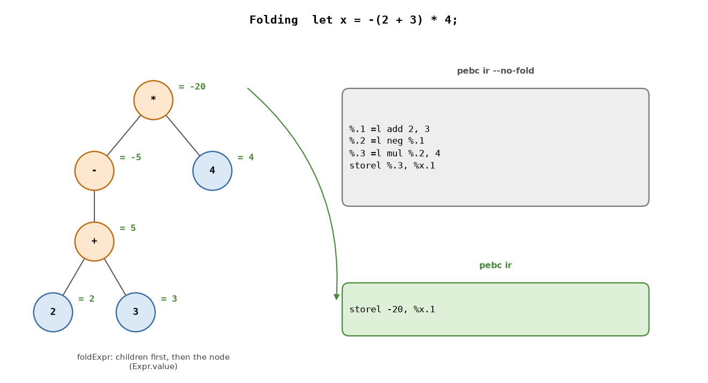

# Chapter 9 — Constant Folding and Where to Go Next

The last chapter adds pebc's first *optimization* pass, and it turns out to be as much about
correctness as about speed. pebc learns to work out, while compiling, every value that doesn't
depend on the running program: `60 * 60 * 24` becomes 86400, `-1 as u8` becomes 255, and
`if 2 > 3 { ... }` disappears. Two things fall out of it. Global variables can be initialized
with any constant expression, and a division by a constant zero, which has crashed programs
since Chapter 1, becomes a compile error. Then comes a surprise, measured: QBE already folds
constants itself, so the machine code barely changes. That tells us what folding in the front
end is really for. The folder must compute *exactly* what the machine would, wrapping around
and rounding toward zero; a planted bug shows what happens when it doesn't, and how Chapter 8's
tools catch it. The chapter, and the course, end with what to read and build next.

Previous: [Chapter 8](08-testing-a-compiler.md). Next: [Appendix A](appendix-a-cheat-sheet.md).

## What constant folding is

**Constant folding** means doing at compile time what doesn't need run time. If every operand
of an expression is known while compiling, the compiler can compute the result itself and put
the number in the program. Two tiny programs in `examples/ch09` show why pebc needs it. The
first wants a global whose value is an expression:

```console
$ cat day.peb
extern fn printf(format: *u8, ...) i32;

let seconds_per_day = 60 * 60 * 24;

fn main() {
    printf("%ld\n", seconds_per_day);
}
$ pebc build day.peb    # Chapter 8's pebc
day.peb:3:23: error: the value of a global variable must be a constant
let seconds_per_day = 60 * 60 * 24;
                      ^~~~~~~~~~~~
```

A global lives in the data section, and its initial value is written into the executable as
bytes (Chapter 6). Chapter 8's checker only accepted a literal, because a literal was the only
thing the code generator knew how to turn into bytes. `60 * 60 * 24` is a constant to any human,
but pebc had no way to compute it. C has the same rule: the initializer of a variable with
static storage must be a constant expression, and every C compiler evaluates those while
compiling.

The second program divides by zero:

```console
$ cat zero.peb
extern fn printf(format: *u8, ...) i32;

fn main() {
    let total = 100;
    printf("%ld per day\n", total / 0);
}
$ pebc build zero.peb && ./zero    # Chapter 8's pebc
Floating point exception (core dumped)
$ echo $?
136
```

It compiles without a word and dies with `SIGFPE` (Chapter 1: 136 is 128 + 8). The `/ 0` is
right there in the source; a compiler that knows the divisor is the constant 0 should say so.
With this chapter's pebc:

```console
$ pebc build day.peb && ./day    # Chapter 9's pebc
86400
$ pebc build zero.peb    # Chapter 9's pebc
zero.peb:5:37: error: division by zero
    printf("%ld per day\n", total / 0);
                                    ^
```

The `Makefile` in `examples/ch09` runs both compilers (`make before`, `make after`); the other
targets come up later in the chapter.

## A value for every expression

The checker (Chapter 5) gave every expression a type, stored in the tree as `Expr.type`. The
folder does the same for values. `src/ast.zig` gets one more field:

```zig
/// Set by the folder (fold.zig): the value, if it is known before the
/// program runs. A bool is 0 or 1, `null` is 0.
value: ?i64 = null,
```

`null` means "not known while compiling". One `i64` holds the value of every Pebble type, and
it is always *normalized*: a `u8` is between 0 and 255, an `i32` is between -2147483648 and
2147483647 (sign-extended to 64 bits), a bool is 0 or 1, the null pointer is 0. Normalizing
makes every comparison a plain `i64` comparison: `200 as u8 > 100` compares 200 with 100,
which is right, and it would be wrong if the `u8` 200 were stored as the byte's signed reading,
-56.

Which expressions have a value?

- A literal: an integer, a character, `true`/`false`, `null`.
- `-x`, `!x` and `x as T`, when `x` has a value.
- `a + b`, `a < b` and the other binary operators, when both sides have values; `&&` and `||`
  sometimes with only one side known (below).
- Nothing else: names, calls, `*p`, `&x`, fields, indexing and strings depend on memory or on
  the running program. (`sizeof` never reaches the folder: the checker already replaced it with
  a number, in Chapter 7.)

A name is "not known" even when it was declared with `let` and a literal. That is a choice to
keep the folder simple; exercise 1 removes it.

The folder walks the tree the way the checker does: statements in order, and for an
expression, the parts first and then the expression itself (post-order). By the time it reaches
`*` in `-(2 + 3) * 4`, both operands have their values:



On the right are the two ways pebc compiles `let x = -(2 + 3) * 4;`: with folding turned off,
three instructions compute -20 at run time; with folding, the store of -20 is all that's left.

## Computing what the machine computes

The folder replaces a computation the program would do with a value pebc computes. That is
only correct if the two are *exactly* equal, for every input, including the ugly ones. The
whole of `src/fold.zig` (224 lines) is organized around that rule. Here is the heart of it,
`foldBinary`, after it has folded both operands:

```zig
const lhs = b.lhs.value orelse return null;
const rhs = b.rhs.value orelse return null;
const t = b.lhs.type;
return switch (b.op) {
    .add => castInt(lhs +% rhs, t),
    .sub => castInt(lhs -% rhs, t),
    .mul => castInt(lhs *% rhs, t),
    .div, .rem => {
        // The smallest value divided by -1 is one more than the
        // largest: the processor's division instruction traps.
        if (rhs == -1 and lhs == minValue(t)) {
            try f.diags.err(e.span, "{d} {s} -1 overflows '{f}'", .{ lhs, b.op.symbol(), t });
            return null;
        }
        // Division rounds toward zero, as on the machine.
        return if (b.op == .div) @divTrunc(lhs, rhs) else @rem(lhs, rhs);
    },
    // A u8 is kept between 0 and 255, so comparing the i64 values
    // gives the right answer for every type.
    .eq => @intFromBool(lhs == rhs),
    // ... and .ne, .lt, .le, .gt, .ge the same way
    .@"and", .@"or" => unreachable,
};
```

Three things in it need explaining.

**Wrapping.** Pebble's arithmetic wraps around (Chapter 5): `2147483647 + 1` as an `i32` is
-2147483648, and `200 + 100` as a `u8` is 44. Zig's plain `+` would panic on overflow, which
is the right default for a compiler's own arithmetic and the wrong one for computing a Pebble
program's. Zig's *wrapping* operators `+%`, `-%` and `*%` wrap around in 64 bits instead. For
the smaller types, `castInt` then keeps the low bits:

```zig
/// Converts a value to type `to` the way the machine does: an i32 keeps
/// the low 32 bits (sign-extended back to 64), a u8 the low 8 bits.
pub fn castInt(n: i64, to: Type) i64 {
    return switch (to) {
        .u8 => @as(u8, @truncate(@as(u64, @bitCast(n)))),
        .i32 => @as(i32, @truncate(n)),
        else => n,
    };
}
```

`@truncate` drops the high bits; the result is widened back to `i64` by the return type. A
`u8` goes through `u64` first, because `@truncate` keeps the signedness of its operand, and
`-1` as a signed 8-bit number is still -1, not 255. `@bitCast` reinterprets the same 64 bits as
unsigned. Is it right to wrap the 64-bit sum and then truncate, rather than truncate first?
Yes: the low 8 or 32 bits of a sum or product depend only on the low 8 or 32 bits of the
operands. `castInt` is not new: the code generator has used it for casts of literals since
Chapter 5. It moved into `fold.zig`, and the code generator imports it from there. The same
function folds a cast: `-1 as u8` is `castInt(-1, .u8)`, 255, and `4294967295 as i32` is -1.

**Division rounds toward zero.** `-7 / 2` is -3.5, and there are two reasonable integer
answers. x86-64's `idiv` instruction, QBE's `div` and C since C99 all *truncate*: they round
toward zero, -3, and the remainder takes the sign of the left side, so `-7 % 2` is -1 and
`7 % -2` is 1. Python *floors*: `-7 // 2` is -4 and `-7 % 2` is 1. Zig has both, as builtins:
a short program, `e.zig`, that prints `@divTrunc(a, b)`, `@rem(a, b)`, `@divFloor(a, b)` and
`@mod(a, b)` for the variables `a = -7` and `b = 2` prints `-3 -1 -4 1`. What Zig *won't* do is
guess. With `a / b` in that `print`:

```console
$ zig run d.zig
d.zig:7:34: error: division with 'i64' and 'i64': signed integers must use @divTrunc, @divFloor, @divCeil, or @divExact
    std.debug.print("{d}\n", .{a / b});
                               ~~^~~
```

Plain `/` on signed integers is a compile error in Zig, because the language doesn't want to
choose a rounding for you. That is the subject of this chapter in miniature: the folder must
pick `@divTrunc` and `@rem`, the ones that match the machine. Section "A planted bug" shows
what the wrong choice does.

**One division that doesn't fit.** The smallest `i64`, -9223372036854775808, divided by -1 is
9223372036854775808, one more than the largest `i64`. There is no right answer to wrap to, and
`idiv` raises the same exception as a division by zero (Chapter 8's difftest avoided it for that
reason). Zig's `@divTrunc` would panic. So the folder reports it as an error, using `minValue`,
which is `minInt(i32)` or `minInt(i64)` for the signed types and 0 for the rest (a `u8` can't be
-1, so the check never fires for it).

Before this `switch`, `foldBinary` handles the cases that don't need both sides. A division
or remainder whose right side is 0 is reported as `division by zero`, even when the left side
is unknown. And `&&` and `||` look at their left side only: if it is known and decides the
answer, `false && x` is 0 and `true || x` is 1, *whatever x is*, even a call. Chapter 4's
short-circuit rule says `x` is never evaluated, so its value doesn't matter. Otherwise
(`true && x`, `false || x`) the result is `x`'s value, which may be `null`.

The rest of the folder is a walk. `foldProgram` folds every global's initializer and every
function body; `foldStmt` folds each expression a statement contains; `foldExpr` is a `switch`
over the kinds of expression that sets `e.value`:

```zig
/// Folds the parts of `e`, then `e` itself.
fn foldExpr(f: *Folder, e: *Expr) Error!void {
    e.value = switch (e.kind) {
        // ... a literal's value is the literal: .bool => |b| @intFromBool(b), ...
        .string, .name, .sizeof => null,
        .unary => |u| blk: {
            try f.foldExpr(u.operand);
            const v = u.operand.value orelse break :blk null;
            break :blk switch (u.op) {
                .neg => castInt(0 -% v, e.type),
                .not => @intFromBool(v == 0),
                .addr, .deref => null,
            };
        },
        .binary => |b| try f.foldBinary(e, b),
        // ... .call, .index and .field fold their parts and are null;
        .cast => |c| blk: {
            try f.foldExpr(c.operand);
            const v = c.operand.value orelse break :blk null;
            break :blk castInt(v, e.type);
        },
    };
}
```

`-x` is `0 -% x`, so negating the smallest `i64` wraps around to itself, as `neg` does on the
machine. Notice that a call's arguments are still folded, although the call has no value: the
argument `60 * 60` in `f(60 * 60)` is a constant.

## Mistakes you can see once you know values

Knowing values shows mistakes the checker couldn't see. The folder reports three new errors,
and the golden test `tests/errors/fold.peb` has them all:

```console
$ pebc check errors/fold.peb
errors/fold.peb:3:34: error: division by zero
let bad_global = 24 * 60 * 60 / (60 - 60);
                                 ^~~~~~~
errors/fold.peb:8:17: error: division by zero
    total = i / 0;
                ^
errors/fold.peb:11:15: error: index -1 is out of bounds for '[10]i64'
    total = a[2 * 5 - 11];
              ^~~~~~~~~~
...
```

(Seven errors in all; the four not shown are `a[10]`, `i % (5 - 5)`, and
`(-9223372036854775807 - 1) / -1` and the same in `i32`: "-9223372036854775808 / -1 overflows
'i64'".)

- **Division by zero** points at the divisor, and needs only the divisor: `i / 0` is an error
  even though `i`'s value isn't known. This is what Chapter 1's exercise 3 started, catching a
  literal `0`; now `(60 - 60)` is caught too.
- **An index out of bounds** when the index is a constant and the base is an array, whose
  length is part of its type. Chapter 6's exercise 1 caught `a[10]` in the checker, but `a[-1]`
  is a negation node, not a literal, and got only the run-time check. The folder sees -1. The check
  is in `foldExpr`'s `.index` case: `if (i < 0 or i >= ix.base.type.array.len)`.
- **`MIN / -1`**, for `i64` and `i32`. The smallest value can't be written as a literal (its
  absolute value doesn't fit), so the test builds it as `-9223372036854775807 - 1`.

The file ends with two lines that are *not* an error, under the comment "Not an error: pebc
doesn't look at what a `let` holds": `let small = (-2147483647 - 1) as i32;` and
`total = (small % -1) as i64;`. That traps at run time, but `small` is a name, and the folder
doesn't look into names. It's an honest limit, and exercise 1 lifts it.

Where does the folder run? After the checker, and only if the checker found no errors: a tree
with errors has expressions of type `.invalid`, and there is nothing sensible to compute with
those. In `main.zig`:

```zig
// The folder always runs: it finds errors too, and global variables
// need its values even with --no-fold.
var folder: Folder = .init(&diags);
try folder.foldProgram(program);
if (diags.hasErrors()) return fail(diags, stderr);
if (command == .check) return 0;
```

`--no-fold` is a new flag, coming up in a moment. "Always runs" matters: the errors above must
not depend on a flag, and a program that compiles with folding must compile without it.

Two older pieces of pebc get simpler. The checker's rule for globals used to accept only a
literal; its `isConstant` now accepts any expression built from literals, `sizeof`, unary `-`
and `!`, binary operators and casts. The checker can't compute the value (the folder hasn't
run yet), but it can tell that one will exist. And the code generator's `constant()`, which
writes a global's initial value into the data section, now starts with
`if (e.value) |v| return .{ .int = v };`, even with `--no-fold`: data needs a number.

## Folding in the code generator

Values in the tree are useless until the code generator uses them. The first line of `genExpr`
does most of the work, with a helper `known`:

```zig
fn genExpr(g: *CodeGen, e: *const Expr) Error!Value {
    if (g.known(e)) |v| return .{ .int = v };
    // ...

/// The folded value of `e`, unless folding is off.
fn known(g: *const CodeGen, e: *const Expr) ?i64 {
    return if (g.fold) e.value else null;
}
```

If the value is known, the expression *is* that number, and no instructions are emitted for it
or for any of its parts.

Statements get the same treatment. An `if` whose condition is known compiles only the branch
that runs:

```zig
.@"if" => |i| {
    if (g.known(i.cond)) |cond| {
        if (cond == 1) {
            try g.genBlock(i.then);
        } else if (i.@"else") |else_branch| {
            try g.genStmt(else_branch);
        }
        return;
    }
    // ... the jnz and the labels, as before
```

The other branch, and every string literal in it, never reaches the IL. It was still *checked*:
the checker ran on the whole tree before the folder, so a type error in dead code is still an
error, as it should be. A `while` with a known condition has two cases: `while false` emits
nothing at all, and `while true` keeps its labels but loses its `jnz`, so the `@while.N.cond`
label falls straight through into the body. (The labels stay because `break` jumps to
`@while.N.end` and `continue` to `@while.N.cond`.) And `genLogical`, the code for `&&` and
`||`, gets one line: when the left side is known but didn't decide the answer (`true && x`,
`false || x`), the result is just the right side,
`if (g.known(b.lhs) != null) return g.genExpr(b.rhs);`. When the left side did decide it,
`genExpr` returned the folded value before `genLogical` was ever called.

`examples/ch09/demo.peb` has a little of everything:

```
extern fn printf(format: *u8, ...) i32;

let seconds_per_day = 60 * 60 * 24;

fn main() {
    let x = -(2 + 3) * 4;
    if x > 0 {
        printf("never\n");
    }
    if 2 > 3 {
        printf("not even compiled\n");
    }
    printf("%ld %ld\n", x, seconds_per_day);
}
```

`pebc` takes the new flag after the command and the file (`pebc ir demo.peb --no-fold`), and
`make ir` runs it both ways. Without folding:

```console
$ pebc ir demo.peb --no-fold
data $seconds_per_day = { l 86400 }

export function w $main() {
@start
	%x.1 =l alloc8 8
	%.1 =l add 2, 3
	%.2 =l neg %.1
	%.3 =l mul %.2, 4
	storel %.3, %x.1
	%.4 =l loadl %x.1
	%.5 =w csgtl %.4, 0
	jnz %.5, @if.1.then, @if.1.end
@if.1.then
	%.6 =w call $printf(l $str.0, ...)
@if.1.end
	%.7 =w csgtl 2, 3
	jnz %.7, @if.2.then, @if.2.end
@if.2.then
	%.8 =w call $printf(l $str.1, ...)
@if.2.end
	%.9 =l loadl %x.1
	%.10 =l loadl $seconds_per_day
	%.11 =w call $printf(l $str.2, ..., l %.9, l %.10)
	ret 0
}
...
```

With folding, the four lines after `alloc8` are one, `storel -20, %x.1`, as in the picture.
The second `if`, from `%.7` to `@if.2.end`, is gone, and so is the string `"not even
compiled"`; the rest is the same, with smaller temporary numbers. But `if x > 0`
is still there, although `x` is obviously -20: `x` is a name, and the folder doesn't look into
names. The global's data is the same both ways, `{ l 86400 }`, because `--no-fold` can't turn
off a global's value; there is no instruction that could compute it at run time.

The golden test `tests/run/fold.peb` exercises each rule and prints the results. Its globals use
a constant expression each (`1000 as u8`, `16 * sizeof(i64)`, `!true || 1 > 2`), and its `main`
has wrapping, rounding, dead branches, `while false`, a `while true` left by `break`, and a
helper `say(name, value)` that prints its name and returns its value, to show which right sides
of `&&` and `||` are called:

```console
$ pebc build run/fold.peb -o fold && ./fold
86400 232 128 0
-2147483648 44 255 -1
-3 -1 -3 1
always
n = 3
= 0
= 1
c = 1
d = 0
```

The last four lines come from `false && say("a", true)`, `true || say("b", true)`,
`true && say("c", true)` and `false || say("d", false)`, each printed with `"= %d\n"`.
`say("a", ...)` and `say("b", ...)` are never called, as Chapter 4's rule demands, and `c` and
`d` are. In the IL, the first two calls are `call $printf(l $str.6, ..., w 0)` and `w 1`, and
the `while true` loop starts with `@while.1.cond` and `@while.1.body`, two labels in a row with
nothing between them.

## Testing an optimization

How do you test an optimization? Chapter 8's oracle problem has a neat answer here: an
optimized program must print exactly what the unoptimized one prints. So pebc can always run
without its optimization, and every test can run both ways:

```console
$ pebc
usage: pebc COMMAND FILE [-o OUTPUT] [--no-fold]
...
--no-fold  compute constant expressions at run time, not while compiling
$ zig build test -Dno-fold 2>&1 | grep -v ^PASS
golden: 40 passed, 0 failed
$ zig build test 2>&1 | grep -v ^PASS
golden: 40 passed, 0 failed
```

`--no-fold` sets `gen.fold = false`, which turns off the *use* of values in the code generator.
The folder still runs, so the errors and the global values are the same both ways. `-Dno-fold`
in `build.zig` passes `--no-fold` to the golden runner and to difftest, which pass it on to
pebc. The same golden files are correct both ways, so one set of files tests both compilers.

The unit test in `fold.zig` checks the folder on its own, through a helper `foldValue`, which
wraps a few statements in `fn main() { ... }`, runs the lexer, parser, checker and folder on it,
and returns the value of the last `let`. Ten cases, among them:

```zig
try expectValue(44, try foldValue(a, "let x: u8 = 200 + 100;"));
// Division rounds toward zero; the remainder has the sign of the left side.
try expectValue(-3, try foldValue(a, "let x = -7 / 2;"));
try expectValue(0, try foldValue(a, "let x = false && 1 / 1 == 1;"));
try expectValue(null, try foldValue(a, "var x = 1; let y = x + 1;"));
```

And the differential tester, both ways:

```console
$ time zig build difftest -Dcount=300
difftest: 300 programs (seeds 1..300), 0 failed

real	0m18.986s
$ zig build difftest -Dcount=300 -Dno-fold
difftest: 300 programs (seeds 1..300), 0 failed
```

Difftest's programs are full of constant subexpressions, such as `(2147483647 % -2)` in the
next section, so with folding on, the folder computes thousands of values that `cc` computes its
own way. While this chapter was written, 1000 more programs (`-Dseed=20000 -Dcount=1000`, one
minute) found no difference, and `zig build test --fuzz=200K` (the fuzz test runs the folder
too now) found no crash.

## A planted bug: dividing like Python

Now the bug this chapter has been warning about. In `fold.zig`, line 150, replace the
truncating builtins with the flooring ones:

```console
$ diff fold.orig src/fold.zig
150c150
<                 return if (b.op == .div) @divTrunc(lhs, rhs) else @rem(lhs, rhs);
---
>                 return if (b.op == .div) @divFloor(lhs, rhs) else @mod(lhs, rhs);
```

It's an easy mistake: someone who learned integer division from Python expects `-7 / 2` to be
-4, and both builtins look equally official. The tests:

```console
$ zig build test 2>&1 | grep -v ^PASS
  --- run/arithmetic.out (expected)
  +++ actual
    5
    13
  - -3 -1
  + -4 1
    ...
FAIL run/arithmetic.peb
  --- run/fold.out (expected)
  +++ actual
  ...
  - -3 -1 -3 1
  + -4 1 -4 -1
  ...
FAIL run/fold.peb
golden: 38 passed, 2 failed
    ...
error: 'fold.test.folding computes what the machine would' failed:
       expected -3, found -4
       ...
```

Two golden tests and the unit test fail, each with a precise message. `run/arithmetic.peb` is
from Chapter 1 and has printed `-7 / 2` and `-7 % 2` ever since; with folding, those are now
computed by pebc instead of by `idiv`. The next command is the interesting one:

```console
$ zig build test -Dno-fold 2>&1 | grep golden:
golden: 40 passed, 0 failed
```

With folding off, everything passes. That *localizes* the bug: whatever is wrong, it is in
the folder or in the code that uses its values, not in the code generator's arithmetic or in
QBE. Differential testing agrees, in both directions:

```console
$ zig build difftest 2>&1 | grep -v '^  '
FAIL seed 2: the programs disagree
FAIL seed 81: the programs disagree
FAIL seed 93: the programs disagree
difftest: 100 programs (seeds 1..100), 3 failed
...
$ zig build difftest -Dno-fold 2>&1 | grep -v '^  '
difftest: 100 programs (seeds 1..100), 0 failed
$ zig build difftest -Dseed=2 -Dcount=1 2>&1 | head -7
FAIL seed 2: the programs disagree
  pebc: .{ .exited = 0 }, 51 bytes of output
  cc:   .{ .exited = 0 }, 50 bytes of output
  first difference, line 2:
  pebc: g2 = -1564717681
  cc:   g2 = 1564717681
  the files are in ./.zig-cache/o/2b24dd6112887bc6fd94deb7d9866cfe/difftest/2
$ cd .zig-cache/o/2b24dd6112887bc6fd94deb7d9866cfe/difftest/2
$ grep -n '2147483647 % -2' case.peb
83:    g2 = ((g2 - (2147483647 % -2)) * -1564717681);
```

`2147483647 % -2` is the remainder of a positive number by a negative one: 1 when the division
truncates, -1 when it floors. Even if the golden tests had missed it, three random programs in a
hundred would not have.

This is how compiler developers test optimizations: compile the same programs at `-O0` and
`-O2` and compare. When they disagree, the bug is in an optimization, or the program has
undefined behaviour, which is why Chapter 8 worked so hard to generate programs without any.

## QBE folds too

So pebc folds constants. How much faster are its programs? Chapter 8 showed QBE's passes with
`qbe -d`; one of them, `F`, is constant folding. Here it is on the `--no-fold` IL of
`demo.peb` (`make sccp`):

```console
$ pebc ir demo.peb --no-fold > off.ssa
$ qbe -d F off.ssa 2>&1 >/dev/null
**** Function main ****
> SCCP findings:
       x.1: Top
        .1: 5
        .2: -5
        .3: -20
        .4: Top
        .5: 0
        .6: Top
        .7: 0
        .8: Top
        .9: Top
 dead code: if.1.then if.2.then 

> After constant folding:
...
```

(The listing after the findings shows `main` with the dead blocks gone, the arithmetic turned
into `nop`s, and `argl -20` passed to `printf`.)

QBE found `.3: -20` by itself, and it found more than pebc did. `.5`, the result of
`csgtl %.4, 0`, is 0: QBE knows that `%.4`, loaded from `x`, is -20, because its slot promotion
(Chapter 8's `M`) turned `x` into a temporary and copy elimination (`C`) replaced the load with
`%.3`. So both `if`s are dead, `x > 0` included.

The algorithm is **sparse conditional constant propagation** (SCCP), from Wegman and Zadeck
(History, below). Each temporary has a place in a small *lattice*: `Top`, "no value seen yet";
a constant; or `Bot`, "more than one value, so not a constant". Every temporary starts at
`Top`. The analysis follows only the branches that can be taken, given what it knows so far,
and moves temporaries down the lattice as it sees their definitions. QBE prints every
temporary that didn't end at `Bot`. The `Top`s at the end are temporaries that never got a
value: `.6` and `.8` are defined only in the dead blocks, and `x.1`, `.4` and `.9` had already
been replaced by the copy elimination pass. Temporaries that do vary, such as `.10`, are at
`Bot` and aren't listed.

The conditional part matters. SCCP treats "this block can run" as one more fact to discover,
so constants and dead code are found together, each helping the other.

Now the measurement. The assembly from both IL files, compared:

```console
$ pebc ir demo.peb > on.ssa; pebc ir demo.peb --no-fold > off.ssa
$ qbe on.ssa > on.s; qbe off.ssa > off.s; diff on.s off.s
14c14
< 	leaq str.1(%rip), %rdi
---
> 	leaq str.2(%rip), %rdi
34a35,42
> 	.ascii "not even compiled"
...
```

The only difference: an unused string that QBE left in the data section, and so a different
name for the next one. The code of `main` is the same both ways, ten lines with no branch: it
loads `seconds_per_day`, puts `-20` straight into a register (`movq $-20, %rsi`) and calls
`printf` once. Every program in `tests/run`, compiled both ways, counting the lines
that differ:

```console
$ for f in *.peb; do pebc ir $f | qbe > a.s; pebc ir $f --no-fold | qbe > b.s; echo "$f $(diff a.s b.s | grep -c "^[<>]")"; done
answer.peb 0
...
fold.peb 74
...
types.peb 0
```

Zero for all of them except `fold.peb`, the test written to exercise folding. Even there, some
of the difference is cosmetic: with `--no-fold`, `2147483647 + 1` as an `i32` reaches the
assembly as `movl $2147483648, %esi`, and with folding as `movl $-2147483648, %esi`, the same
32 bits written two ways.

So, *with this backend*, pebc's folding makes programs almost no faster. QBE's home page states
its aim as "70% of the performance of industrial optimizing compilers in 10% of the code", and
constant folding is in the 10%. What is folding in the front end for, then?

1. **The language.** Global initializers need values while compiling; QBE's data definitions
   take numbers, not instructions. Without the folder, `let seconds_per_day = 60 * 60 * 24;`
   can't exist.
2. **Errors.** QBE folds what it safely can, and a division by zero is not something it can
   fold. A hand-written `examples/ch09/dz.ssa` (`make dz`) is a `main` that returns
   `div 7, 0`:

   ```console
   $ qbe dz.ssa | sed -n '/^main:/,/ret/p'
   main:
   	...
   	movl $0, %ecx
   	movl $7, %eax
   	cltd
   	idivl %ecx
   	leave
   	ret
   $ qbe -o dz.s dz.ssa && cc -o dz dz.s && ./dz
   Floating point exception (core dumped)
   ```

   QBE is right not to complain: a back end compiles what it's given, and `div 7, 0` is valid
   IL that traps. Only the front end knows that the `0` was written by a person who made a
   mistake, and only it can point at the line of source.
3. **Not depending on the backend.** Another back end might not fold at all, and the day you
   write your own (section "Where to go next"), the folder is already there.
4. **What the backend can't see.** QBE knows only the IL. A global's value is in memory, and
   QBE doesn't assume it never changes; a `let` global *can't* change, but only the front end
   knows that. Exercise 1 makes the folder look into `let`s, and Mandelbrot's assembly shrinks
   from 195 to 175 lines.

Real compilers fold in the front end for all four reasons. Clang evaluates constant
expressions in its front end, because C requires them in array sizes, `case` labels and static
initializers and wants to warn about overflow and division by zero in them, and LLVM folds
again, much more aggressively, later.

## A crash nobody found

Exercise 4 of this chapter lets an array length be a constant expression. While it was being
written, a test with an absurd length crashed pebc. The crash had nothing to do with folding;
it was older. `examples/ch09/huge.peb` (`make huge`):

```console
$ cat huge.peb
fn main() {
    var a: [9223372036854775807]i64;
}
$ pebc ir huge.peb 2>&1 | head -4    # Chapter 8's pebc
thread 1001545 panic: integer overflow
./src/types.zig:76:33: 0x123dc8c in size (main.zig)
            .array => |a| a.len * a.elem.size(),
                                ^
```

`Type.size` multiplies the length by the element size, and 9223372036854775807 × 8 doesn't fit
in a `u64`. Zig's safety check turned a silent wrong size into a panic, the better failure, but
a compiler must never panic on its input. The bug has been there since arrays arrived in Chapter
6 (whose snapshots, like 7 and 8, keep it). No golden test tried such a length; difftest's
programs have no arrays; and random tokens rarely form a valid declaration with a 19-digit
length in the right place, so the fuzzer missed it.

The fix has three parts. A limit, `Type.max_size`, set to `std.math.maxInt(i32)` bytes (2 GiB).
A size computation that can't overflow, using Zig's *saturating* multiplication `*|`, which
stops at the largest `u64` instead of wrapping around or panicking:

```zig
// `*|` saturates: a size too big for a u64 stays too big
// instead of wrapping around to a small one.
.array => |a| a.len *| a.elem.size(),
```

Saturating matters for nested arrays: in `[1000000][1000000][1000000][1000000]u8`, a wrapping
multiplication could come back to a small number before the check sees it. And a check,
`checkSize`, wherever the checker builds an array type, lays out a struct, or adds a field to
one, reporting `'{f}' is too large: the limit is {d} bytes` and returning `.invalid`.

The new golden test `tests/errors/sizes.peb` has every way to make a type too big: a struct
`Huge` with a field `[1000000][1000000]u8`; a struct `Pair` with two fields of 1.5 GB each,
fine on their own and too big together; a struct `Table` with a field `[1000000]Row`, where
`Row` (8000 bytes) is declared *after* `Table`, so its size is only known later; a global
`var table: [1000000]Row;`; and in `main`, `huge.peb`'s array, a fine `var fine: [1000]Row;`
and a `sizeof` of a too-big type. Three of its errors:

```console
$ pebc check errors/sizes.peb    # Chapter 9's pebc
errors/sizes.peb:22:12: error: '[9223372036854775807]i64' is too large: the limit is 2147483647 bytes
    var a: [9223372036854775807]i64;
           ^~~~~~~~~~~~~~~~~~~~~~~~
...
```

Six errors in all, one for each too-big type, such as `'Pair' is too large` at `struct Pair` and
`'[1000000]Row' is too large` at `Table`'s field. The `Table` error comes from checking the
struct's fields again once `Row` is laid out. Why 2 GiB? Nothing near that size fits in a stack
(8 MiB by default on Linux), and with every size below 2³¹, the offset arithmetic in the checker
and the code generator stays far from overflowing.

The lesson: every test method has blind spots, and different ones. Golden tests check what
someone thought of, the fuzzer finds crashes near the inputs it reaches, difftest finds wrong
code in the programs its generator writes. None of them wrote `[9223372036854775807]i64`.
Trying the edges on purpose, while writing new code near them, still finds a lot of bugs.

## History: constant propagation, division, and compilers that compile themselves

Folding expressions whose operands are literals is as old as compilers. The harder problem is
*propagation*: knowing that `x` is 5 at one point of a program because of an assignment
somewhere else, through branches and loops. Mark Wegman and F. Kenneth Zadeck's "Constant
Propagation with Conditional Branches" (ACM Transactions on Programming Languages and Systems
13(2), April 1991) gave the algorithm QBE prints as "SCCP findings". It works on SSA form, where
each temporary has one definition, so the facts about a temporary can be kept in one place
(the "sparse" part), and it discovers which branches can be taken together with the constants
(the "conditional" part). Doing both at once finds constants that a propagation which assumes
every branch can be taken misses. SCCP is still the standard algorithm; LLVM has an SCCP
pass, and QBE's `fold.c` implements it in a few hundred lines.

The planted bug of this chapter is a piece of C history. In C89, the result of `/` with a
negative operand was implementation-defined: a compiler could round the quotient toward zero
or toward minus infinity, as long as `(a / b) * b + a % b` equalled `a`. C99 fixed it:
the quotient is the algebraic quotient "with any fractional part discarded", that is, truncated
toward zero, which is what x86's `idiv` and most other processors' division instructions do.
Python chose the other rounding, floor, on purpose, so that `a % b` has the sign of `b`. Zig
lets you have either, but only by name.

Where to go next ends with a compiler compiling itself, which has a history too. Zig's
compiler was first written in C++. In "Goodbye to the C++ Implementation of Zig" (December
2022), Andrew Kelley explains how the project removed it. Before, "the Zig codebase consisted
of two compilers": the old one "written in 80,000 lines of C++" and the new one "written in
250,000 lines of Zig", and the old one was needed to build the new one from source. Now the
repository keeps `zig1.wasm`, a WebAssembly build of the compiler with every backend disabled
except the one that writes C. A small C program (`wasm2c`) turns it into C, the system's C
compiler builds that, and the result translates the compiler's own source into C, which is
compiled again. "Thus, instead of 80,000 lines of C++, there are now 4,000 of portable C."

And the classic warning about self-compiling compilers is Ken Thompson's Turing Award lecture,
"Reflections on Trusting Trust" (Communications of the ACM 27(8), August 1984): a compiler's
binary can be changed to compile a backdoor into `login`, and to compile the same change into
every new compiler built from clean source, where no one can read it. His moral: "You can't
trust code that you did not totally create yourself."

## Where to go next

pebc is finished, as far as this course goes. Four directions to take it further:

**More optimizations.** Exercises 1 and 3 add two. The classic next ones are dead code
elimination, common subexpression elimination (compute `a[i] + a[i]` once) and inlining. Each
wants to know where every value comes from and where it is used, across branches and loops,
which a tree doesn't show; that is why real compilers optimize an SSA-form IR, and QBE's passes
from Chapter 8 (`M`, `N`, `C`, `F`, ...) are a map of what one does with it.

**Other back ends.** LLVM is the industrial one, and Zig ships Clang, so `zig cc` shows LLVM IR
right now (`make llvm` in `examples/ch09`). `sum.c` is Chapter 8's `sum.peb` in C:

```console
$ zig cc -S -emit-llvm -O0 -g0 -fno-sanitize=undefined -fno-discard-value-names -o sum0.ll sum.c
$ grep -A8 '^while.body' sum0.ll
while.body:                                       ; preds = %while.cond
  %2 = load i64, ptr %total, align 8
  %3 = load i64, ptr %i, align 8
  %add = add nsw i64 %2, %3
  store i64 %add, ptr %total, align 8
  %4 = load i64, ptr %i, align 8
  %add1 = add nsw i64 %4, 1
  store i64 %add1, ptr %i, align 8
  br label %while.cond, !llvm.loop !6
```

(`zig cc` is Clang 22.1.8 in Zig 0.17.1. It turns on debug information and the undefined-
behaviour sanitizer by default here; `-g0 -fno-sanitize=undefined` turns them off.) Look
familiar? At `-O0`, Clang writes IR the way pebc does: every variable an `alloca` slot (QBE's
`alloc8`), a `load` and a `store` around every use, and the clean-up left to the optimizer.
`nsw` means "no signed wrap": C's undefined behaviour on overflow, written into the IR so the
optimizer may rely on it. At `-O2`:

```console
$ zig cc -S -emit-llvm -O2 -g0 -fno-sanitize=undefined -o sum2.ll sum.c
$ sed -n '/^3:/,/br label/p' sum2.ll
3:                                                ; preds = %1
  %4 = shl nuw i64 %0, 1
  %5 = add nsw i64 %0, -1
  %6 = zext nneg i64 %5 to i65
  %7 = add nsw i64 %0, -2
  %8 = zext i64 %7 to i65
  %9 = mul i65 %6, %8
  %10 = lshr i65 %9, 1
  %11 = trunc nuw i65 %10 to i64
  %12 = add i64 %4, %11
  %13 = add i64 %12, -1
  br label %14
```

The block before it returns 0 when `n < 1`; the block after returns `%13`. The loop is gone.
LLVM recognized the sum 1 + 2 + ... + n and replaced it with 2n + (n − 1)(n − 2)/2 − 1, which
equals n(n + 1)/2; the product is computed in 65 bits, `i65`, so that it can't overflow before
the halving. The x86-64 for it has no loop. QBE compiles pebc's `sum` to Chapter 8's
five-instruction loop: the trade QBE makes on purpose. LLVM's tutorial "My First Language
Frontend with LLVM" builds a small language, Kaleidoscope, with pebc's shape (lexer, parser,
tree, code generator), and the LLVM Language Reference documents the IR.

Between the two sits **Cranelift**, "a fast, secure, relatively simple and innovative compiler
backend", used by the Wasmtime WebAssembly runtime and as an experimental backend for the Rust
compiler; it aims to compile quickly rather than to optimize as hard as LLVM. QBE's users page
lists the compilers built on QBE, among them the C11 compiler `cproc` and Hare's.

Or **write your own back end**: replace `driver.zig`'s call to `qbe` with code that writes
x86-64 assembly. The hard parts are instruction selection (which instructions implement each IL
operation) and register allocation (which temporaries live in which of the sixteen registers).
pebc's IL, with its explicit types and temporaries, is a good input. Nora Sandler's *Writing a
C Compiler* (No Starch Press) builds a C compiler with its own x86-64 back end, adding
optimizations and a register allocator in its later chapters: the natural next book. For the
other side of language implementation, Robert Nystrom's *Crafting Interpreters* (free online)
builds a tree-walking interpreter and a bytecode virtual machine for one language.

**Bootstrapping.** A compiler that compiles itself is the traditional proof that a language is
ready. Could pebc be rewritten in Pebble? Memory is not the problem: Pebble calls `malloc`
through `extern fn` (Chapter 7's `list.peb`). What it lacks is what makes a compiler pleasant to
write: slices, growable strings, enums and tagged unions for tokens and tree nodes, `switch`,
and modules. **Language features** like these, plus `for` loops and floating point (QBE has the
types `s` and `d`; the System V ABI passes them in `xmm` registers), each touch every phase of
pebc, which is the best way to understand the phases.

Whatever you build, **Compiler Explorer** (godbolt.org) shows what real compilers do with any
snippet, in dozens of languages, at any optimization level: ask GCC, Clang and Zig there first.

## The project at the end of the course

This chapter added `src/fold.zig` (224 lines: the folder, `castInt`, `minValue`, the unit
test), `Expr.value` in `ast.zig`, constant expressions and `checkSize` in `check.zig`,
`max_size` in `types.zig`, folded `if`, `while`, `&&` and `||` in `codegen.zig`, `--no-fold` in
`main.zig`, the test harnesses and `build.zig`, and three golden tests. `zig build test
--summary all` ends with `golden: 40 passed, 0 failed` and `23/23 tests passed`.

And the whole compiler, the way a source file travels through it, with the chapter that
introduced each part:

```
source.peb
  │  main.zig      command line, the pipeline                      Chapter 1
  ▼
lexer.zig          tokens with spans; diag.zig for messages         Chapter 2
  ▼
parser.zig         recursive descent + Pratt → ast.zig tree         Chapters 3–4
  ▼                (print.zig prints it for `pebc ast`)
check.zig          names, scopes, types.zig types, size limit       Chapter 5
  ▼
fold.zig           constant values, compile-time errors             Chapter 9
  ▼
codegen.zig        tree → QBE IL text                               Chapters 3–7
  ▼
driver.zig         qbe → assembly, cc → executable                  Chapter 1
```

`src/` is 3,505 lines of Zig in 12 files; with the tests (`golden.zig` 281, `difftest.zig`
702) and `build.zig` (100), 4,588 in all. They are checked by 40 golden tests (20 programs that
run, 16 that must fail with the right messages, 4 syntax trees), 23 tests in `src/` including
the fuzz test, and a differential tester that generates as many programs as you have time for.
The language they compile runs the Game of Life and draws the Mandelbrot set.

## Summary

- **Constant folding** computes at compile time every value that doesn't depend on the running
  program. The folder stores it in `Expr.value: ?i64`, normalized for its type, so that one
  `i64` comparison works for every type.
- A folded value must be exactly what the machine computes: `+%`, `-%`, `*%` and `castInt`
  wrap around, `@divTrunc` and `@rem` round toward zero like `idiv` and C99, and `MIN / -1`
  is an error. `false && f()` is false without calling `f`.
- The folder finds new errors: division by a constant zero, a constant index out of bounds,
  and `MIN / -1`. It always runs, even with `--no-fold`, so errors and global values don't
  depend on a flag. Globals can now be initialized with any constant expression.
- The code generator emits a known value instead of its computation, compiles only the live
  branch of an `if` with a known condition, drops `while false` and the test of `while true`.
- An optimization is tested by turning it off (`--no-fold`, `-Dno-fold`). A planted
  `@divFloor` fails two golden tests, the unit test and 3 of 100 random programs with folding
  on, and nothing with it off, which locates it.
- QBE already folds constants (SCCP); the assembly of every golden program except `fold.peb`
  is the same both ways. Front-end folding is for the language, for errors, for independence
  from the back end, and for facts only the front end knows.
- `Type.size` overflowed on huge arrays since Chapter 6; a 2 GiB limit, saturating `*|` and
  `checkSize` fixed it. No test method had found it.
- Next: SSA optimizations, LLVM, Cranelift or your own back end, bootstrapping, new features.

## Exercises

1. **Let propagation.** A `let` never changes, so its value is known wherever its name is used.
   Make the folder use it. Which line of `errors/fold.peb` becomes an error? Measure what it
   does to the assembly of a program that uses a `let` global.

<details><summary>Solution</summary>

`Symbol` in `ast.zig` gets a field like `Expr`'s, `value: ?i64 = null`, "the value of a
`let`, if the folder knows it". In `fold.zig`, a `let` statement records its value, and a name
reads it:

```zig
.let => |l| if (l.value) |v| {
    try f.foldExpr(v);
    // A `let` never changes, so its value is known wherever
    // its name is used.
    if (!l.mutable) l.sym.value = v.value;
},
// ... and in foldExpr:
.name => e.sym.?.value,
```

One more change: a function may use a global declared *after* it, so `foldProgram` folds all
the globals first, then all the functions, in two loops. Without that, the function would see
the global's value as `null` and nothing would break, but nothing would be folded either.

Is it safe? The danger would be a `let` changed behind the folder's back, through a pointer.
That can't happen: Chapter 6's `checkPlace` already rejects `&x` when `x` is a `let` ("cannot
take the address of 'x', which was declared with 'let'"). And a `let` whose value is not known
(`let y = f();`) leaves `sym.value` null, so names of it stay unknown.

`errors/fold.peb`'s last line is now caught, and its comment changes to "An error too, now
that the folder knows what a `let` holds":

```
errors/fold.peb:16:14: error: -2147483648 % -1 overflows 'i32'
    total = (small % -1) as i64;
             ^~~~~~~~~~
```

Two new golden tests. `run/lets.peb` has a global `let size = 8;`, and in `main`
`let cells = size * size;`, `let half = cells / 2;`, `var grid: [64]u8;` and
`grid[cells - 1] = 1;`; it prints `cells`, `half` and `grid[63]`: `64 32 1`. `errors/lets.peb`,
the same with `grid[size * size] = 1;`, says

```
errors/lets.peb:6:10: error: index 64 is out of bounds for '[64]u8'
    grid[size * size] = 1;
         ^~~~~~~~~~~
```

42 golden tests pass both ways. The assembly of `lets.peb`'s `main` goes from 34 lines to 18:
before, it loaded `size` from memory, multiplied, and divided with `idivq`, because QBE can't
know that a global in memory never changes; now it is `movl $64, %esi` and `movl $32, %edx`.
`mandelbrot.peb`, whose fixed-point scale is `let one = 4096;`, goes from 195 lines of assembly
to 175. This is the fourth reason for front-end folding from section "QBE folds too", measured.

A global's *initializer* still can't use a name (`let cells = size * size;` at the top level
fails `isConstant`). Allowing it means folding globals in an order where each name's value is
ready before its uses, and reporting cycles (`let a = b; let b = a;`): a good next step.

</details>

2. **Overflow warnings.** The folder knows when `+`, `-`, `*` or unary `-` wrap around. Say
   so, with a warning that doesn't stop compilation. Compare with what `gcc` says about the
   same arithmetic in C.

<details><summary>Solution</summary>

`diag.zig` gets a third severity, `Severity = enum { @"error", warning, note }`, and a
`warn` function next to `err` (Chapter 5's exercise 3 did the same for unused variables). The
renderer prints the severity's tag name, so `warning:` needs no new code there. In
`fold.zig`, the exact result is computed in `i128`, where no `i64` sum, difference or product
can overflow, and compared with the wrapped one:

```zig
/// The `exact` result of `e`, wrapped around to e's type the way the
/// machine does it, with a warning if that changed it.
fn wrap(f: *Folder, e: *const Expr, op: []const u8, exact: i128) Error!i64 {
    const wrapped = castInt(@truncate(exact), e.type);
    if (wrapped != exact) {
        try f.diags.warn(e.span, "'{s}' overflows '{f}': the result wraps around to {d}", .{ op, e.type, wrapped });
    }
    return wrapped;
}
```

and the four operations call it: `.add => try f.wrap(e, "+", @as(i128, lhs) + rhs),`, the same
for `-` and `*`, and `.neg => try f.wrap(e, "-", -@as(i128, v)),` for unary minus. `@truncate`
to `i64` first, then `castInt` to the type: the same two steps as before, from a wider start.
Casts don't warn: `-1 as u8` asks for the wrap. Finally `main.zig` renders the diagnostics after
a successful fold, since only warnings can be left: `try diags.render(stderr);`. A test program,
`w.peb`, declares five `let`s and prints them (the last line, `./w`, below):

```console
$ pebc build w.peb -o w
w.peb:4:20: warning: '+' overflows 'i32': the result wraps around to -2147483648
    let big: i32 = 2147483647 + 1;
                   ^~~~~~~~~~~~~~
w.peb:5:20: warning: '+' overflows 'u8': the result wraps around to 44
    let byte: u8 = 200 + 100;
                   ^~~~~~~~~
w.peb:7:16: warning: '*' overflows 'i64': the result wraps around to -9223372036709301616
    let huge = 3037000500 * 3037000500;
               ^~~~~~~~~~~~~~~~~~~~~~~
w.peb:8:15: warning: '-' overflows 'i64': the result wraps around to -9223372036854775808
    let min = -(-9223372036854775807 - 1);
              ^~~~~~~~~~~~~~~~~~~~~~~~~~
$ echo $?; ./w
0
-2147483648 44 255 -9223372036709301616 -9223372036854775808
```

The one without a warning, line 6, is `let fine: u8 = 200 as u8 + 55 as u8;`, exactly 255.
GCC 11.4 on the first two lines in C:

```console
$ cat w.c
#include <stdint.h>
int32_t big = 2147483647 + 1;
uint8_t byte = 200 + 100;
$ gcc -c w.c
w.c:2:26: warning: integer overflow in expression of type ‘int’ results in ‘-2147483648’ [-Woverflow]
    2 | int32_t big = 2147483647 + 1;
      |                          ^
w.c:3:16: warning: unsigned conversion from ‘int’ to ‘uint8_t’ {aka ‘unsigned char’} changes value from ‘300’ to ‘44’ [-Woverflow]
    3 | uint8_t byte = 200 + 100;
      |                ^~~
```

GCC's folder found the same two things. Its second message is different because C does the
addition in `int`, where 300 fits; the value changes only in the conversion to `uint8_t`. The
golden tests still pass, and difftest too: warnings go to stderr, and the programs' output is
unchanged.

</details>

3. **Algebraic simplification.** `x + 0`, `0 + x`, `x - 0`, `x * 1`, `1 * x` and `x / 1` are
   `x`, and `x * 0` and `0 * x` are 0, even when `x` isn't known. Teach the code generator.
   Does QBE already do it? Plant a wrong rule and see which tests notice.

<details><summary>Solution</summary>

In `codegen.zig`'s `genBinary`, after both operands have been generated and after the
comparisons have been handled:

```zig
if (g.fold) if (simplify(b.op, lhs, rhs)) |v| return v;
```

```zig
/// `x + 0`, `x * 1` and friends need no instruction. Both sides have
/// been generated already, so their side effects still happen.
fn simplify(op: ast.BinaryOp, lhs: Value, rhs: Value) ?Value {
    const is = struct {
        fn f(v: Value, n: i64) bool {
            return v == .int and v.int == n;
        }
    }.f;
    return switch (op) {
        .add => if (is(rhs, 0)) lhs else if (is(lhs, 0)) rhs else null,
        .sub => if (is(rhs, 0)) lhs else null,
        .div => if (is(rhs, 1)) lhs else null,
        .mul => if (is(rhs, 1)) lhs else if (is(lhs, 1)) rhs else if (is(lhs, 0) or is(rhs, 0)) .{ .int = 0 } else null,
        else => null,
    };
}
```

The placement matters: in `f() * 0` the call must still happen, so the rule may only drop the
*instruction*, never the generation of an operand. (Zig has no local functions, so `is` is a
function in an anonymous struct, a common idiom.) The 40 golden tests pass both ways, and
their IL doesn't change at all, 1860 lines before and after: nobody writes `x * 1` by hand.
Generated programs do. On 50 difftest programs, the IL shrinks from 15269 lines to 15214 and
the assembly from 21021 to 20968, so QBE does *not* do these simplifications itself.

Now the wrong rule: `0 - x` is not `x`, but suppose `.sub` said
`if (is(rhs, 0)) lhs else if (is(lhs, 0)) rhs else null`. The golden tests all pass, because
no golden program subtracts a variable from a literal 0. Difftest:

```console
$ zig build difftest -Dcount=300 2>&1 | grep '^FAIL'
FAIL seed 241: the programs disagree
FAIL seed 257: the programs disagree
FAIL seed 296: the programs disagree
$ zig build difftest -Dcount=300 -Dno-fold 2>&1 | tail -1
difftest: 300 programs (seeds 1..300), 0 failed
```

Three in 300, and none with folding off, which points at the optimization. Generated tests
find what hand-written ones don't think of.

</details>

4. **Constant array lengths.** Allow any constant expression as an array length:
   `var board: [8 * 8]u8;`, `[sizeof(Point) * 2]u8`. Report a length that isn't a constant, isn't
   an integer, or isn't positive.

<details><summary>Solution</summary>

In `ast.zig`, the length becomes an expression, `pub const Array = struct { len: *Expr, elem:
*TypeExpr };`, and the parser reads it with `parseExpr` instead of expecting an integer token
(its "invalid array length" error goes away). `print.zig` prints the expression, so
`pebc ast` shows `(var board [(* 8 8)]u8)`.

The checker can't wait for the folder: it needs the array's length to compute sizes and check
indexes *now*. So `resolveType` checks and folds the length on the spot, with `foldExpr` made
`pub`:

```zig
/// Checks and folds the length of an array type, right now: the
/// size of the type is needed before the folder's turn comes.
fn arrayLength(c: *Checker, len: *Expr) Error!?i64 {
    const t = try c.checkValue(len, .i64);
    if (t == .invalid) return null;
    if (!t.isInteger()) {
        try c.diags.err(len.span, "an array length must be an integer, not '{f}'", .{t});
        return null;
    }
    const errors = c.diags.error_count;
    var folder: Folder = .init(c.diags);
    try folder.foldExpr(len);
    // The folder has said why, as in `[8 / 0]u8`.
    if (c.diags.error_count > errors) return null;
    return len.value orelse {
        try c.diags.err(len.span, "an array length must be a constant", .{});
        return null;
    };
}
```

and in `resolveType`, `const len = try c.arrayLength(a.len) orelse return .invalid;`, then the
old `len <= 0` check and `checkSize`. `checkValue(len, .i64)` gives a bare literal its type
from the context, as everywhere else. `run/grid.peb` declares `var board: [8 * 8]u8;`,
`[sizeof(Point) * 2]u8` and `[64 / 8 - 1]i64` and prints their sizes and an element:
`64 32 56 1`. `errors/lengths.peb` has five mistakes; `[true]u8` gets "an array length must
be an integer, not 'bool'", `[2 - 2]i64` and `[3037000500 * 3037000500]u8` "an array needs
at least one element", `[n]u8` "an array length must be a constant", and `[8 / 0]i64`

```
errors/lengths.peb:6:17: error: division by zero
    var c: [8 / 0]i64;
                ^
```

The division by zero is reported once, by the folder; the `error_count` comparison stops a
second "must be a constant" for the same mistake. `3037000500 * 3037000500` wraps around to a
negative number, and the message is true but puzzling; with exercise 2's warning, it would also
say why. `[1000000][1000000 * 1000000]u8` reaches `checkSize` and is "too large". 42 golden
tests pass both ways, and 100 difftest programs too.

Two lessons. First, *phase ordering*: at the top level, `let N = 8; var a: [N]u8;` says
`an array length must be a constant`, even with exercise 1, because the checker needs the
length before the folder has run over the globals. Real compilers interleave the two: Zig's
`comptime` and C++'s `constexpr` evaluate code while type-checking. Second, this exercise is
where the size crash of section "A crash nobody found" turned up: a new feature near an edge,
tried on the edge.

</details>

Sources for this chapter: [REFERENCES.md](REFERENCES.md#chapter-9--constant-folding-and-where-to-go-next)
