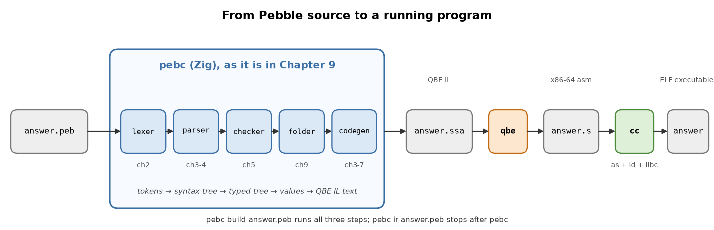
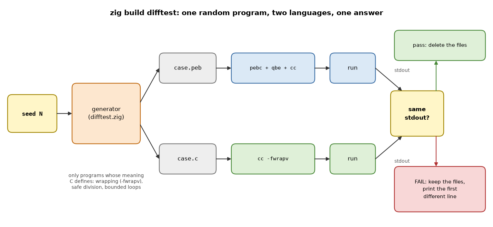

# Learn Compilers by Building One in Zig

A compiler is a program that reads a program and writes another one. This course builds one
from an empty directory: **`pebc`**, a compiler for **Pebble**, a small statically typed
language that looks like C with Zig's syntax for declarations. `pebc` is written in Zig. It
does what a real compiler's front end does (lexing, parsing, name resolution, type checking,
constant folding, good error messages) and writes **QBE** intermediate language. QBE, a small
compiler back end, turns that into x86-64 assembly, and `cc` assembles and links it with libc.
The Pebble programs you compile print Fibonacci numbers, sieve primes, run the Game of Life and
draw the Mandelbrot set.

The course borrows from two classics. As in *Go by Example*, every idea comes with a small,
complete example and the output it really printed. As in *The Rust Programming Language*, the
chapters tell a story: each one explains *why* the compiler works the way it does and shows the
mistakes, QBE errors and crashes you are likely to meet. And the whole course grows one project,
chapter by chapter, from a 297-line compiler for a single integer expression to a 3,505-line
compiler with a test suite that fuzzes it and checks it against C.

By the end you can:

- write QBE IL by hand, read the x86-64 assembly QBE makes from it, and drive `qbe` and `cc`
  from a Zig program;
- write a lexer and a precedence-climbing (Pratt) parser, and report errors with a line,
  a column and a caret, recovering so that one mistake gives one message;
- compile statements, functions, short-circuit operators, pointers, arrays, structs and calls
  to C's variadic `printf` into IL;
- resolve names and check types, lay out structs the way the System V ABI does, and know where
  undefined behaviour hides;
- test a compiler with golden files, Zig's built-in fuzzer and differential testing against C;
- fold constants with exactly the arithmetic the machine does, and know where to go next: more
  optimizations on an SSA IR, other back ends (LLVM, Cranelift, your own), new language
  features, and compilers that compile themselves.

## Prerequisite

This course builds on **[learn-zig](https://github.com/sipak-gh/learn-zig)**: the chapters use
allocators and arenas, tagged unions, `switch`, error unions, `std.Io` writers, `build.zig` and
`test` blocks without explaining them again. **[learn-c](https://github.com/sipak-gh/learn-c)**
helps: Pebble borrows C's types, pointers, structs and libc, and the course compares the two
often. Chapter 1 reads x86-64 assembly; if that is new,
**[learn-linux-nasm](https://github.com/sipak-gh/learn-linux-nasm)** teaches it. No previous
compiler course is assumed.

## Requirements

Every console output in the course comes from these versions:

| Tool | Version | Used for |
|------|---------|----------|
| Linux x86-64 | any modern kernel | everything (QBE's output is x86-64 System V assembly) |
| Zig | 0.17.1, exactly | `pebc` itself, `zig build`, the tests |
| QBE | 1.2 | the back end: IL to assembly |
| A C compiler as `cc` | gcc 11.4 (binutils 2.38) | assembling and linking; differential testing |
| GNU make | 4.3 | the `examples/` Makefiles |

Optional: Python 3 (3.10.12) makes random input for the fuzzing section of Chapter 8, and
`zig cc` (Clang 22.1.8, part of Zig) shows clang's diagnostics in Chapter 2 and LLVM IR in
Chapter 9.

**Zig must be 0.17.1.** The standard library changes between releases, and the code won't build
with another version. Download the official tarball for your platform from ziglang.org, unpack
it, and put the directory with the `zig` binary on your `PATH`.

**QBE must be 1.2**, built from source (Ubuntu 22.04 doesn't package it). It needs only a C
compiler and builds in seconds:

```console
$ curl -O https://c9x.me/compile/release/qbe-1.2.tar.xz
$ tar xf qbe-1.2.tar.xz && cd qbe-1.2
$ make
$ sudo make install            # or: make install PREFIX=$HOME/.local
```

`cc` comes with `sudo apt install build-essential`; clang works too. `pebc build` and the test
suite run `qbe` and `cc` by name, so both must be on `PATH`:

```console
$ zig version
0.17.1
$ qbe -h | head -1
qbe [OPTIONS] {file.ssa, -}
$ cc --version | head -1
cc (Ubuntu 11.4.0-1ubuntu1~22.04.3) 11.4.0
```

## How to use this course

- **Read in order.** Each chapter uses only what earlier chapters (and learn-zig) taught.
- **Type the code.** Run every command. Commands start with `$` and are followed by their real
  output.
- **Project snapshots:** `project/chNN/` is the complete `pebc` as it stands at the end of
  chapter NN, with a `README.md`, `build.zig`, sample programs in `samples/` and golden tests in
  `tests/`. `zig build` builds `zig-out/bin/pebc`; `zig build test --summary all` runs every
  test. If you get stuck, compare your code with the snapshot.
- **Examples:** `examples/chNN/` holds the chapter's other programs: hand-written QBE IL,
  Pebble programs that show one point, and programs that fail on purpose. Each directory has a
  `Makefile`; `make` builds the chapter's snapshot of `pebc` if needed and then the examples.
- **Figures:** `images/` holds every figure, drawn for the course or captured from real runs of
  the course code.
- **Exercises** end each chapter. Their solutions are hidden in collapsible blocks.
- **In the wild and History:** most chapters have a section about a real compiler (QBE, Zig's
  own tokenizer, Pratt parsing, B) or the history of an idea, from "Let's Build a Compiler" to
  Csmith and compilers that compile themselves.
- **Reference:** [Appendix A](appendix-a-cheat-sheet.md) is a cheat sheet of commands, the
  Pebble grammar, the QBE IL subset and common errors. [REFERENCES.md](REFERENCES.md) lists
  sources by chapter.

## What you'll build

`pebc` grows one phase at a time. At the end of the course a Pebble program goes through five
phases inside `pebc`, then through `qbe` and `cc`:



Chapter 7 compiles the Game of Life and a Mandelbrot set drawn with integer arithmetic, both
written in Pebble:


Chapter 8 tests the compiler by writing random programs twice, in Pebble and in C, and checking
that both print the same thing:



| Chapter | `pebc` learns to… | Lines in `src/` | Golden tests |
|---|---|---|---|
| 1 | compile one integer expression, end to end | 297 | 4 |
| 2 | split the text into tokens and point at errors with line, column and a caret | 788 | 9 |
| 3 | build a syntax tree with a precedence-climbing (Pratt) parser | 1136 | 17 |
| 4 | parse statements and functions, and recover from syntax errors | 1860 | 21 |
| 5 | resolve names and check types | 2548 | 24 |
| 6 | handle pointers, arrays and addresses | 2817 | 30 |
| 7 | lay out structs, call libc, run Game of Life and Mandelbrot | 3098 | 36 |
| 8 | test itself with golden files, a fuzzer and differential testing against C | 3222 | 37 |
| 9 | fold constants itself | 3505 | 40 |

## Table of contents

| # | Chapter | Topics |
|---|---------|--------|
| 1 | [A Compiler in One Afternoon](01-a-compiler-in-one-afternoon.md) | the pipeline; Pebble; QBE IL by hand (hello, factorial); what QBE catches and what it doesn't; a one-file compiler for integer expressions; running `qbe` and `cc` from Zig; golden tests; "Let's Build a Compiler" |
| 2 | [Lexing](02-lexing.md) | tokens and spans; maximal munch; keywords; line and column from a byte offset; diagnostics with a caret; bad input without stopping; caret diagnostics in gcc, clang and Zig's tokenizer |
| 3 | [Parsing Expressions](03-parsing-expressions.md) | syntax trees in an arena; printing trees as S-expressions; recursive descent; precedence climbing; prefix and postfix operators; comparisons that don't chain; code from a tree; Pratt parsing |
| 4 | [Statements and Functions](04-statements-and-functions.md) | declarations and statements; panic-mode error recovery; variables in stack slots; scopes; `if` and `while` with `jnz` and `jmp`; short-circuit `&&` and `\|\|`; calls into libc; `main`'s exit status; B |
| 5 | [Names and Types](05-names-and-types.md) | how B became C; type syntax; a type checker; literal typing; good diagnostics with notes; "every path returns"; `as`; typed IL, signed and unsigned instructions; reading QBE's output |
| 6 | [Pointers and Arrays](06-pointers-and-arrays.md) | memory in QBE; places and addresses; arrays are not values; indexing; zero values and global data; strings as bytes; null pointers and undefined behaviour; arrays and pointers from B to C |
| 7 | [Structs and libc](07-structs-and-libc.md) | struct declarations; C layout and padding; four checker passes; field access; struct copies with `blit`; `null`, `sizeof`, `as`; real libc calls; the Game of Life; the Mandelbrot set with integers |
| 8 | [Testing a Compiler](08-testing-a-compiler.md) | golden tests with diffs, filters and updates; fuzzing with Zig; a planted lexer bug; the error limit; differential testing against C; a bug only difftest finds; QBE's `-d` dumps; Csmith and test-case reduction |
| 9 | [Constant Folding and Where to Go Next](09-constant-folding-and-where-to-go-next.md) | a value for every expression; machine arithmetic; compile-time errors from values; folding in the code generator; testing an optimization; a planted division bug; QBE's SCCP; a crash nobody found; where to go next |
| A | [Cheat Sheet](appendix-a-cheat-sheet.md) | commands, Pebble grammar and type rules, type-to-IL table, QBE IL subset, pebc's IL names, common errors, testing, growth of pebc, concept → code |
| | [REFERENCES.md](REFERENCES.md) | the sources, chapter by chapter |
